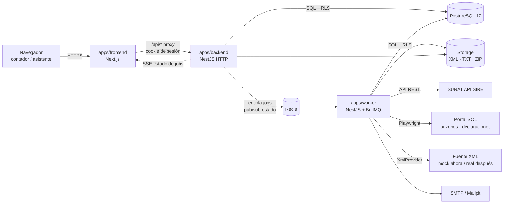
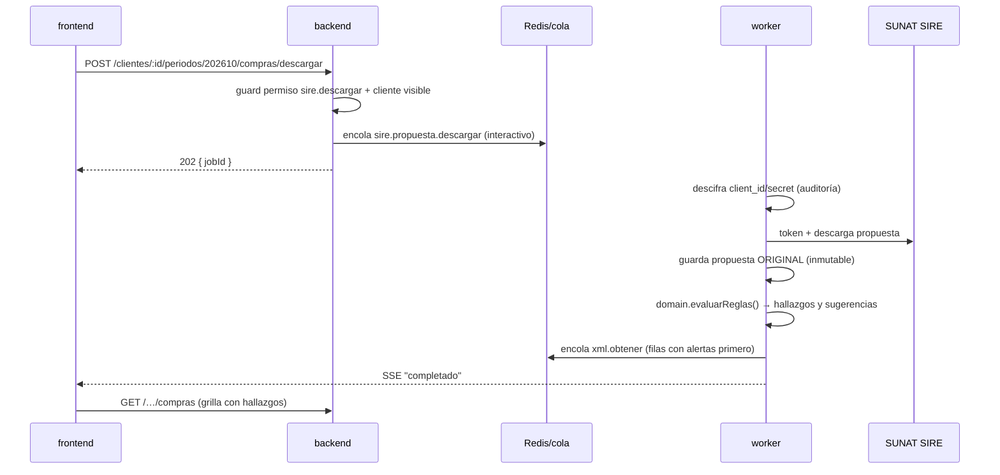

# ContApp — Arquitectura y estructura de carpetas (v0.1)

Fecha: 2026-10-24 · Base: [01-definiciones-base.md](01-definiciones-base.md), [02-requerimientos.md](02-requerimientos.md)

## 1. Vista general



**Tres procesos desplegables**, un solo repositorio:

| Proceso | Responsabilidad | Nunca hace |
|---|---|---|
| **frontend** (Next.js) | UI, render, navegación. Llama al backend a través de un proxy `/api/*` del mismo origen. | No toca la BD, ni Redis, ni SUNAT. No tiene lógica de negocio. |
| **backend** (NestJS) | Autenticación, autorización (rol + permiso + cliente visible), CRUD, lectura de grillas, aplicar correcciones, encolar trabajos, emitir estado de trabajos por SSE. | No llama a SUNAT. No puede **descifrar** credenciales. |
| **worker** (NestJS standalone) | Ejecuta los trabajos: SIRE, SOL, XML, generación de archivos, buzones programados, notificaciones. | No expone HTTP público. |

Los tres comparten código de `packages/*`. La lógica de negocio pura (reglas, montos, prorrata) vive en `packages/domain` y no depende de BD, HTTP ni SUNAT, para poder probarse sola.

## 2. Capas

```
┌──────────────────────────────────────────────────────────────┐
│ apps/frontend   UI (Next.js) ── usa ──► packages/shared       │
├──────────────────────────────────────────────────────────────┤
│ apps/backend    Controllers → Services → Repositories         │
│ apps/worker     Processors  → Services → Repositories         │
├──────────────────────────────────────────────────────────────┤
│ packages/domain    Lógica pura (sin IO)                       │
│ packages/sunat     Adaptadores externos (puertos + adaptadores)│
│ packages/crypto    Cifrado de credenciales                    │
│ packages/db        Esquema, migraciones, RLS, transacciones    │
│ packages/queue     Colas, payloads, despachador justo          │
│ packages/storage   Archivos (local / S3)                       │
│ packages/shared    Esquemas zod, tipos, permisos, enums        │
└──────────────────────────────────────────────────────────────┘
```

Regla de dependencias. Se valida con lint en `eslint.config.mjs`: `no-restricted-imports` bloquea nombres `@contapp/*` y rutas con `apps/`/`packages/`, y la regla local `limites/imports-relativos` resuelve cada import relativo contra la raíz del repo y aplica las mismas políticas. No se usa `eslint-plugin-boundaries`: resuelve contra el sistema de archivos y no detecta imports relativos a carpetas sin `index` (spec 001, T4).

| Paquete | Puede depender de |
|---|---|
| `shared` | nada (solo `zod`, `decimal.js`) |
| `domain` | `shared` |
| `db`, `crypto`, `storage`, `queue` | `shared` |
| `sunat` | `shared`, `domain` (para formatos y montos) |
| `apps/backend` | `packages/*` excepto `sunat` (el backend no habla con SUNAT); de `crypto` solo cifra (ADR-06). Ninguna otra app |
| `apps/worker` | todos los `packages/*`. Ninguna otra app |
| `apps/frontend` | solo `shared` |

Ninguna app importa código de otra app (ni por nombre `@contapp/<app>` ni por ruta relativa). Lo que deban compartir va a un `packages/*`; backend y worker se comunican solo por colas, BD y Redis.

## 3. Puertos y adaptadores (todo lo externo es intercambiable)

| Puerto (interfaz) | Adaptador local / pruebas | Adaptador real | Usado por |
|---|---|---|---|
| `SireApiClient` | `MockSireApiClient` (propuestas desde fixtures) | `HttpSireApiClient` | worker |
| `SolPortal` | `MockSolPortal` | `PlaywrightSolPortal` (buzones, declaraciones PDT 621, validación de login) | worker |
| `XmlProvider` | **`MockXmlProvider`** (fixtures o UBL sintético, errores y latencia configurables) | `RealXmlProvider` (fuente/API que entregará el equipo) | worker |
| `KeyProvider` | `LocalKeyProvider` (par de llaves en archivos fuera del repo) | `AwsKmsKeyProvider` / `VaultKeyProvider` | backend (solo cifrar), worker (descifrar) |
| `StorageProvider` | `LocalFsStorage` (`./storage`) | `S3Storage` | backend, worker |
| `Mailer` | `SmtpMailer` → Mailpit | `SmtpMailer` / SES | worker |
| `RucDirectory` | `MockRucDirectory` | consulta RUC (razón social, estado, CIIU) | worker |

Selección por variables de entorno: `SIRE_CLIENT=mock|http`, `SOL_PORTAL=mock|playwright`, `XML_PROVIDER=mock|real`, `KEY_PROVIDER=mock|local|aws|vault`, `STORAGE=mock|local|s3` (por defecto `mock`, ver spec 001).
Con todo en `mock` el sistema funciona de punta a punta **sin conectarse a SUNAT**, lo que permite desarrollar y demostrar sin claves reales.

## 4. Multitenancy

### 4.1 Contexto de tenant
1. El backend autentica la cookie de sesión → obtiene `userId` y `tenantId` activo.
2. Un middleware guarda `{ tenantId, userId, permisos, alcance }` en `AsyncLocalStorage`.
3. Toda operación de BD pasa por `withTenant(tx => …)` de `packages/db`, que abre una transacción y ejecuta
   `SELECT set_config('app.tenant_id', $1, true), set_config('app.user_id', $2, true)`.
4. En el worker, cada payload de trabajo lleva `tenantId`, y el procesador usa el mismo `withTenant`.

### 4.2 Row Level Security
```sql
ALTER TABLE compra ENABLE ROW LEVEL SECURITY;
ALTER TABLE compra FORCE ROW LEVEL SECURITY;
CREATE POLICY tenant_isolation ON compra
  USING (tenant_id = current_setting('app.tenant_id', true)::uuid)
  WITH CHECK (tenant_id = current_setting('app.tenant_id', true)::uuid);
```
- Si `app.tenant_id` no está fijado, `current_setting(..., true)` devuelve NULL y **no se ve ninguna fila** (falla cerrado).
- Las políticas viven en las migraciones (`packages/db/migrations`), una por tabla de negocio.

### 4.3 Roles de base de datos
| Rol PG | Uso | RLS | Notas |
|---|---|---|---|
| `contapp_migrator` | Migraciones y seeds | dueño de tablas | Solo en CI/despliegue |
| `contapp_backend` | Proceso backend | **forzado** | Sobre `credencial`: `INSERT`/`UPDATE` del cifrado y `SELECT` **solo** de columnas de estado (sin `ciphertext`) |
| `contapp_worker` | Proceso worker | **forzado** | Puede leer `ciphertext` |
| `contapp_platform` | Panel super-admin | `BYPASSRLS` | Solo tablas de plataforma (tenant, plan, suscripción); sin permiso sobre tablas contables |

### 4.4 Visibilidad por cliente (asignación)
RLS separa **estudios**. La visibilidad **dentro** del estudio (cliente asignado o no) la aplica el backend:
- `ClientScopeGuard` en toda ruta con `:clienteId` → si el rol es de alcance "asignado" y no existe `asignacion(usuario, cliente)`, responde 404.
- Los repositorios de listados reciben `scope` y agregan `JOIN asignacion` cuando corresponde.
- Prueba automática por endpoint que verifica que un asistente no ve clientes no asignados.

## 5. Credenciales: flujo de cifrado

Refinamiento del esquema de 01-definiciones-base §5: se usa **cifrado híbrido** para que el backend pueda cifrar pero **no descifrar**.

```
Backend (al guardar)                                Worker (al usar)
────────────────                                   ─────────────────
secreto ─► DEK aleatoria (AES-256-GCM)             lee ciphertext + dek_envuelta
        ─► ciphertext (AAD = tenant|cliente|tipo)  KeyProvider.unwrap(dek_envuelta) ─► DEK
DEK ─► KeyProvider.wrap (llave pública / KMS       DEK + AAD ─► secreto (solo en memoria)
       Encrypt) ─► dek_envuelta                    registra auditoría "descifrado"
guarda {ciphertext, nonce, dek_envuelta,           usa y descarta
        kek_id, version}
```

- **Local**: `LocalKeyProvider` con un par RSA-OAEP 4096. El backend solo monta la **llave pública**; el worker monta la **privada** (`./secrets/kek-private.pem`, fuera de git).
- **Nube**: KMS con política: rol backend = `kms:Encrypt`; rol worker = `kms:Decrypt`. Mismo código.
- `kek_id` + `version` permiten rotar la llave maestra y re-envolver DEKs con un job sin tocar los secretos.
- El token SIRE se guarda solo en Redis, cifrado con una llave efímera del worker y con TTL igual a su expiración.

## 6. Colas y trabajos

### 6.1 Colas (BullMQ)
| Cola | Trabajos | Concurrencia por defecto |
|---|---|---|
| `sire` | `sire.propuesta.descargar`, `sire.reemplazo.enviar`, `sire.ticket.consultar`, `sire.periodos.listar` | 4 |
| `sol` | `sol.credencial.verificar`, `sol.buzon.revisar`, `sol.declaraciones.descargar`, `sol.ventas.cruzar` | 2 (navegadores son pesados) |
| `xml` | `xml.obtener` | 8 |
| `archivos` | `archivo.generar` | 4 |
| `programados` | `buzon.programar` (repetible por tenant según plan), `kek.rotar` | 1 |
| `notificaciones` | `notificacion.enviar` | 4 |

### 6.2 Reparto justo y límites SUNAT
BullMQ abierto no reparte por tenant, así que se agrega un **despachador** en `packages/queue`:
1. El backend no encola directo en la cola de ejecución: agrega el trabajo a una lista **por tenant** en Redis (`pend:{cola}:{tenantId}`) con prioridad.
2. El despachador recorre los tenants en **round-robin** y pasa trabajos a la cola de ejecución mientras se cumplan:
   - concurrencia global de la cola,
   - concurrencia máxima por tenant (`max_jobs_tenant`),
   - espera mínima por RUC (`lock:ruc:{ruc}` en Redis con TTL = espera configurada).
3. Prioridad: `interactivo` (usuario esperando) > `programado` (buzones nocturnos).
4. Todos los límites están en la tabla `config_sistema` y se recargan sin reiniciar.

### 6.3 Estado en tiempo real
- El worker publica el progreso en Redis (`jobs:{tenantId}`).
- La API expone `GET /api/jobs/stream` (SSE) filtrado por tenant y clientes visibles.
- El frontend muestra la cola, la posición y el progreso; al terminar refresca la grilla.

### 6.4 Errores
| Tipo | Ejemplo | Acción |
|---|---|---|
| Transitorio | timeout, 5xx, SOL lento | 3 reintentos con backoff exponencial |
| Credencial | login inválido | sin reintento, `credencial.estado = invalida`, notificación |
| Datos | XML de otro comprobante | sin reintento, error visible en la fila |
| Portal cambió | selector no encontrado en SOL | sin reintento, alerta a operación (RNF-044) |

## 7. Flujos principales

### 7.1 Descargar y revisar la propuesta de compras


### 7.2 Lupa (modal de detalle)
1. `GET /api/comprobantes/:id/detalle` → cabecera, comparación SIRE vs XML, hallazgos, sugerencia e historial del proveedor.
2. Si el XML no está en storage → responde `xml: "pendiente"` y encola `xml.obtener` interactivo; el modal se actualiza por SSE.
3. Acciones → `POST /api/comprobantes/:id/acciones` con `{ tipo: aceptar | editar | clasificar | excluir | recordar }`. Cada una crea una **versión nueva** de la fila (la original nunca cambia) y un registro de auditoría.

### 7.3 Generar archivo de reemplazo
1. `POST /…/archivos` → el backend corre la **prevalidación** (`domain.prevalidar`) en línea; si hay errores, responde 422 con la lista de filas.
2. Si pasa, encola `archivo.generar` → el worker arma el TXT con el formato versionado de `packages/sunat/formatos`, lo comprime en ZIP, calcula el hash y lo guarda en storage con su versión.
3. (R2) `sire.reemplazo.enviar` → ticket → `sire.ticket.consultar` cada N minutos hasta el estado final.

## 8. Modelo de datos (resumen)

Detalle completo en el próximo documento (04-modelo-datos). Agrupación:

| Grupo | Tablas | tenant_id / RLS |
|---|---|---|
| Plataforma | `plan`, `tenant`, `suscripcion`, `usuario`, `sesion`, `config_sistema`, `proveedor_global`, `diccionario_global` | no |
| Acceso | `membresia` (usuario↔tenant↔rol), `rol`, `rol_permiso`, `asignacion` | sí |
| Clientes | `cliente`, `cliente_perfil_fiscal`, `credencial` | sí |
| SIRE | `periodo`, `propuesta` (original, inmutable), `comprobante`, `comprobante_version`, `hallazgo` | sí |
| XML | `documento_xml` (metadatos + ruta en storage) | sí |
| Archivos | `archivo_generado`, `ticket_sunat` | sí |
| Aprendizaje | `regla_cliente`, `diccionario_tenant` | sí |
| Buzón | `buzon_mensaje`, `buzon_adjunto` | sí |
| Prorrata | `declaracion_mensual`, `prorrata_calculo` | sí |
| Ajustes | `ajuste`, `ajuste_detalle` | sí |
| Transversal | `auditoria` (solo inserción), `notificacion`, `job_registro` | sí |

Convenciones: PK `uuid` v7, montos `NUMERIC(14,2)`, `created_at`/`updated_at` con zona horaria, nombres en español y `snake_case`, borrado lógico solo donde aplica (`archivado_at`).

## 9. Frontend (Next.js)

- **App Router**, server components para layout y datos iniciales; client components para la grilla y el modal.
- **Datos**: TanStack Query contra la API vía `/api/*` (proxy por `rewrites` de Next en local → mismo origen, la cookie de sesión es de primera parte).
- **Grilla**: TanStack Table + virtualización (TanStack Virtual) para 5,000 filas, edición por celda y teclado.
- **Formularios**: React Hook Form + resolvers zod con los esquemas de `packages/shared`.
- **UI**: Tailwind + shadcn/ui.
- **Permisos en UI**: hook `usePuede('sire.aprobar_generar')` que solo oculta; el backend vuelve a validar.
- **Organización por feature** (no por tipo de archivo): cada carpeta de `features/` tiene sus componentes, hooks y llamadas al backend.

## 10. Entorno local

| Servicio | Cómo corre | Puerto |
|---|---|---|
| frontend | `pnpm dev` | 3000 |
| backend | `pnpm dev` | 4000 |
| worker | `pnpm dev` | — |
| PostgreSQL 17 | instalado en Windows (o Docker) | 5432 |
| Redis | Docker (`redis:7`) | 6379 |
| Mailpit | Docker | 1025 SMTP / 8025 UI |

- `pnpm setup:local` → crea `.env` desde `.env.example`, genera el par de llaves en `./secrets/`, crea roles y BD, corre migraciones y seed.
- Seed: 1 plataforma admin, 2 tenants (para probar aislamiento), usuarios de cada rol, 10 clientes con credenciales falsas, 2 periodos con los casos reales (San Juan ISC, mixta 21.48/1.61, redondeo USD, boleta 291 faltante, compra "zapatilla").
- Todo con adaptadores `mock` por defecto.

## 11. Estructura de carpetas

```
contapp/
├── apps/
│   ├── frontend/                         # Next.js (UI)
│   │   ├── src/
│   │   │   ├── app/
│   │   │   │   ├── (publico)/            # login, registro, recuperar, invitación
│   │   │   │   │   ├── login/page.tsx
│   │   │   │   │   ├── registro/page.tsx
│   │   │   │   │   └── invitacion/[token]/page.tsx
│   │   │   │   ├── (app)/                # requiere sesión
│   │   │   │   │   ├── layout.tsx        # sidebar, selector de estudio, cola de jobs
│   │   │   │   │   ├── inicio/page.tsx   # onboarding / resumen
│   │   │   │   │   ├── clientes/
│   │   │   │   │   │   ├── page.tsx
│   │   │   │   │   │   ├── importar/page.tsx
│   │   │   │   │   │   └── [clienteId]/
│   │   │   │   │   │       ├── page.tsx              # ficha, credenciales, asignación
│   │   │   │   │   │       ├── reglas/page.tsx
│   │   │   │   │   │       ├── prorrata/page.tsx
│   │   │   │   │   │       └── periodos/[periodo]/
│   │   │   │   │   │           ├── compras/page.tsx
│   │   │   │   │   │           ├── ventas/page.tsx
│   │   │   │   │   │           ├── archivos/page.tsx
│   │   │   │   │   │           └── ajustes/page.tsx
│   │   │   │   │   ├── buzon/page.tsx
│   │   │   │   │   ├── configuracion/
│   │   │   │   │   │   ├── usuarios/page.tsx
│   │   │   │   │   │   ├── roles/page.tsx
│   │   │   │   │   │   ├── plan/page.tsx
│   │   │   │   │   │   ├── diccionario/page.tsx
│   │   │   │   │   │   └── auditoria/page.tsx
│   │   │   │   │   └── notificaciones/page.tsx
│   │   │   │   └── (plataforma)/admin/   # super-admin: planes, estudios
│   │   │   ├── features/
│   │   │   │   ├── compras/              # PurchasesGrid, ResumenCasilleros, AccionesMasivas
│   │   │   │   ├── ventas/               # SalesGrid, AlertaCorrelatividad
│   │   │   │   ├── comprobante-detalle/  # DetalleModal (lupa), ComparacionSireXml, ItemsXml
│   │   │   │   ├── clientes/
│   │   │   │   ├── credenciales/
│   │   │   │   ├── buzon/
│   │   │   │   ├── prorrata/
│   │   │   │   ├── jobs/                 # useJobStream (SSE), ColaTrabajos
│   │   │   │   ├── acceso/               # usePuede, roles, asignación
│   │   │   │   └── plan/
│   │   │   ├── components/ui/            # shadcn/ui
│   │   │   ├── lib/                      # api-client, query-client, formato de montos
│   │   │   └── styles/
│   │   ├── next.config.ts                # rewrites /api → API_URL
│   │   └── package.json
│   │
│   ├── backend/                          # NestJS HTTP
│   │   ├── src/
│   │   │   ├── main.ts
│   │   │   ├── app.module.ts
│   │   │   ├── common/
│   │   │   │   ├── contexto/             # TenantContext (AsyncLocalStorage), middleware
│   │   │   │   ├── guards/               # SesionGuard, PermisoGuard, ClienteScopeGuard
│   │   │   │   ├── decorators/           # @RequierePermiso(), @Publico(), @ClienteId()
│   │   │   │   ├── interceptors/         # AuditoriaInterceptor
│   │   │   │   ├── filters/              # errores → respuesta estándar
│   │   │   │   └── pipes/                # ZodValidationPipe
│   │   │   └── modules/
│   │   │       ├── auth/                 # login, sesión, 2FA, recuperación
│   │   │       ├── plataforma/           # planes, tenants (super-admin)
│   │   │       ├── suscripcion/          # límites de plan (RUCs, usuarios)
│   │   │       ├── usuarios/             # invitaciones, membresías
│   │   │       ├── roles/                # roles y permisos
│   │   │       ├── asignaciones/
│   │   │       ├── clientes/             # CRUD, importación Excel, perfil fiscal
│   │   │       ├── credenciales/         # guardar (cifrar) y estado; nunca leer
│   │   │       ├── periodos/
│   │   │       ├── ventas/
│   │   │       ├── compras/              # grilla, edición, clasificación, exclusión
│   │   │       ├── comprobantes/         # detalle (lupa), acciones, versiones
│   │   │       ├── reglas/               # reglas aprendidas, diccionario
│   │   │       ├── archivos/             # prevalidación, generar, descargar
│   │   │       ├── buzon/
│   │   │       ├── prorrata/
│   │   │       ├── ajustes/
│   │   │       ├── auditoria/
│   │   │       ├── notificaciones/
│   │   │       └── jobs/                 # encolar, estado, SSE
│   │   │           # cada módulo: *.controller.ts, *.service.ts, *.repository.ts, *.module.ts, *.spec.ts
│   │   └── package.json
│   │
│   └── worker/                           # NestJS standalone + BullMQ
│       ├── src/
│       │   ├── main.ts
│       │   ├── worker.module.ts
│       │   ├── despachador/              # round-robin por tenant, locks por RUC
│       │   ├── procesadores/
│       │   │   ├── sire/                 # descargar propuesta, enviar reemplazo, tickets
│       │   │   ├── sol/                  # verificar credencial, buzones, declaraciones, cruce ventas
│       │   │   ├── xml/                  # obtener XML (XmlProvider)
│       │   │   ├── archivos/             # generar TXT/ZIP
│       │   │   ├── programados/          # buzones por plan, rotación de llaves
│       │   │   └── notificaciones/
│       │   ├── servicios/                # descifrado de credenciales, evaluación de reglas
│       │   └── adaptadores.module.ts     # elige mock/real por variables de entorno
│       └── package.json
│
├── packages/
│   ├── shared/                           # usado por frontend, backend y worker
│   │   └── src/
│   │       ├── esquemas/                 # zod: cliente, comprobante, acciones, import…
│   │       ├── permisos.ts               # lista de permisos y roles de sistema
│   │       ├── enums.ts                  # destino (DG/DGNG/DNG), tipos de comprobante, estados
│   │       ├── jobs.ts                   # nombres y payloads de trabajos
│   │       └── errores.ts                # códigos de error compartidos
│   │
│   ├── domain/                           # lógica pura, 100 % testeable
│   │   └── src/
│   │       ├── dinero/                   # Money (decimal.js), redondeo SUNAT, tipo de cambio
│   │       ├── comprobante/              # mover montos entre columnas, recálculo, cuadre
│   │       ├── reglas/
│   │       │   ├── motor.ts              # evalúa reglas → hallazgos + sugerencias
│   │       │   ├── r-isc.ts
│   │       │   ├── r-mix.ts
│   │       │   ├── r-red.ts
│   │       │   ├── r-icb.ts
│   │       │   ├── r-new.ts
│   │       │   ├── r-his.ts
│   │       │   └── r-gasto-personal.ts   # puntaje de sospecha sin IA
│   │       ├── correlatividad/           # saltos de numeración
│   │       ├── prevalidacion/            # reglas de estructura y cuadre SUNAT
│   │       ├── prorrata/                 # coeficiente 12 meses, IGV estimado
│   │       ├── aprendizaje/              # derivar reglas desde historial
│   │       └── texto/                    # normalización de glosas
│   │       # tests/casos-reales/: San Juan ISC, mixta 21.48/1.61, redondeo USD, boleta 291, zapatilla
│   │
│   ├── sunat/                            # adaptadores externos
│   │   └── src/
│   │       ├── puertos.ts                # SireApiClient, SolPortal, XmlProvider, RucDirectory
│   │       ├── sire/                     # http + mock
│   │       ├── sol/                      # playwright + mock; selectores en un solo archivo
│   │       ├── xml/
│   │       │   ├── mock-xml-provider.ts  # fixtures o UBL sintético, errores y latencia
│   │       │   ├── real-xml-provider.ts  # pendiente de la fuente del equipo
│   │       │   └── ubl/                  # parser UBL 2.1 → modelo legible (ítems, tributos)
│   │       ├── formatos/                 # estructuras TXT versionadas (RVIE, RCE, ajustes)
│   │       │   ├── v1/
│   │       │   └── index.ts
│   │       └── ruc/                      # validación dígito verificador, consulta RUC
│   │
│   ├── crypto/                           # cifrado híbrido de credenciales
│   │   └── src/ (envelope.ts, key-providers/local.ts, key-providers/aws-kms.ts)
│   │
│   ├── db/
│   │   ├── src/
│   │   │   ├── schema/                   # tablas Drizzle por grupo (plataforma, acceso, sire…)
│   │   │   ├── with-tenant.ts            # transacción + set_config
│   │   │   └── client.ts
│   │   ├── migrations/                   # SQL generado + políticas RLS + roles y grants
│   │   └── seed/                         # datos locales con los casos reales
│   │
│   ├── queue/                            # definición de colas, despachador justo, locks
│   ├── storage/                          # LocalFsStorage, S3Storage
│   └── config/                           # tsconfig base, eslint (con reglas de límites), prettier
│
├── fixtures/
│   ├── xml/                              # XML reales/anónimos para MockXmlProvider
│   ├── sire/                             # propuestas de ejemplo para MockSireApiClient
│   └── excel/                            # plantilla de importación de clientes
│
├── infra/
│   ├── docker-compose.yml                # redis, mailpit (y postgres opcional)
│   └── scripts/                          # setup-local, generar-llaves, crear-roles-db
│
├── tests/
│   ├── e2e/                              # Playwright sobre frontend (flujos de historias de usuario)
│   └── aislamiento/                      # pruebas RLS y visibilidad entre tenants/usuarios
│
├── docs/
│   ├── 01-definiciones-base.md
│   ├── 02-requerimientos.md
│   └── 03-arquitectura.md
│
├── secrets/                              # llaves locales (en .gitignore)
├── storage/                              # archivos locales (en .gitignore)
├── .env.example
├── package.json
├── pnpm-workspace.yaml
└── turbo.json
```

## 12. Estrategia de pruebas

| Nivel | Herramienta | Qué cubre |
|---|---|---|
| Unitarias | Vitest | `packages/domain` completo (≥ 90 %), cifrado, formatos TXT, parser UBL |
| Casos reales | Vitest | Un test por caso documentado en los videos; si una regla cambia, estos tests lo detectan |
| Integración | Vitest + PostgreSQL local | Repositorios, migraciones, **políticas RLS**, guards de permisos y alcance |
| Aislamiento | Vitest | Con 2 tenants y usuarios de cada rol: ningún endpoint ni consulta cruza datos (bloquea el CI) |
| Workers | Vitest + adaptadores mock | Procesadores, reintentos, despachador justo, locks por RUC |
| E2E | Playwright | Historias de R1 sobre la app completa con todo en `mock` |

## 13. Decisiones de arquitectura (ADR)

| # | Decisión | Motivo | Alternativa descartada |
|---|---|---|---|
| ADR-01 | Monorepo pnpm + Turborepo | Tipos y esquemas compartidos; un PR cambia front y back juntos | Repos separados |
| ADR-02 | Backend separado de Next.js | Workers y backend escalan aparte; Next solo UI | API routes de Next |
| ADR-03 | NestJS | Módulos, guards y DI encajan con roles/permisos y adaptadores | Express/Fastify a mano |
| ADR-04 | Drizzle | Control de transacciones para `set_config` + RLS | Prisma (RLS incómodo) |
| ADR-05 | RLS + guard de alcance | Defensa en profundidad: BD aísla estudios, backend aísla asignaciones | Solo filtro en código |
| ADR-06 | Cifrado híbrido: backend cifra, worker descifra | Un compromiso del backend no expone claves SOL | DEK simétrica por tenant accesible por el backend |
| ADR-07 | Despachador round-robin sobre BullMQ | Reparto justo entre estudios y respeto a límites de SUNAT | BullMQ Pro (groups, pago) |
| ADR-08 | Puertos y adaptadores para todo lo externo | Desarrollar sin SUNAT (mocks) y reemplazar el XML real cuando llegue | Llamadas directas |
| ADR-09 | Propuesta original inmutable + versiones de fila | Auditoría, deshacer y comparación original vs corregido | Editar en sitio |
| ADR-10 | Lógica de negocio en `packages/domain` sin IO | Probar reglas contables aisladas y con casos reales | Lógica dentro de servicios Nest |
| ADR-11 | Sesión por cookie (no JWT en localStorage) | Revocable, sin exposición a XSS | JWT en el navegador |
| ADR-12 | Detección de gastos personales por reglas | Explicable, sin costo por uso, sin enviar datos a terceros | IA |
