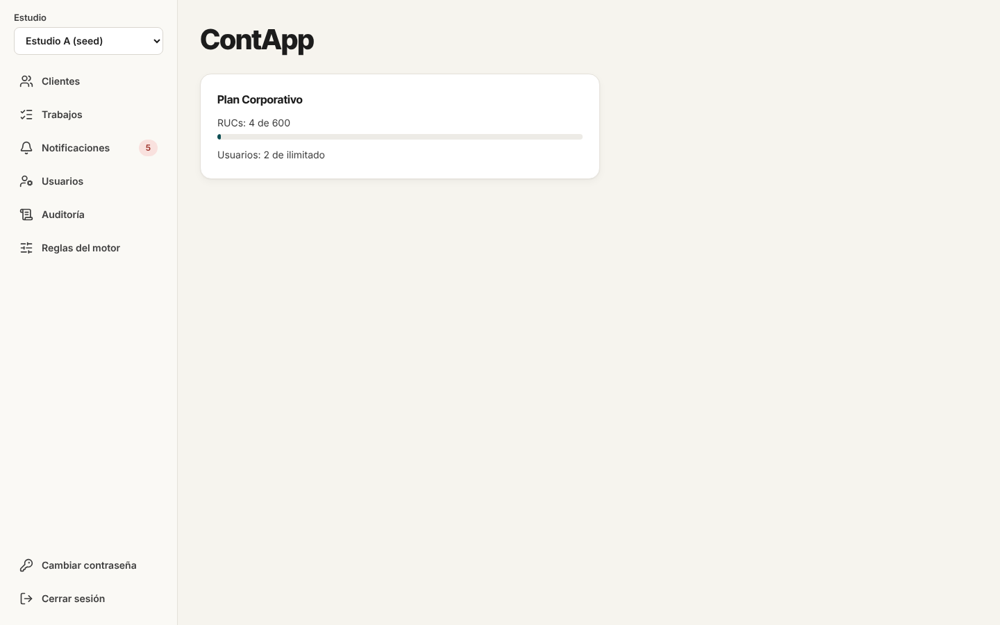

# 02 · Entrar a ContApp

> Anterior: [01 · Preparar tu entorno de prueba](01-preparar-entorno.md) · Siguiente: [03 · Tu equipo: usuarios, roles y asignaciones](03-equipo-roles-asignaciones.md) · Índice: [00-indice.md](00-indice.md)

Al terminar este módulo sabrás registrar un estudio nuevo con su prueba gratis de 14 días, iniciar sesión, recuperar y cambiar tu contraseña, moverte entre estudios y cerrar sesión. También entenderás por qué a veces ContApp te bloquea o te pide entrar de nuevo.

## Para qué sirve

Cada persona del estudio entra a ContApp con **su propio correo y contraseña**. Nunca se comparte un usuario: así la auditoría sabe quién hizo cada corrección.

Una misma persona puede trabajar para **varios estudios** (por ejemplo, un contador que apoya a dos estudios). Con una sola cuenta elige en qué estudio trabaja y cambia cuando quiera, sin volver a escribir la contraseña. Mientras está en un estudio, solo ve los datos de ese estudio.

Lo usas el primer día (registro), cada mañana (inicio de sesión) y de vez en cuando (olvidé mi contraseña, cambio de estudio).

## Quién puede usarlo

Estas pantallas no dependen del rol: las usa cualquier persona según su situación.

| Situación | Qué puede hacer |
|---|---|
| Visitante sin cuenta | Registrar un estudio nuevo («Crear estudio») y quedar como su Dueño. |
| Persona con cuenta | Iniciar sesión, recuperar y cambiar su contraseña, cerrar sesión. |
| Miembro de varios estudios | Elegir el estudio al entrar y cambiar desde el selector «Estudio» del menú (en celular, dentro de «Más»). |
| Persona con cuenta pero sin estudios activos | Iniciar sesión, pero no entrar a ningún estudio hasta que un Dueño o Administrador la agregue. |
| Super-admin de plataforma | Entrar y abrir «Administración de plataforma» (ver [módulo 04](04-planes-y-limites.md)). |

## Antes de empezar

- ContApp debe estar corriendo ([módulo 01](01-preparar-entorno.md)) y debes saber dónde ver los correos: en la terminal (`CORREO_PROVIDER=consola`) o en Mailpit (`http://localhost:8025`).
- Para entrar con datos ya cargados, usa los usuarios del seed con la contraseña de desarrollo `desarrollo-contapp-2026` (solo para pruebas locales).
- Para registrar un estudio nuevo, inventa un correo de prueba, por ejemplo `dueno@prueba.test`. En tu entorno los correos no salen a internet.

## Paso a paso

### Registrar tu estudio (prueba gratis de 14 días)

1. Abre `http://localhost:3000/login` y haz clic en «Crear estudio» (o entra directo a `http://localhost:3000/registro`).
2. En «Crear estudio en ContApp» completa:
   - «Nombre del estudio», por ejemplo `Estudio Prueba Guía`.
   - «RUC del estudio (opcional)»: si lo escribes, deben ser 11 dígitos.
   - «Tu nombre».
   - «Correo», por ejemplo `dueno@prueba.test`.
3. Haz clic en «Crear estudio».
4. Verás «Revisa tu correo para continuar con el registro.» y «El enlace vence en 24 horas.».
5. Abre el correo «ContApp: confirma tu registro» (en la terminal o en Mailpit) y entra al enlace que termina en `/registro/confirmar#t=…`.
6. La página dice «Verificando el enlace…» y luego muestra el estudio y el correo del Dueño.
7. Escribe tu «Contraseña» (entre 12 y 128 caracteres) y haz clic en «Confirmar y crear estudio».

**Resultado esperado:** ves «Tu estudio fue creado. Ya puedes iniciar sesión.» y el enlace «Ir a iniciar sesión». ContApp creó, todo junto, el estudio, tu usuario, tu rol de **Dueño** y una suscripción al plan **Prueba** (14 días, 5 RUC). Al entrar, el inicio muestra «Plan Prueba · periodo de prueba, vence el …» con la fecha de vencimiento.

> Si el correo **ya tiene cuenta** en ContApp, el enlace no pide una contraseña nueva: muestra «Ya tienes una cuenta con este correo: inicia sesión para crear el estudio.». Escribe tu contraseña actual y haz clic en «Iniciar sesión y crear estudio». Verás «Tu estudio … fue creado.» y el botón «Cambiar a este estudio».

### Iniciar sesión

1. Abre `http://localhost:3000/login` («Ingresar a ContApp»).
2. Escribe tu «Correo» y tu «Contraseña».
3. Haz clic en «Ingresar».

**Resultado esperado:** depende de cuántos estudios tengas:

| Tus estudios activos | A dónde te lleva |
|---|---|
| Uno | Directo al inicio de ese estudio. |
| Dos o más | A «Elige tu estudio», con el último que usaste resaltado. |
| Ninguno | A «Elige tu estudio» con el mensaje «No perteneces a ningún estudio activo. Pide a tu administrador que te agregue a uno.» |

### Elegir o cambiar de estudio

1. En «Elige tu estudio», haz clic en el nombre del estudio.
2. Para cambiar más tarde, usa el selector «Estudio»: en escritorio está arriba del menú lateral; en celular, toca «Más» en la barra inferior. Elige otro estudio.

**Resultado esperado:** la pantalla se recarga con los datos del estudio elegido. No se pide contraseña. Si tenías otra pestaña abierta con el estudio anterior, al usarla verás «El estudio activo cambió en otra pestaña. Se actualizaron los datos.»: ContApp no deja que una pestaña vieja guarde cambios en el estudio equivocado.

### Recuperar tu contraseña

1. En la pantalla de ingreso, haz clic en «Olvidé mi contraseña».
2. En «Recuperar contraseña» escribe tu «Correo» y haz clic en «Enviar enlace».
3. Verás «Si el correo está registrado, te enviamos un enlace para restablecer tu contraseña.». El mensaje es el mismo exista o no la cuenta: así nadie puede averiguar qué correos están registrados.
4. Abre el correo «ContApp: restablece tu contraseña» y entra al enlace (termina en `/recuperar/nueva#t=…`). Vence en **30 minutos** y sirve **una sola vez**.
5. En «Nueva contraseña» escribe la contraseña nueva y haz clic en «Cambiar contraseña».

**Resultado esperado:** ves «Tu contraseña fue actualizada.» y el enlace «Ir a iniciar sesión». Además:

- Se cierran **todas** tus sesiones abiertas, en cualquier navegador.
- Si tu cuenta estaba bloqueada, se desbloquea.
- Te llega el correo «ContApp: tu contraseña cambió».

Si pides dos enlaces, solo vale el último.

### Cambiar tu contraseña con la sesión iniciada

1. Con la sesión iniciada, haz clic en «Cambiar contraseña» al pie del menú lateral (en celular, dentro de «Más»). También puedes abrir `http://localhost:3000/cuenta/contrasena`.
2. En «Cambiar contraseña» completa «Contraseña actual» y «Nueva contraseña».
3. Haz clic en «Cambiar contraseña».

**Resultado esperado:** ves «Tu contraseña fue actualizada.». Sigues dentro en esta pestaña, pero ContApp cierra tus **otras** sesiones (otro navegador, otra computadora) y te envía el correo «ContApp: tu contraseña cambió».

### Cerrar sesión

1. Haz clic en «Cerrar sesión», al pie del menú lateral. En celular, toca «Más» en la barra inferior y luego «Cerrar sesión».

**Resultado esperado:** vuelves a «Ingresar a ContApp». Si usas el botón «atrás» del navegador, ContApp te devuelve al ingreso: la sesión ya no vale.

> En «Elige tu estudio» y en la consola del super-admin no hay botón «Cerrar sesión». Allí la sesión se cierra sola por inactividad (ver «Reglas y límites»), o puedes usar una ventana privada del navegador para tus pruebas.

## Qué ves en pantalla

*El inicio de un estudio: a la izquierda, el menú lateral con el selector «Estudio»; al centro, el título «ContApp» y el recuadro con el plan y su uso.*

| Pantalla | Dirección | Título | Botones y enlaces |
|---|---|---|---|
| Ingreso | `/login` | «Ingresar a ContApp» | «Ingresar», «Olvidé mi contraseña», «Crear estudio» |
| Registro | `/registro` | «Crear estudio en ContApp» | «Crear estudio», «Ya tengo cuenta» |
| Confirmar registro | `/registro/confirmar` | «Crear estudio en ContApp» | «Confirmar y crear estudio» o «Iniciar sesión y crear estudio», luego «Ir a iniciar sesión» o «Cambiar a este estudio» |
| Recuperar | `/recuperar` | «Recuperar contraseña» | «Enviar enlace», «Volver a iniciar sesión» |
| Nueva contraseña | `/recuperar/nueva` | «Nueva contraseña» | «Cambiar contraseña», «Ir a iniciar sesión» o «Solicitar un enlace nuevo» |
| Elegir estudio | `/estudios` | «Elige tu estudio» | Un botón por estudio; «Administración de plataforma» si eres super-admin |
| Cambiar contraseña | `/cuenta/contrasena` | «Cambiar contraseña» | «Cambiar contraseña» |

Una vez dentro de un estudio, el menú cambia según el ancho de la pantalla:

| Dónde | Qué tiene |
|---|---|
| Escritorio (menú lateral, a la izquierda) | Arriba, el selector «Estudio». Debajo, los enlaces que tu rol permite («Clientes», «Trabajos», «Usuarios», «Auditoría», «Reglas del motor») y la campana «Notificaciones». Al pie, «Cambiar contraseña» y «Cerrar sesión». |
| Celular (barra inferior) | «Clientes», «Trabajos», «Notificaciones» y «Más». «Más» abre el resto: «Estudio», «Usuarios», «Auditoría», «Reglas del motor», «Cambiar contraseña» y «Cerrar sesión». Se cierra con Esc o al elegir un enlace. |

El menú no tiene un enlace «Inicio»: para volver al inicio abre `http://localhost:3000/`.

### Correos que puede enviarte ContApp en este módulo

| Asunto | Cuándo llega | Qué contiene |
|---|---|---|
| «ContApp: confirma tu registro» | Al pedir el registro de un estudio | Enlace que vence en 24 horas y sirve una vez |
| «ContApp: restablece tu contraseña» | Al pedir la recuperación | Enlace que vence en 30 minutos y sirve una vez |
| «ContApp: tu contraseña cambió» | Al restablecer o cambiar la contraseña | Aviso; si no fuiste tú, restablece de inmediato |
| «ContApp: tu cuenta se bloqueó temporalmente» | Al bloquearse tu cuenta por intentos fallidos | Aviso de 15 minutos de bloqueo (como máximo uno cada 24 horas) |

## Reglas y límites

**Política de contraseña.** Entre 12 y 128 caracteres. No exige mayúsculas, números ni símbolos, pero rechaza las contraseñas demasiado comunes de una lista interna. Una frase larga que recuerdes es una buena opción.

**Correos solo con caracteres básicos.** El correo no puede llevar tildes ni ñ.

**Bloqueo por intentos fallidos.** Al **quinto** intento fallido en 15 minutos, la cuenta se bloquea **15 minutos**. Durante el bloqueo, incluso la contraseña correcta se rechaza con el mismo mensaje de siempre. El bloqueo se levanta solo al pasar los 15 minutos o restableciendo la contraseña; el Dueño del estudio no puede desbloquear a nadie (la cuenta puede estar en varios estudios). Un ingreso correcto reinicia el contador.

**Límite por computadora.** Desde una misma dirección se permiten 20 intentos de ingreso cada 10 minutos, sumando todas las cuentas. En tu entorno de prueba todos los intentos salen de tu computadora, así que cuentan juntos.

**Sesión.** La sesión se cierra sola tras **2 horas sin actividad** y, en todo caso, a las **12 horas** de haber entrado. No hay opción «recordarme». Cuando pasa, la siguiente acción te lleva a «Ingresar a ContApp». La conexión que actualiza en vivo el avance de los trabajos no renueva la sesión por sí sola: dejar una pantalla abierta mirando no es lo mismo que usarla.

**Un estudio por sesión.** Trabajas en un estudio a la vez; si cambias de estudio en una pestaña, las demás pestañas se actualizan al nuevo.

| Mensaje que ves | Por qué | Qué hacer |
|---|---|---|
| «Correo o contraseña incorrectos.» | Correo o contraseña mal escritos, **o** cuenta bloqueada. ContApp no dice cuál, a propósito. | Revisa lo escrito. Si sigues sin entrar, espera 15 minutos o usa «Olvidé mi contraseña». |
| «Demasiados intentos. Inténtalo de nuevo en unos minutos.» | Se superó el límite de intentos desde tu computadora (ingreso o registro). | Espera unos minutos. |
| «No se pudo enviar la solicitud. Inténtalo de nuevo.» (al recuperar) | Pediste demasiados enlaces (más de 3 por correo en una hora) o hubo un error. | Usa el último correo recibido o espera una hora. |
| «El enlace no es válido o venció. Solicita uno nuevo.» | El enlace de recuperación ya se usó, venció (30 min), está incompleto o pediste otro después. | Pide un enlace nuevo. |
| «El enlace no es válido o venció. Solicita un registro nuevo.» | El enlace de registro ya se usó, venció (24 h) o se pidió otro registro después. | Haz clic en «Solicitar un registro nuevo». |
| «La contraseña debe tener entre 12 y 128 caracteres.» | Muy corta o muy larga. | Elige otra. |
| «Esa contraseña es demasiado común. Elige otra.» | Está en la lista de contraseñas comunes. | Elige otra menos predecible. |
| «La contraseña actual no es correcta.» | En «Cambiar contraseña», la actual no coincide. | Escríbela de nuevo. |
| «El RUC debe tener 11 dígitos.» | En el registro, el RUC del estudio no tiene 11 dígitos. | Corrígelo o déjalo vacío. |
| «Revisa los datos ingresados.» | Falta un dato del registro o no es válido. | Completa los campos. |
| «Tu estudio se creó, pero no tiene plan: la prueba gratis ya se usó con tu cuenta. Contacta a ContApp para activar uno.» | Cada cuenta puede originar **una sola** prueba gratis en toda su vida. | El super-admin debe asignarle un plan ([módulo 04](04-planes-y-limites.md)). |
| «Demasiados intentos. Prueba de nuevo en una hora.» | Más de 10 confirmaciones de registro en una hora desde tu computadora. | Espera una hora. |
| «No perteneces a ningún estudio activo. Pide a tu administrador que te agregue a uno.» | No tienes membresía activa (nunca te agregaron o te desactivaron). | Pide a un Dueño o Administrador que te invite o te reactive. |

## Pruébalo con los datos de prueba

1. **Registro.** Registra «Estudio Prueba Guía» con el correo `dueno@prueba.test`. Abre el correo «ContApp: confirma tu registro», fija la contraseña `una frase larga de prueba` y confirma. Debes ver «Tu estudio fue creado. Ya puedes iniciar sesión.».
2. **Ingreso directo.** Entra con `dueno@prueba.test`. Como tienes un solo estudio, entras directo. El inicio muestra «Plan Prueba · periodo de prueba, vence el …» (14 días después de hoy), «RUCs: 0 de 5» y la tarjeta «Primeros pasos».
3. **Contraseña común.** Haz clic en «Cambiar contraseña» en el menú, escribe tu contraseña actual y como nueva `123456789012`. Debes ver «Esa contraseña es demasiado común. Elige otra.».
4. **Una prueba por cuenta.** Cierra sesión y registra otro estudio, «Segundo Estudio Guía», otra vez con `dueno@prueba.test`. En el enlace verás «Ya tienes una cuenta con este correo…». Inicia sesión desde ahí: debe salir «Tu estudio se creó, pero no tiene plan: la prueba gratis ya se usó con tu cuenta. Contacta a ContApp para activar uno.». Haz clic en «Cambiar a este estudio»: el inicio muestra el mismo aviso en lugar del uso del plan.
5. **Selector de estudios.** Cierra sesión y entra de nuevo con `dueno@prueba.test`. Ahora tienes dos estudios: debes ver «Elige tu estudio», con el último usado resaltado. Lo mismo pasa con `uab@seed.contapp.test` (Estudio A y Estudio B).
6. **Bloqueo.** Cierra sesión. Intenta entrar 5 veces con `dueno@prueba.test` y una contraseña equivocada. Luego escribe la correcta: sigue saliendo «Correo o contraseña incorrectos.». Busca el correo «ContApp: tu cuenta se bloqueó temporalmente».
7. **Desbloqueo.** Usa «Olvidé mi contraseña» con `dueno@prueba.test`, abre el enlace y fija una contraseña nueva. Debes ver «Tu contraseña fue actualizada.» y poder entrar enseguida con ella.
8. **Sin estudio.** Entra con `usin@seed.contapp.test` (contraseña `desarrollo-contapp-2026`): debes ver «No perteneces a ningún estudio activo…».

> Haz las pruebas de bloqueo y de recuperación con la cuenta que registraste, no con los usuarios del seed. Si cambias la contraseña de un usuario del seed, volver a correr `pnpm db:seed` **no** la restaura: tendrías que empezar de cero ([módulo 01](01-preparar-entorno.md#empezar-de-cero)).

## Problemas frecuentes

| Síntoma | Causa | Solución |
|---|---|---|
| No llega el correo de registro o de recuperación | Lo buscas en el lugar equivocado. | Con `CORREO_PROVIDER=consola` está en la terminal de `pnpm dev` (bloque `[correo:consola]`); con `smtp`, en `http://localhost:8025`. |
| Al abrir el enlace sale que no es válido o venció | Ya lo usaste, venció, pediste otro después, o el enlace se cortó al copiarlo (falta la parte `#t=…`). | Copia el enlace completo o pide uno nuevo. |
| Pusiste la contraseña correcta y sale «Correo o contraseña incorrectos.» | La cuenta está bloqueada por 5 intentos fallidos. | Espera 15 minutos o restablece la contraseña. |
| Estabas trabajando y de pronto aparece «Ingresar a ContApp» | La sesión venció (2 h sin actividad o 12 h desde el ingreso), o cambiaste la contraseña desde otro lugar. | Vuelve a ingresar. |
| No encuentras dónde cambiar la contraseña | En celular está escondida dentro de «Más». | Toca «Más» en la barra inferior y luego «Cambiar contraseña», o abre `/cuenta/contrasena`. |
| No ves el estudio que esperabas en el selector | Tu membresía en ese estudio está desactivada, o aún no aceptaste la invitación. | Pide al Dueño que te reactive o te reenvíe la invitación ([módulo 03](03-equipo-roles-asignaciones.md)). |
| Registraste un segundo estudio y no puedes crear clientes | La cuenta ya usó su prueba gratis: el estudio quedó sin plan. | El super-admin debe asignarle un plan ([módulo 04](04-planes-y-limites.md)). |
| No hay botón «Cerrar todas mis sesiones» | En esta versión no tiene pantalla. | Cambia tu contraseña: eso cierra tus otras sesiones. |

## Comprueba lo aprendido

1. Un asistente te llama: «Pongo mi contraseña bien y me dice "Correo o contraseña incorrectos."». ¿Qué puede estar pasando y qué le recomiendas?
2. Trabajas para dos estudios. ¿Necesitas dos cuentas? ¿Cómo pasas de uno a otro?
3. Pediste dos enlaces de recuperación seguidos y abres el primero. ¿Qué pasa?
4. Ya registraste un estudio con tu correo y ahora registras otro con el mismo correo. ¿Qué plan tendrá el segundo?
5. Dejaste ContApp abierto en la pantalla «Trabajos» durante tres horas, solo mirando el avance en vivo, sin hacer clic en nada. Al hacer clic en «Clientes», te pide ingresar. ¿Por qué?

Soluciones

1. Puede haberla escrito mal o su cuenta puede estar bloqueada por 5 intentos fallidos (ContApp muestra el mismo mensaje en ambos casos). Que espere 15 minutos o use «Olvidé mi contraseña»; el Dueño no puede desbloquearlo.
2. No: una sola cuenta sirve para varios estudios. Al ingresar eliges en «Elige tu estudio» y después cambias con el selector «Estudio» del menú, sin escribir la contraseña.
3. Sale «El enlace no es válido o venció. Solicita uno nuevo.»: pedir otro enlace anula el anterior. Usa el último.
4. Ninguno: cada cuenta origina una sola prueba gratis. El estudio se crea sin plan y el super-admin debe asignarle uno.
5. Porque la actualización en vivo no renueva la sesión: pasaron más de 2 horas sin que hicieras nada y la sesión venció por inactividad.

## Para saber más

- Curso técnico: [07 · Seguridad: cifrado de credenciales y sesiones](../curso/07-seguridad-cifrado-y-sesiones.md)
- Specs: [`docs/specs/004-auth/spec.md`](../specs/004-auth/spec.md) (ingreso, sesión, recuperación y multi-estudio) · [`docs/specs/006-planes/spec.md`](../specs/006-planes/spec.md) (registro del estudio y prueba de 14 días)
- Requisitos: RF-002, RF-010, RF-011, RF-013, RF-014 (en parte), RF-015 · HU-01, HU-04.
