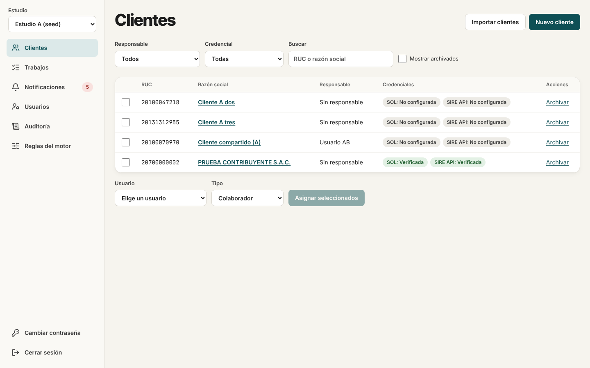

# 05 · Clientes

> Anterior: [04 · Planes y límites](04-planes-y-limites.md) · Siguiente: [06 · Credenciales y trabajos](06-credenciales-y-trabajos.md) · Índice: [00-indice.md](00-indice.md)

Al terminar este módulo vas a poder dar de alta a un cliente con su RUC, registrar su perfil fiscal, encontrarlo con los filtros del listado, archivarlo y reactivarlo, y cargar muchos clientes de una vez desde un Excel o un CSV, sin pasarte del cupo de tu plan.

## Para qué sirve

Cada contribuyente que atiende tu estudio es un **cliente** en ContApp. Todo lo demás cuelga de él: sus credenciales, sus compras y ventas de cada periodo, sus archivos generados. Por eso este es el primer paso real después de entrar al sistema.

Piénsalo como el archivador de expedientes del estudio:

- **Crear un cliente** es abrir su expediente. Basta el RUC: ContApp revisa que el número sea válido y, en segundo plano, consulta los datos del contribuyente.
- **El perfil fiscal** es la carátula del expediente: régimen, zona, si vende exonerado o mixto y en qué moneda opera.
- **Archivar** es mandar el expediente al depósito: no se borra, pero queda de solo lectura y deja de ocupar un lugar en tu plan.
- **Importar** es cuando llegas con la cartera completa en una hoja de cálculo y no quieres digitar cliente por cliente.

Normalmente lo usas al empezar con ContApp (para cargar toda tu cartera) y luego cada vez que entra o sale un cliente del estudio.

## Quién puede usarlo

Los permisos salen de la matriz de roles de ContApp. Si no ves un botón, casi siempre es por tu rol.

| Rol | Ver clientes | Crear, importar | Editar datos fiscales | Archivar / reactivar | Asignar responsable |
|---|---|---|---|---|---|
| Dueño | Todos | Sí | Sí | Sí | Sí |
| Administrador | Todos | Sí | Sí | Sí | Sí |
| Contador | Solo los asignados | No | No | No | No |
| Asistente | Solo los asignados | No | No | No | No |
| Lectura | Solo los asignados | No | No | No | No |

- «Nuevo cliente» e «Importar clientes» solo aparecen con el permiso `clientes.crear` (Dueño y Administrador).
- Un Contador, Asistente o Lectura **solo ve los clientes que tiene asignados**. Si abre por enlace un cliente que no le toca, ve «No se encontró lo que buscas.», el mismo mensaje que para un cliente que no existe.
- Las asignaciones (responsable y colaboradores) se explican en [03 · Tu equipo](03-equipo-roles-asignaciones.md).

## Antes de empezar

- Debes poder entrar a ContApp ([02 · Entrar a ContApp](02-entrar-a-contapp.md)) con un usuario Dueño o Administrador. En el entorno de prueba, `ua@seed.contapp.test` es Dueño del «Estudio A (seed)». La contraseña de desarrollo del seed es `desarrollo-contapp-2026` (solo sirve para pruebas locales).
- Conviene saber cuántos RUC te permite tu plan ([04 · Planes y límites](04-planes-y-limites.md)). Los estudios del seed tienen el plan Corporativo (600 RUC). Un estudio nuevo en prueba gratis tiene 5.
- Para importar, ten a mano la lista de RUC de tus clientes y, si quieres, el correo del miembro que será responsable de cada uno.

## Paso a paso

### Crear un cliente por RUC

1. En el menú, haz clic en «Clientes».
2. Arriba a la derecha (en celular, debajo del título), haz clic en «Nuevo cliente». Se abre la pantalla «Nuevo cliente» (`/clientes/nuevo`).
3. En «RUC», escribe los 11 dígitos. Debajo verás la ayuda «11 dígitos. Empieza con 10, 15, 16, 17 o 20.».
4. Sal del campo (tecla Tab o clic fuera). Si el número no cumple el formato o el dígito verificador, aparece en rojo «El RUC no es válido.» y no podrás crearlo hasta corregirlo.
5. «Razón social» es opcional. La ayuda dice: «Opcional. Si la dejas vacía, se guarda «RUC <número>» hasta completarla.»
6. Si tienes permiso para asignar, elige en «Responsable» a un miembro del equipo. Solo aparecen quienes pueden ser responsables (Dueño, Administrador, Contador o Asistente activos). Puedes dejar «Sin responsable».
7. Si quieres, completa el recuadro «Datos fiscales (opcional)» (ver la tarea siguiente).
8. Haz clic en «Crear cliente».

**Resultado esperado:** ContApp te lleva a la ficha del cliente (`/clientes/<id>`), con su razón social como título y «RUC 20…» debajo. El cliente ya aparece en el listado. En segundo plano se encola un trabajo «Consultando datos de RUC» que verás en «Trabajos» ([06 · Credenciales y trabajos](06-credenciales-y-trabajos.md)).

#### Qué hace la consulta RUC

Al crear (o importar) un cliente, ContApp encola una consulta del RUC. Cuando termina:

- guarda el **estado** y la **condición** del contribuyente (por ejemplo `ACTIVO` y `HABIDO`);
- reemplaza la razón social **solo si sigue siendo la provisional** «RUC <número>». Si tú escribiste una razón social, o la editaste antes de que termine la consulta, se respeta la tuya.

Hoy esa consulta es una **simulación**: no pregunta a SUNAT. Devuelve siempre una razón social inventada del tipo «EMPRESA MOCK 480DD604 S.A.C.», con estado `ACTIVO` y condición `HABIDO`. Si la consulta falla o tarda, el cliente queda tal como lo creaste, con la razón social provisional, y puedes corregirla a mano en su ficha. En esta versión no hay botón para repetir la consulta.

> En esta versión la ficha no muestra el estado ni la condición del contribuyente: quedan guardados, pero la pantalla solo enseña la razón social y el RUC.

### Registrar el perfil fiscal

Puedes hacerlo al crear el cliente o después, en su ficha.

1. Abre la ficha del cliente (clic en su razón social en el listado).
2. En la sección «Datos fiscales», completa:
   - «Régimen»: «Sin definir», «Régimen General (RG)», «Régimen MYPE Tributario (RMT)», «Régimen Especial de Renta (RER)» o «Nuevo RUS (NRUS)».
   - «Zona»: «General» o «Amazonía».
   - «Ventas exoneradas» y «Ventas mixtas»: casillas que marcas si aplica.
   - «Moneda habitual»: «Soles (PEN)» o «Dólares (USD)».
3. En la misma sección puedes corregir la «Razón social».
4. Haz clic en «Guardar datos fiscales».

**Resultado esperado:** aparece «Datos guardados.» y, al recargar, los valores siguen ahí. Si algo no es válido, verás «Revisa los datos fiscales.».

Estos datos describen al cliente y servirán para clasificar automáticamente según su régimen y zona; esa clasificación «estándar» está prevista para una versión posterior.

### Buscar y filtrar clientes

1. Entra a «Clientes» (`/clientes`).
2. Usa los filtros de la parte superior; se combinan entre sí:
   - «Responsable»: «Todos», «Sin responsable» o un miembro del equipo.
   - «Credencial»: «Todas», «No configurada», «Configurada», «Verificada» o «Inválida». Un cliente aparece si **alguna** de sus dos credenciales (SOL o SIRE) está en ese estado.
   - «Buscar»: escribe el inicio del RUC o una parte de la razón social (placeholder «RUC o razón social», hasta 100 caracteres). La lista se actualiza sola un momento después de que dejas de escribir.
   - «Mostrar archivados»: marca la casilla para ver también los clientes archivados.

**Resultado esperado:** la tabla muestra solo los clientes que cumplen todos los filtros y que tú puedes ver.

### Archivar un cliente

1. Abre la ficha del cliente. También puedes hacer clic en «Archivar» en la columna «Acciones» del listado: te lleva a la misma ficha.
2. Haz clic en el botón «Archivar».
3. Lee la ventana «¿Archivar este cliente?»: «Libera su lugar en el cupo de RUCs. Quedará de solo lectura hasta que lo reactives; sus credenciales se conservan.»
4. Haz clic en «Confirmar» (o «Cancelar» para no hacer nada).

**Resultado esperado:** la ficha muestra el aviso «El cliente está archivado y es de solo lectura.», los datos fiscales pasan a texto, desaparece el formulario de credenciales y el de asignaciones, y el botón cambia a «Reactivar». El cliente deja de verse en el listado salvo que marques «Mostrar archivados», y ya no cuenta en el cupo de tu plan.

### Reactivar un cliente

1. En «Clientes», marca «Mostrar archivados» y abre la ficha del cliente.
2. Haz clic en «Reactivar».
3. La ventana «¿Reactivar este cliente?» avisa: «Volverá a ocupar un lugar en el cupo de RUCs de tu plan. Si no hay cupo libre, no se reactiva.»
4. Haz clic en «Confirmar».

**Resultado esperado:** desaparece el aviso de solo lectura y el cliente vuelve a ser editable. Sus credenciales siguen ahí: no hay que volver a ingresarlas. Si tu plan está lleno verás «Llegaste al límite de RUCs de tu plan.» con el recuadro de uso del plan.

### Importar clientes desde Excel o CSV

1. En «Clientes», haz clic en «Importar clientes». Se abre «Importar clientes» (`/clientes/importar`).
2. Haz clic en «Descargar plantilla». Se descarga `plantilla-clientes.xlsx`, con una hoja «Clientes» (solo la cabecera) y una hoja «Instrucciones».
3. Llena la hoja «Clientes», un cliente por fila, con estas columnas:

   | Columna | ¿Obligatoria? | Qué va |
   |---|---|---|
   | RUC | Sí | 11 dígitos, prefijo 10, 15, 16, 17 o 20 y dígito verificador válido. |
   | Razón social | No | Si la dejas vacía, se usa «RUC <número>» hasta que la consulta RUC la complete. |
   | Usuario SOL | Columna sí, celda no | Llena usuario y clave SOL juntos, o ninguno. |
   | Clave SOL | Columna sí, celda no | Se guarda cifrada y no se vuelve a mostrar. |
   | client_id | Columna sí, celda no | Credencial SIRE: llena client_id y client_secret juntos, o ninguno. |
   | client_secret | Columna sí, celda no | Se guarda cifrado y no se vuelve a mostrar. |
   | Responsable | Columna sí, celda no | El **correo** de un miembro activo del estudio que pueda ser responsable. |

4. Guarda el archivo como `.xlsx` (la plantilla) o como `.csv` (separado por comas o por punto y coma, en UTF-8).
5. En «Archivo (.xlsx o .csv)», elige tu archivo.
6. Haz clic en «Revisar archivo». ContApp no crea nada todavía: te muestra la vista previa.
7. Revisa el resumen y la tabla (ver «Qué ves en pantalla»). Las claves nunca se muestran: solo verás «SOL ••••» o «SIRE ••••» si la fila las trae.
8. Si estás conforme, haz clic en «Confirmar importación». Si no, «Cancelar», corrige el archivo y vuelve a elegirlo.

**Resultado esperado:** la pantalla muestra «Clientes creados: N», «Consultas de RUC encoladas: N» y «Consultas de RUC omitidas: N», y una tabla con las filas no importadas y su motivo. El enlace «Ir a clientes» te devuelve al listado. ContApp no guarda tu archivo: lo lee en memoria y lo descarta.

> La importación es **parcial**: crea las filas válidas en el orden del archivo hasta llenar el cupo libre, y reporta el resto como no importadas con su motivo. No hace falta que el archivo esté perfecto para importar las filas buenas.

> Si el archivo trae claves, recuerda el aviso del [índice](00-indice.md): en tu entorno de prueba **no pongas claves SOL ni client_secret reales**. Usa valores inventados.

## Qué ves en pantalla

*El listado «Clientes»: arriba, «Importar clientes» y «Nuevo cliente»; debajo, los filtros y la tabla con el responsable y el estado de las credenciales SOL y SIRE de cada cliente.*

### Listado de clientes (`/clientes`)

| Columna | Qué muestra |
|---|---|
| (casilla) | Solo si puedes asignar. Sirve para la asignación masiva («Asignar seleccionados»). Está desactivada en clientes archivados. |
| RUC | El RUC del cliente. |
| Razón social | Enlace a la ficha. Puede ser la provisional «RUC <número>» si la consulta RUC aún no terminó o falló. |
| Responsable | El nombre del responsable o «Sin responsable». |
| Credenciales | Dos etiquetas, «SOL: …» y «SIRE API: …», con el estado de cada una («No configurada», «Configurada», «Verificada», «Inválida»). Si el cliente está archivado, también la etiqueta «Archivado». |
| Acciones | Solo con permiso de archivar: «Archivar» o «Reactivar», que llevan a la ficha. |

### Ficha del cliente (`/clientes/<id>`)

| Parte | Qué hay |
|---|---|
| Encabezado | Razón social, «RUC …» y los enlaces «Compras · Ventas · Reglas aprendidas»: la grilla de compras ([08](08-compras.md)), la pantalla de ventas ([07](07-ventas.md)) y las reglas aprendidas del cliente ([13](13-reglas-aprendidas.md)). En escritorio van a la derecha del título; en celular, debajo. |
| «Archivar» / «Reactivar» | Botón con confirmación (solo Dueño y Administrador). |
| «Datos fiscales» | Formulario editable o, si no puedes editar o el cliente está archivado, el texto de cada dato. |
| «Credenciales» | Estado y formulario de SOL y SIRE ([06 · Credenciales y trabajos](06-credenciales-y-trabajos.md)). |
| «Asignaciones» | Tabla «Nombre / Tipo» y formulario para asignar (solo con permiso de asignar). |

### Vista previa de la importación

| Elemento | Significado |
|---|---|
| «Filas válidas: N» | Filas que se pueden crear. |
| «Filas con error: N» | Filas que no se crearán; mira sus motivos. |
| «Cupo de RUCs disponible: N» | Lugares libres en tu plan en este momento. |
| «Excedentes que no caben: N» | Filas válidas que quedarían fuera por el cupo. |
| Tabla «Fila / RUC / Estado / Claves / Motivos» | «Fila» es el número de fila del archivo (la cabecera es la 1). «Estado» es «Válida» o «Con error». |

Motivos por fila que puedes ver:

| Motivo | Qué significa |
|---|---|
| «El RUC no es válido.» | Formato, prefijo o dígito verificador incorrectos. |
| «RUC repetido en el archivo.» | El RUC ya apareció en una fila anterior; vale la primera. |
| «Ya existe un cliente con ese RUC.» | El RUC ya está en tu estudio. No se actualiza nada. |
| «Ya existe un cliente archivado con ese RUC. Reactívalo desde su ficha.» | Igual, pero el existente está archivado. |
| «El responsable no existe en el estudio.» | El correo no corresponde a un miembro activo. |
| «El responsable no puede ser asignado a clientes.» | El miembro existe pero su rol no puede ser responsable (por ejemplo, Lectura). |
| «La credencial está incompleta.» | Pusiste usuario SOL sin clave (o al revés), o client_id sin client_secret (o al revés). |
| «La fila contiene una fórmula o un carácter no permitido.» | Hay una fórmula, o la razón social, el usuario SOL, el client_id o el responsable empiezan con `=`, `+`, `-` o `@`. |
| «No cabe en el cupo de RUCs de tu plan.» | Solo en el resultado final: la fila era válida pero ya no había cupo. |

## Reglas y límites

| Mensaje que ves | Por qué | Qué hacer |
|---|---|---|
| «Ingresa el RUC.» | Intentaste crear sin RUC. | Escribe los 11 dígitos. |
| «El RUC no es válido.» | Prefijo distinto de 10, 15, 16, 17 o 20, menos de 11 dígitos o dígito verificador incorrecto. | Revisa el número en la ficha RUC del cliente. |
| «Ya existe un cliente con ese RUC.» | El RUC ya está en tu estudio, activo o archivado. | Búscalo en el listado (marca «Mostrar archivados») y, si está archivado, reactívalo. |
| «Llegaste al límite de RUCs de tu plan.» | Tu plan no tiene cupo libre para crear o reactivar. | Archiva un cliente que ya no atiendas o pide a ContApp subir de plan ([04](04-planes-y-limites.md)). |
| «El cliente está archivado y es de solo lectura.» | Intentaste editar, asignar o tocar credenciales de un archivado. | Reactívalo primero. |
| «Hay clientes archivados en la selección. Reactívalos o quítalos para asignar.» | La asignación masiva incluía un archivado. | Quítalo de la selección. |
| «Tu estudio se creó, pero no tiene plan: …» | El estudio no tiene suscripción activa. | Contacta a ContApp para activar un plan. |
| «El archivo no es válido. Usa la plantilla (.xlsx) o un .csv.» | El archivo no es un `.xlsx` o `.csv` legible. | Descarga la plantilla y vuelve a llenarla. |
| «Faltan columnas en la cabecera. Descarga la plantilla y úsala.» | Borraste o renombraste una columna obligatoria. | Usa la cabecera de la plantilla tal cual. Solo «Razón social» puede faltar. |
| «El archivo supera las 1.000 filas permitidas.» | Más de 1.000 filas. | Divide el archivo en partes. |
| «El archivo supera los 2 MB permitidos.» | Archivo muy pesado. | Divide el archivo o quita hojas y formatos que no uses. |

Otras reglas:

- **Archivar no borra.** Las compras, ventas, archivos y credenciales del cliente se conservan. La eliminación definitiva llegará en una versión posterior.
- **Un archivado no trabaja.** Si tenía trabajos en cola, se cancelan con el motivo «Acceso retirado».
- **Las filas en blanco del archivo se ignoran.** Solo se lee la hoja «Clientes».
- **«Confirmar importación»** se desactiva si no hay ninguna fila válida.
- **Dos importaciones a la vez** nunca superan el cupo: lo que no quepa sale como «No cabe en el cupo de RUCs de tu plan.».

## Pruébalo con los datos de prueba

Entra como `ua@seed.contapp.test` (Dueño). El «Estudio A (seed)» ya trae tres clientes de ejemplo; vas a agregar el contribuyente de prueba que usan los módulos siguientes.

1. **RUC inválido.** En «Nuevo cliente», escribe `20700000001` y sal del campo. Debe salir «El RUC no es válido.» (el dígito verificador correcto sería 2).
2. **Alta del contribuyente de prueba.** Cambia el RUC a `20700000002`, escribe en «Razón social» `PRUEBA CONTRIBUYENTE S.A.C.`, elige «Régimen General (RG)» y haz clic en «Crear cliente». Llegas a su ficha con ese nombre. Como escribiste la razón social, la consulta RUC no la cambia.
3. **Razón social provisional.** Crea otro cliente con `20700000011` y deja la razón social vacía. La ficha se abre como «RUC 20700000011». Ve a «Trabajos»: verás «Consultando datos de RUC» → «Completado». Vuelve a «Clientes» y recarga: ahora dice «EMPRESA MOCK 65BAEAF0 S.A.C.».
4. **Consulta que falla por datos.** Crea `20700000088` sin razón social (es un RUC válido que termina en 8, un «centinela» del simulador). En «Trabajos» el trabajo termina «Con error» y «Datos inválidos». El cliente sigue como «RUC 20700000088»: corrígelo a mano en «Datos fiscales» → «Razón social».
5. **SUNAT no responde.** Crea `20700000037` (termina en 7). El trabajo se reintenta solo varias veces (vuelve a «En cola» entre intentos) y, pasado alrededor de medio minuto, queda «Con error» y «SUNAT no responde». El cliente conserva la razón social provisional.
6. **Duplicado.** Intenta crear de nuevo `20700000002`: «Ya existe un cliente con ese RUC.».
7. **Archivar y reactivar.** Archiva `20700000088`. Desaparece del listado; marca «Mostrar archivados» y vuelve a verlo con «Archivado». Reactívalo.
8. **Importación.** Descarga la plantilla y llena cuatro filas: `20700000045` (sin claves), `20700000045` otra vez, `20700000002` y `20700000003` (dígito verificador incorrecto). En la vista previa: 1 válida y 3 con error, con los motivos «RUC repetido en el archivo.», «Ya existe un cliente con ese RUC.» y «El RUC no es válido.». Confirma: «Clientes creados: 1» y «Consultas de RUC encoladas: 1».

## Problemas frecuentes

| Síntoma | Causa | Solución |
|---|---|---|
| No veo «Nuevo cliente» ni «Importar clientes». | Tu rol no es Dueño ni Administrador. | Pide a un Dueño o Administrador que cree el cliente. |
| Un compañero dice que creó un cliente y yo no lo veo. | No estás asignado a ese cliente (Contador, Asistente o Lectura solo ven sus asignados). | Pide que te asignen ([03](03-equipo-roles-asignaciones.md)). |
| La razón social sigue como «RUC 20…». | La consulta RUC falló, se omitió o aún no termina. | Revisa «Trabajos». Si terminó con error, edita la razón social en la ficha. |
| La razón social es «EMPRESA MOCK …» y no la real. | La consulta RUC es una simulación. | Corrígela a mano. Con la conexión real (versión posterior) llegará la de SUNAT. |
| No encuentro un cliente que sé que existe. | Está archivado o un filtro lo oculta. | Pon «Todos» y «Todas», borra la búsqueda y marca «Mostrar archivados». |
| No puedo editar nada en la ficha. | El cliente está archivado o tu rol no tiene permiso de editar. | Reactívalo o pide ayuda a un Dueño o Administrador. |
| La importación creó menos clientes de los que esperaba. | Filas con error, RUC existentes o cupo lleno. | Revisa la tabla de no importadas y su motivo. |

## Comprueba lo aprendido

1. Creas un cliente sin razón social y la consulta RUC falla. ¿Qué nombre queda y cómo lo corriges?
2. Tu plan está lleno y entra un cliente nuevo. ¿Qué dos caminos tienes dentro de ContApp para hacerle lugar?
3. Tu archivo de importación tiene 50 filas válidas y solo hay 30 lugares libres. ¿Qué pasa al confirmar?
4. Un Contador te dice que no ve el botón «Archivar». ¿Es un error?
5. Archivaste un cliente con su clave SOL guardada. Al reactivarlo, ¿debes ingresarla de nuevo?

Soluciones

1. Queda la razón social provisional «RUC <número>». La corriges en la ficha, sección «Datos fiscales», campo «Razón social», y «Guardar datos fiscales».
2. Archivar un cliente que ya no atiendes (libera su lugar) o pedir a ContApp que suba tu plan. Archivar no borra nada.
3. Se crean las primeras 30 filas válidas en el orden del archivo y las otras 20 salen como no importadas con «No cabe en el cupo de RUCs de tu plan.». La vista previa ya te lo advertía con «Excedentes que no caben: 20».
4. No. Archivar y reactivar requieren el permiso `clientes.archivar`, que solo tienen el Dueño y el Administrador.
5. No. Archivar conserva las credenciales cifradas; al reactivar siguen ahí.

## Para saber más

- Curso técnico: [03 · RLS y withTenant](../curso/03-rls-y-withtenant.md) (por qué cada estudio y cada usuario solo ve lo suyo) · [05 · BullMQ y la cola](../curso/05-bullmq-y-la-cola.md) (la consulta RUC como trabajo).
- Specs: [`docs/specs/007a-clientes/spec.md`](../specs/007a-clientes/spec.md) (alta, perfil fiscal, cupo, archivado, listado) · [`docs/specs/007b-credenciales/spec.md`](../specs/007b-credenciales/spec.md) (consulta RUC e importación).
- Requisitos: RF-030 a RF-037 y RF-039 (RF-038, eliminación definitiva, es de una versión posterior) · HU-06.
