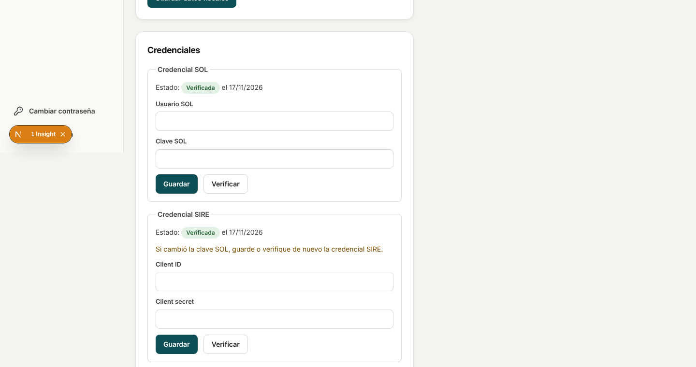

# 06 · Credenciales y trabajos

> Anterior: [05 · Clientes](05-clientes.md) · Siguiente: [07 · Ventas (RVIE)](07-ventas.md) · Índice: [00-indice.md](00-indice.md)

Al terminar este módulo vas a poder guardar la clave SOL y la credencial de la API SIRE de un cliente, comprobar si funcionan con «Verificar», entender cada estado («Configurada», «Verificada», «Inválida»…) y seguir en vivo, en el panel «Trabajos», todo lo que ContApp hace en segundo plano, incluidos los errores.

> **Aviso importante. No ingreses credenciales reales en tu entorno de prueba.** ContApp todavía no se conecta con SUNAT: la verificación de credenciales es una simulación y no te dirá si la clave real funciona. Además, en modo desarrollo las claves se cifran con una llave de pruebas cuya parte privada está en el propio repositorio (`packages/crypto/fixtures/mock-kek/`): cualquiera con acceso al repositorio podría descifrarlas. Usa siempre valores inventados, por ejemplo usuario `PRUEBA01` y clave `CLAVEPRUEBA1`. Las credenciales reales se podrán usar cuando existan la configuración de producción y la conexión real con SUNAT.

## Para qué sirve

### Las credenciales

Para trabajar el SIRE de un cliente, alguien tiene que entrar a SUNAT en su nombre. ContApp guarda dos credenciales por cliente:

| Credencial | Qué es | Para qué la usará ContApp |
|---|---|---|
| **Credencial SOL** | El **usuario SOL** y la **clave SOL** del contribuyente (o de su usuario secundario), los mismos con los que se entra a SUNAT Operaciones en Línea. | Comprobar el acceso a SUNAT y, junto con la SIRE, obtener el permiso para usar la API del SIRE. |
| **Credencial SIRE** | El **client_id** y el **client_secret** que SUNAT entrega al generar las credenciales de la API SIRE. | Pedir a SUNAT el «token» del SIRE y, con él, descargar las propuestas de compras y ventas ([07](07-ventas.md) y [08](08-compras.md)). El token SIRE se pide con **las dos** credenciales. |

Son **de solo escritura**: las escribes una vez y ContApp no te las vuelve a mostrar nunca, ni a ti ni a nadie del estudio. Solo ves su **estado**. Es como dejar las llaves del cliente en una caja fuerte con ranura: puedes meter una llave nueva, pero no sacar la que está dentro. Si el cliente cambia su clave, simplemente guardas la nueva encima.

### Los trabajos

Lo que depende de SUNAT (consultar un RUC, verificar una credencial, descargar una propuesta, traer XML) puede tardar o fallar. Por eso ContApp no lo hace mientras esperas frente a la pantalla: lo pone en una **cola** y un proceso aparte (el «worker») lo ejecuta. Cada tarea en la cola es un **trabajo**, y el panel «Trabajos» te muestra en vivo en qué va cada uno: en cola, ejecutando, completado o con error, y por qué.

En el mes lo usas al incorporar un cliente (guardar y verificar sus credenciales), cada vez que SUNAT le cambia la clave, y siempre que lances una descarga o una generación y quieras saber si terminó.

## Quién puede usarlo

| Rol | Ver estado de credenciales | Guardar y «Verificar» | Ver «Trabajos» | «Cancelar» un trabajo en cola |
|---|---|---|---|---|
| Dueño | Todos los clientes | Sí | Sí, de todos los clientes | Cualquiera |
| Administrador | Todos los clientes | Sí | Sí, de todos los clientes | Cualquiera |
| Contador | Sus clientes asignados | Sí | Sí, de sus clientes | Solo los que él encoló |
| Asistente | Sus clientes asignados | No | Sí, de sus clientes | Solo los que él encoló, si aún tiene el permiso de ese tipo de trabajo |
| Lectura | Sus clientes asignados | No | Sí, de sus clientes | No (no puede encolar) |

- Guardar y verificar piden el permiso `credenciales.editar` (Dueño, Administrador y Contador).
- Quien no lo tiene ve los estados, pero no el formulario ni los botones.
- «Cancelar» lo ven quien encoló el trabajo, el Dueño y el Administrador. Quien encoló deja de poder cancelar si después le bajan el rol y ya no tiene el permiso de ese tipo de trabajo.

## Antes de empezar

- Haz el módulo [05 · Clientes](05-clientes.md): necesitas un cliente activo, por ejemplo el contribuyente de prueba `20700000002`.
- Entra como Dueño (`ua@seed.contapp.test`) o como Contador asignado al cliente (`uab@seed.contapp.test`, responsable del primer cliente del «Estudio A (seed)»). Contraseña de desarrollo: `desarrollo-contapp-2026` (solo pruebas locales).
- Ten a mano **valores inventados** para usuario, clave, client_id y client_secret. No uses los reales.

## Paso a paso

### Guardar la credencial SOL

1. En «Clientes», abre la ficha del cliente (clic en su razón social).
2. Baja a la sección «Credenciales», recuadro «Credencial SOL». Verás «Estado: No configurada».
3. Escribe el «Usuario SOL» (por ejemplo `PRUEBA01`) y la «Clave SOL» (por ejemplo `CLAVEPRUEBA1`). La clave se ve como puntos.
4. Haz clic en «Guardar».

**Resultado esperado:** los dos campos se vacían al instante, aparece «Credencial guardada.» y el estado pasa a «Configurada». Configurada significa «guardada pero aún no probada».

### Guardar la credencial SIRE

1. En la misma sección, recuadro «Credencial SIRE», escribe el «Client ID» y el «Client secret» (inventados).
2. Haz clic en «Guardar».

**Resultado esperado:** campos vacíos, «Credencial guardada.» y «Estado: Configurada». Debajo del estado verás siempre el recordatorio «Si cambió la clave SOL, guarde o verifique de nuevo la credencial SIRE.»: el token SIRE usa la clave SOL, así que si esta cambia, la SIRE también deja de funcionar.

### Actualizar una credencial

No hay un botón «Editar». Para cambiar una credencial, escribe los datos nuevos en el mismo formulario y haz clic en «Guardar»: reemplaza la anterior y el estado vuelve a «Configurada», aunque antes estuviera «Verificada» o «Inválida». Luego verifícala de nuevo.

### Verificar una credencial

1. En el recuadro de la credencial, haz clic en «Verificar».
2. Aparece «Verificación encolada.» con el enlace «Ver en el panel de trabajos», y el estado cambia a «Verificando…».
3. Espera unos segundos sin recargar: la ficha consulta sola el resultado.

**Resultado esperado:** el estado pasa a «Verificada el <fecha>» si el simulador acepta la credencial, o a «Inválida: SUNAT rechazó las credenciales. Revísalas y guárdalas de nuevo.» si la rechaza. Si pasan dos minutos sin respuesta, la ficha deja de esperar: recarga la página para ver el estado actual.

- Para verificar la **SIRE** necesitas haber guardado antes **también la SOL**. Si falta alguna, verás «Primero guarda la credencial.».
- Verificar una credencial «Inválida» sí se puede: es justamente la forma de comprobar que la nueva clave funciona.

### Seguir los trabajos en el panel

1. En el menú (lateral en escritorio, barra inferior en celular), haz clic en «Trabajos» (`/trabajos`), o en el enlace «Ver en el panel de trabajos» que aparece al encolar algo.
2. Verás los trabajos del estudio agrupados por tipo, los más recientes primero. Cada fila tiene el nombre del trabajo, su estado y, si terminó mal, el motivo.
3. Deja la página abierta: los cambios llegan solos, sin recargar.
4. Si un tipo tiene más de 10 trabajos, verás una línea de resumen, por ejemplo «Consultando datos de RUC: 8 de 12», y «3 con error» si los hay. Haz clic en «Ver detalle» para desplegar las filas y en «Ocultar detalle» para plegarlas.

**Resultado esperado:** ves el avance de cada trabajo en tiempo real, hasta «Completado», «Con error» o «Cancelado».

### Cancelar un trabajo en cola

1. En «Trabajos», busca un trabajo en estado «En cola».
2. Si puedes cancelarlo, verás el botón «Cancelar» al final de la fila. Haz clic.

**Resultado esperado:** el trabajo pasa a «Cancelado» con el motivo «Cancelado por el usuario». Un trabajo que ya está «Ejecutando» o que terminó no se puede cancelar: no tiene botón.

## Qué ves en pantalla

*La sección «Credenciales» de la ficha del cliente: cada recuadro muestra el estado de la credencial y los botones «Guardar» y «Verificar». Los campos quedan vacíos porque las claves nunca se vuelven a mostrar.*

### Estados de una credencial (ficha del cliente y listado)

| Estado | Qué significa | Qué hacer |
|---|---|---|
| «No configurada» | Nunca se guardó. | Guárdala. |
| «Configurada» | Guardada, aún sin probar (o recién reemplazada). | «Verificar». |
| «Verificando…» | Hay una verificación en curso (solo se ve en la ficha). | Espera unos segundos. |
| «Verificada el <fecha>» | La última prueba funcionó en esa fecha. | Nada. |
| «Inválida: <motivo>» | La última prueba (o un trabajo que la usó) fue rechazada. Mientras siga así, ContApp **no vuelve a intentar** con ella, para no bloquear la clave del cliente en SUNAT. | Corrige la clave, «Guardar» y «Verificar». |
| «Estado no disponible.» | No se pudo leer el estado. | Recarga la página. |

En el listado de clientes la columna «Credenciales» muestra «SOL: …» y «SIRE API: …» con los mismos estados (sin «Verificando…» ni fecha), y el filtro «Credencial» te deja ver, por ejemplo, todos los clientes con alguna credencial «Inválida».

### Estados de un trabajo

| Estado | Qué significa |
|---|---|
| «En cola» | Espera su turno. También vuelve aquí entre reintentos si SUNAT no respondió. |
| «Ejecutando» | El worker lo está haciendo ahora. |
| «Completado» | Terminó bien. |
| «Con error» | Terminó mal; mira el motivo. |
| «Cancelado» | No llegó a ejecutarse (lo cancelaste, o ContApp lo descartó por un motivo). |

### Motivos

| Motivo | Qué pasó |
|---|---|
| «SUNAT no responde» | SUNAT (hoy, el simulador) no contestó; ContApp reintentó varias veces y se rindió. |
| «Credencial inválida» | SUNAT rechazó la credencial, o el trabajo se descartó porque la credencial ya estaba «Inválida». |
| «Datos inválidos» | SUNAT respondió que los datos pedidos no son válidos. No se reintenta. |
| «El portal de SUNAT cambió» | La respuesta no tiene la forma esperada. |
| «Interrumpido» | El trabajo se cortó (por ejemplo, se reinició el worker). |
| «Acceso retirado» | El cliente se archivó, o quien lo encoló ya no tiene acceso a ese cliente. |
| «Cancelado por el usuario» | Alguien pulsó «Cancelar». |
| «Error interno» | Falla inesperada de ContApp. |

### Tipos de trabajo

Estos son todos los tipos que existen hoy en el catálogo de trabajos:

| Nombre en el panel | Cuándo se crea | Módulo |
|---|---|---|
| «Consultando datos de RUC» | Al crear o importar un cliente. Completa estado, condición y la razón social provisional. Tiene prioridad baja («programado»): cede el paso a lo que pides tú. | [05](05-clientes.md) |
| «Verificando clave SOL» | Al pulsar «Verificar» en la credencial SOL. | Este |
| «Verificando credencial SIRE» | Al pulsar «Verificar» en la credencial SIRE. | Este |
| «Descargando propuesta del SIRE» | Al descargar la propuesta de ventas o de compras de un periodo. Debajo muestra el cliente y «Periodo AAAAMM». | [07](07-ventas.md), [08](08-compras.md) |
| `xml.obtener` | Al pedir el XML de un lote de compras (la lupa). En esta versión el panel lo muestra con este nombre técnico. | [09](09-lupa-y-xml.md) |
| `archivo.generar` | Al generar el archivo SIRE de un periodo. También se muestra con su nombre técnico. | [10](10-generar-archivo.md) |

Notas:

- El panel muestra los trabajos de los clientes que tú puedes ver. Para un Contador, solo los de sus clientes asignados.
- El servidor calcula la **posición en la cola** de cada trabajo, pero en esta versión el panel no la muestra: solo dice «En cola».
- Solo las filas de descarga de propuesta muestran el cliente. En las demás, el cliente no aparece.

## Reglas y límites

| Mensaje que ves | Por qué | Qué hacer |
|---|---|---|
| «Revisa los datos de la credencial.» | Dejaste un campo vacío o pasaste el largo máximo (256 bytes). | Llena los dos campos. |
| «Primero guarda la credencial.» | Pulsaste «Verificar» sin haber guardado esa credencial (o, para la SIRE, sin la SOL). | Guarda la SOL y, si corresponde, la SIRE. |
| «El cliente está archivado y es de solo lectura.» | El cliente está archivado. | Reactívalo ([05](05-clientes.md)). |
| «No tienes permiso para realizar esta acción.» | Tu rol no puede guardar, verificar o cancelar. | Pide ayuda a un Contador, Administrador o Dueño. |
| «Ocurrió un error. Inténtalo de nuevo.» al cancelar | El trabajo ya empezó o terminó justo antes de tu clic. | Revisa su estado en el panel. |

Otras reglas:

- **Nunca se muestran las claves.** Ninguna pantalla, respuesta, exportación ni registro contiene la clave SOL ni el client_secret. Si la olvidaste, pídela al cliente: ContApp no puede recuperarla.
- **«Inválida» frena todo.** Mientras una credencial SIRE esté «Inválida», las descargas de propuesta de ese cliente se cancelan con «Credencial inválida» en lugar de reintentar. Guardar o verificar de nuevo la credencial las vuelve a habilitar.
- **Archivar no borra las credenciales.** Quedan cifradas y siguen ahí al reactivar.

## Pruébalo con los datos de prueba

Todo lo que sigue funciona con los simuladores que trae ContApp. Son deterministas: con los mismos datos, siempre dan el mismo resultado.

**Cómo provocar errores a propósito.** Los simuladores tienen «centinelas»: valores especiales que fuerzan un error, para que puedas ver cómo reacciona ContApp sin depender de SUNAT.

| Si haces esto | El simulador responde | Verás en el panel |
|---|---|---|
| Guardas la clave SOL `clave-errada` (exacta, en minúsculas) y pulsas «Verificar» en SOL. | Clave rechazada. | «Verificando clave SOL» → «Con error», «Credencial inválida». La ficha: «Inválida: SUNAT rechazó las credenciales…». |
| Guardas el client_secret `clave-errada` y pulsas «Verificar» en SIRE. | Credencial SIRE rechazada. | «Verificando credencial SIRE» → «Con error», «Credencial inválida». |
| Creas un cliente con un RUC válido que termina en **7** (por ejemplo `20700000037`). | La consulta RUC no responde. | «Consultando datos de RUC» vuelve a «En cola» varias veces y, en medio minuto aproximado, queda «Con error», «SUNAT no responde». |
| Creas un cliente con un RUC válido que termina en **8** (por ejemplo `20700000088`). | Datos inválidos. | «Consultando datos de RUC» → «Con error», «Datos inválidos», sin reintentos. |
| Descargas la propuesta de un cliente cuyo RUC termina en **7**, **8** o **9** (por ejemplo `20700000029` para el 9). | 7: no responde; 8: datos inválidos; 9: credencial rechazada. | «Descargando propuesta del SIRE» con «SUNAT no responde», «Datos inválidos» o «Credencial inválida». Con el 9, además, la credencial SIRE del cliente pasa a «Inválida». Lo verás en [07](07-ventas.md). |
| Pides el XML de un comprobante cuyo número termina en 7, 8 o 9. | Lo mismo que arriba, por el número del comprobante. | `xml.obtener` con error. Los datos de prueba nunca usan esos finales, así que esto no ocurre con ellos. |

Los RUC del ejemplo son válidos (pasan el dígito verificador). Cualquier otro final de RUC o cualquier otra clave dan un resultado exitoso.

**Recorrido sugerido** con el contribuyente de prueba `20700000002`:

1. Abre su ficha. Ambas credenciales dicen «No configurada».
2. Guarda la SOL con `PRUEBA01` / `CLAVEPRUEBA1`. Estado: «Configurada».
3. Pulsa «Verificar» en la SIRE. Debe salir «Primero guarda la credencial.» (falta la SIRE).
4. Guarda la SIRE con client_id `11111111-2222-3333-4444-555555555555` y client_secret `SECRETOPRUEBA1`. Estado: «Configurada».
5. Abre «Trabajos» en otra pestaña. En la ficha, pulsa «Verificar» en SOL y luego en SIRE. En el panel verás aparecer «Verificando clave SOL» y «Verificando credencial SIRE» y pasar a «Completado» sin recargar. En la ficha, ambas quedan «Verificada el <fecha de hoy>».
6. Ahora guarda la SOL con la clave `clave-errada` y verifica. Resultado: «Inválida: SUNAT rechazó las credenciales. Revísalas y guárdalas de nuevo.». En el listado de clientes, filtra «Credencial: Inválida»: aparece este cliente.
7. Corrige: guarda otra vez `CLAVEPRUEBA1` (el estado vuelve a «Configurada») y verifica. Vuelve a «Verificada».
8. Crea el cliente `20700000037` ([05](05-clientes.md)) y mira en el panel cómo su consulta RUC se reintenta y termina en «SUNAT no responde».

## Problemas frecuentes

| Síntoma | Causa | Solución |
|---|---|---|
| No veo los campos ni los botones de credenciales. | Tu rol es Asistente o Lectura, o el cliente está archivado. | Pide a un Contador, Administrador o Dueño, o reactiva el cliente. |
| Quiero ver la clave que guardé. | Las credenciales son de solo escritura. | No se puede. Pídela al cliente y guárdala de nuevo. |
| Se queda en «Verificando…» mucho rato. | El worker no está corriendo o la cola está ocupada. | Revisa «Trabajos». Si el trabajo sigue «En cola», revisa que el worker esté levantado ([01](01-preparar-entorno.md)). Pasados dos minutos, recarga. |
| Verifiqué con la clave real del cliente y salió «Verificada». | Es el simulador: acepta cualquier clave salvo `clave-errada`. | No uses claves reales. «Verificada» hoy no prueba nada frente a SUNAT. |
| La SIRE estaba «Verificada» y las descargas fallan con «Credencial inválida». | Cambió la clave SOL o SUNAT rechazó la SIRE. | Guarda la SOL nueva, luego guarda o verifica de nuevo la SIRE. |
| El panel no se actualiza solo. | Se cortó la conexión en vivo. | El panel se reconecta solo y, mientras tanto, consulta la lista cada pocos segundos. Si no cambia nada, recarga. |
| No aparece el botón «Cancelar». | El trabajo ya no está «En cola», o no lo encolaste tú y no eres Dueño ni Administrador. | Solo se cancela lo que aún espera turno. |
| Veo `xml.obtener` o `archivo.generar` en vez de un nombre en español. | Esos tipos aún no tienen nombre legible en el panel. | Es normal en esta versión. |

## Comprueba lo aprendido

1. Un cliente te avisa que cambió su clave SOL. ¿Qué haces en ContApp, en qué orden?
2. Un compañero Asistente dice que no puede guardar la clave SOL de un cliente. ¿Por qué?
3. ¿Cómo provocarías a propósito el estado «Inválida» en la credencial SOL para enseñárselo a tu equipo?
4. Ves un trabajo «Consultando datos de RUC» que pasa de «Ejecutando» a «En cola» varias veces. ¿Qué está pasando?
5. ¿Por qué ContApp no reintenta con una credencial «Inválida»?

Soluciones

1. Guardas la nueva clave SOL (el estado vuelve a «Configurada») y la verificas. Después guardas o verificas de nuevo la credencial SIRE, porque el token SIRE usa la clave SOL. Es lo que recuerda el aviso «Si cambió la clave SOL, guarde o verifique de nuevo la credencial SIRE.».
2. Guardar y verificar credenciales requieren el permiso `credenciales.editar`, que tienen el Dueño, el Administrador y el Contador, pero no el Asistente.
3. Guardando como clave SOL el texto exacto `clave-errada` y pulsando «Verificar». El simulador la rechaza y la ficha muestra «Inválida: SUNAT rechazó las credenciales. Revísalas y guárdalas de nuevo.».
4. SUNAT (el simulador) no responde y ContApp reintenta solo, esperando cada vez un poco más. Si tras los reintentos sigue sin respuesta, el trabajo queda «Con error» con «SUNAT no responde». Con el simulador pasa cuando el RUC termina en 7.
5. Para no insistir con una clave errada: varios intentos fallidos pueden bloquear el acceso SOL del cliente. Las descargas se cancelan con «Credencial inválida» hasta que alguien guarde o verifique de nuevo la credencial.

## Para saber más

- Curso técnico: [05 · BullMQ y la cola](../curso/05-bullmq-y-la-cola.md) (encolar, reintentos, cancelar) · [06 · Backend NestJS y SSE](../curso/06-backend-nestjs-sse.md) (cómo llegan los cambios en vivo al panel) · [07 · Seguridad, cifrado y sesiones](../curso/07-seguridad-cifrado-y-sesiones.md) (cómo se cifran las claves y por qué la llave de pruebas no sirve para datos reales).
- Specs: [`docs/specs/007b-credenciales/spec.md`](../specs/007b-credenciales/spec.md) (credenciales, verificación, panel) · [`docs/specs/008-cola/spec.md`](../specs/008-cola/spec.md) (cola, estados, motivos, cancelación) · [`docs/specs/009-adaptadores-mock/spec.md`](../specs/009-adaptadores-mock/spec.md) (simuladores y centinelas) · [`docs/specs/020-deuda-r1/spec.md`](../specs/020-deuda-r1/spec.md) («Verificando…», motivos en español, «Cancelar» con permiso).
- Requisitos: RF-033, RF-034, RF-035 · HU-09, HU-10. Datos de prueba: [`fixtures/LEEME.md`](../../fixtures/LEEME.md).
