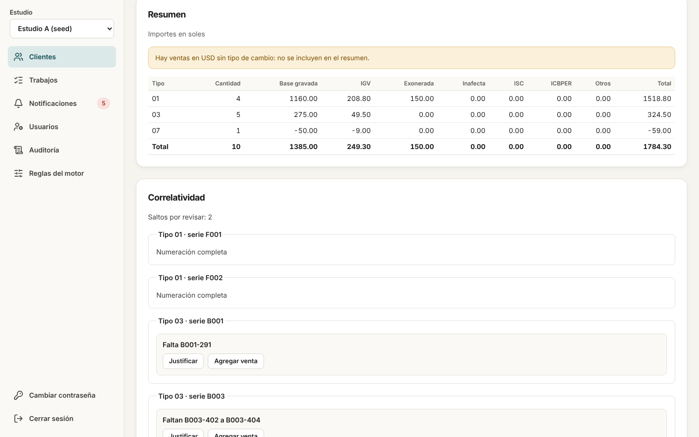

# 07 · Ventas (RVIE)

> Anterior: [06 · Credenciales y trabajos](06-credenciales-y-trabajos.md) · Siguiente: [08 · Compras (RCE)](08-compras.md) · Índice: [00-indice.md](00-indice.md)

Al terminar este módulo vas a poder traer las ventas de un periodo (descargándolas o importándolas desde un archivo), revisar su resumen en soles, encontrar las boletas o facturas que faltan en la numeración y decidir qué hacer con cada salto. También vas a saber marcar el periodo como revisado y apartar del archivo una venta del SIRE que trae un error.

## Para qué sirve

El Registro de Ventas e Ingresos Electrónico (RVIE) lo arma SUNAT con lo que tu cliente emitió. Antes de aceptarlo o reemplazarlo, el contador revisa tres cosas: que estén todos los comprobantes, que los importes cuadren y que el total del mes tenga sentido. Esa revisión, hecha a mano en Excel, es lenta y es fácil que se escape una boleta.

La pantalla **Ventas** hace esa revisión por ti, una vez por periodo, normalmente en la primera semana del mes siguiente:

- **Descarga la propuesta** del periodo (o la importa desde un archivo) y la guarda tal como llegó.
- **Resume** las ventas por tipo de comprobante, todo en soles: las notas de crédito restan y las ventas en dólares se convierten con su tipo de cambio.
- **Revisa la correlatividad**: si tienes la B001-290 y la B001-292, te avisa «Falta B001-291». Puedes justificar el salto con un comentario (por ejemplo, «boleta anulada») o agregar la venta que falta.
- **Controla el estado del periodo** (abierto, revisado, generado), igual que en compras.

Piensa en ella como la hoja de control de correlativos que muchos estudios llevan aparte, pero alimentada sola desde el SIRE.

> Recuerda: ContApp todavía no se conecta con SUNAT. La «descarga» devuelve datos de prueba (ver [Índice](00-indice.md)).

## Quién puede usarlo

Los permisos salen de `packages/shared/src/acceso/roles.ts`. Dueño y Administrador ven todos los clientes; los demás roles, solo los clientes que tienen asignados.

| Rol | Permisos que usa esta pantalla | Qué puede hacer en Ventas |
|---|---|---|
| Dueño, Administrador | todos | Todo, en todos los clientes: descargar, importar, justificar, agregar, quitar, excluir, restaurar, marcar revisado, reabrir, modificar un periodo revisado y generar. |
| Contador | `clientes.ver`, `sire.descargar`, `sire.clasificar`, `sire.aprobar_generar` | Lo mismo que el Dueño, pero solo en sus clientes asignados. |
| Asistente | `clientes.ver`, `sire.descargar`, `sire.clasificar` | Descargar, importar, justificar, revertir, agregar, quitar, excluir, restaurar y marcar revisado, mientras el periodo esté **abierto**. No puede reabrir ni tocar un periodo revisado. |
| Lectura | `clientes.ver` | Solo mirar: grilla, resumen, correlatividad, diferencias y el panel «Generar archivo» (sin generar). No ve botones de escritura. |

| Permiso | Para qué |
|---|---|
| `clientes.ver` | Abrir la pantalla y ver todo. |
| `sire.descargar` | Botón «Descargar» y enlace «Importar propuesta». |
| `sire.clasificar` | «Justificar», «Revertir», «Agregar venta», «Agregar venta manual», «Quitar», «Excluir», «Restaurar» y «Marcar como revisado». |
| `sire.aprobar_generar` | «Reabrir», escribir en un periodo revisado y «Generar» (módulo 10). |

Si un botón no aparece, casi siempre es por el rol. Ocultarlo es solo comodidad: el servidor vuelve a comprobar el permiso en cada acción.

## Antes de empezar

- Haber levantado el entorno ([01](01-preparar-entorno.md)) y entrar con un usuario ([02](02-entrar-a-contapp.md)).
- Tener creado el cliente de prueba RUC `20700000002` ([05](05-clientes.md)).
- Haber guardado su credencial SIRE con una clave inventada ([06](06-credenciales-y-trabajos.md)). Sin credencial, «Descargar» responde «Primero guarda la credencial.».
- Saber el periodo a revisar, en formato `AAAAMM`. Para probar: `202610`.

Cómo llegar: «Clientes» → el cliente → enlace «Ventas» del encabezado de su ficha (junto a «Compras» y «Reglas aprendidas»). Desde «Compras», el enlace «Ventas» del encabezado te lleva con el mismo periodo ya escrito. También puedes escribir la dirección `/clientes/<id del cliente>/ventas?periodo=202610`. Al revés, el botón «Compras» del encabezado de Ventas te devuelve a las compras.

## Paso a paso

### Descargar la propuesta del periodo

1. En la pantalla **Ventas**, escribe el periodo en «Periodo (AAAAMM)», por ejemplo `202610`. Si escribes algo inválido verás «Ingresa un periodo válido (AAAAMM).».
2. En la sección «Descarga», haz clic en «Descargar».
3. La descarga es un **trabajo en cola**: verás «En cola · posición N» o «En cola» y luego «Descargando la propuesta…». Mientras tanto el botón queda deshabilitado. El enlace «Ver en el panel de trabajos» te lleva a `/trabajos` (módulo 06).
4. No hace falta recargar: al terminar, la pantalla vuelve a pedir la grilla, el resumen y la correlatividad.

**Resultado esperado:** debajo del botón aparece el conteo de la descarga, por ejemplo «11 nuevos, 0 difieren», y «Última descarga: <fecha>». Si nunca descargaste el periodo, antes verías «Aún no hay descargas de este periodo.».

Si el trabajo falla verás «La descarga falló: <motivo>» (por ejemplo «SUNAT no responde» o «Credencial inválida») y un botón «Reintentar».

### Volver a descargar (descarga complementaria)

Volver a descargar un periodo **no borra ni pisa nada**. ContApp compara lo que trae SUNAT con lo que ya tienes, comprobante por comprobante (tipo, serie y número):

| Lo que llega | Qué hace ContApp |
|---|---|
| Un comprobante que no tenías | Lo agrega. Cuenta en «nuevos». |
| Uno idéntico al que ya tienes | No hace nada. Solo lo cuenta. |
| Uno que ya tienes pero con otro valor (otro total, otra fecha…) | **No lo cambia.** Lo cuenta en «difieren» y lo lista en «Diferencias de la última descarga». |

Lo que tú trabajaste (ventas agregadas a mano, justificaciones, exclusiones) se queda como estaba.

1. Haz clic otra vez en «Descargar».
2. Revisa el conteo («N nuevos, M difieren»).
3. Baja hasta «Diferencias de la última descarga». Cada fila muestra el «Comprobante», el «Origen guardado» («SIRE» o «Manual») y el «Valor del SIRE» de cada campo que difiere (por ejemplo «Total: 120.00»).

**Resultado esperado:** si nada cambió, «0 nuevos, 0 difieren» y «La última descarga no trajo diferencias.».

### Importar la propuesta desde un archivo (TXT o Excel)

Sirve cuando tienes la propuesta en un archivo en vez de descargarla. Se hace en **dos fases**: primero ves una vista previa sin guardar nada y luego confirmas.

1. Haz clic en «Importar propuesta» (junto al periodo). Se abre «Importar propuesta de ventas».
2. Revisa el periodo y elige el archivo en «Archivo (.xlsx, .csv o .txt)».
3. Haz clic en «Revisar archivo». Verás:
   - «Filas válidas: N», «Filas con error: N» y, si hay, «Filas con advertencia: N».
   - Una tabla «Fila | Estado | Motivos», con el número de fila del archivo (la cabecera es la fila 1) y el estado «Válida», «Válida con advertencia» o «Con error».
4. Si hay filas con error, corrige el archivo y vuelve a elegirlo. La importación es **todo o nada**: «Corrige las filas con error: si alguna falla no se guarda nada.».
5. Si solo hay advertencias, puedes seguir: «Las filas con advertencia se pueden confirmar: se guardan tal cual.».
6. Haz clic en «Confirmar importación». Para descartar, «Cancelar».

**Resultado esperado:** «N nuevos, M difieren» y el enlace «Ver ventas del periodo». La importación usa la misma regla complementaria que la descarga.

**El formato del archivo.** La primera fila lleva estos nombres de columna (no importan mayúsculas ni tildes): `tipo`, `serie`, `numero`, `tipoDocContraparte`, `docContraparte`, `fechaEmision`, `moneda`, `tipoCambio`, `baseGravada`, `igv`, `exonerada`, `inafecta`, `isc`, `icbper`, `otros`, `total`. Solo `tipoDocContraparte` y `tipoCambio` pueden quedar vacías. La fecha va como `AAAA-MM-DD`, la moneda `PEN` o `USD`, el documento `-` para el consumidor final, y los montos con punto decimal. En CSV o TXT separa con coma o punto y coma.

**Por qué solo funciona en desarrollo.** Ese diseño de columnas es **provisional**: SUNAT todavía no ha entregado el anexo oficial ni un archivo de muestra. Para no importar datos tributarios con un formato inventado, el servidor solo acepta este layout cuando corre en modo desarrollo o pruebas. En cualquier otro entorno verás «La importación no está disponible: el diseño de columnas es provisional y no oficial.».

### Leer la grilla y buscar

1. Baja a «Ventas del periodo». Las ventas salen ordenadas por tipo, serie y número.
2. Para buscar, usa «Buscar» (serie-número o documento del cliente), «Tipo» (por ejemplo `03`), «Serie», «Monto mínimo» y «Monto máximo» (comparan el total, en la moneda del comprobante). Haz clic en «Filtrar».
3. Abajo eliges «Filas por página» (10, 25, 50 o «todas») y te mueves con «Anterior» y «Siguiente». Verás «Página 1 · N comprobantes».

**Resultado esperado:** solo las filas que cumplen el filtro. Con más de 5.000 filas, «todas» muestra las primeras 5.000 y un aviso para usar la paginación.

### Revisar la correlatividad y justificar un salto

1. Mira la sección «Correlatividad». Arriba dice «Saltos por revisar: N».
2. Cada serie sale en su propio recuadro, «Tipo 03 · serie B001». Verás «Numeración completa», o los faltantes: «Falta B001-291» (uno) o «Faltan B003-402 a B003-404» (un rango).
3. Para justificar, haz clic en «Justificar» junto al faltante.
4. Escribe el «Comentario» (de 1 a 500 caracteres), por ejemplo «Boleta anulada en el sistema de facturación», y haz clic en «Guardar».

**Resultado esperado:** el faltante muestra «Justificado» con tu comentario, deja de contar en «Saltos por revisar» y aparece el botón «Revertir».

### Revertir una justificación

1. Junto al salto justificado, haz clic en «Revertir».
2. Lee la confirmación («¿Revertir la justificación del salto B001-291? Quedará registro de quién la revirtió y cuándo.») y haz clic en «Confirmar».

**Resultado esperado:** «Justificación revertida.» y el salto vuelve a contar como pendiente. La justificación no se borra: queda el registro de quién la revirtió.

### Agregar la venta que falta

1. Junto al faltante, haz clic en «Agregar venta». El formulario ya trae el tipo, la serie y el primer número del salto. Para una venta sin salto, usa «Agregar venta manual» (arriba, junto al periodo).
2. Completa «Fecha de emisión», «Moneda» (si eliges USD aparece «Tipo de cambio»), «Tipo de documento» y «Documento» (deja `-` para consumidor final) y los montos.
3. El «Total» debe ser **exactamente** la suma de base gravada, IGV, exonerada, inafecta, ISC, ICBPER y otros. ContApp no lo calcula por ti en este formulario.
4. Haz clic en «Agregar».

**Resultado esperado:** «Venta agregada.»; la venta aparece en la grilla con la marca «Manual», el resumen la suma y el salto desaparece. La propuesta original del SIRE no cambia.

### Quitar una venta agregada a mano

1. En la grilla, en la fila con la marca «Manual», haz clic en «Quitar».
2. Confirma: «¿Quitar la venta B001-291 agregada a mano? Esta acción no se puede deshacer.».

**Resultado esperado:** «Venta quitada.». Solo se quitan las ventas agregadas a mano: las que vinieron del SIRE no tienen ese botón.

### Marcar el periodo como revisado y reabrirlo

1. En «Estado del periodo» verás la insignia «Abierto», «Revisado» o «Generado» y, si se marcó, «Marcado el <fecha> por <usuario>».
2. Con el periodo abierto, haz clic en «Marcar como revisado» y confirma («¿Marcar el periodo como revisado? Solo quien puede aprobar y generar podrá modificarlo después.»).
3. Para volver atrás, quien tiene `sire.aprobar_generar` hace clic en «Reabrir» y confirma («¿Reabrir el periodo revisado? Volverá a quedar abierto para modificarlo.»). Si estaba generado, el aviso agrega «Habrá que generar el archivo de nuevo.».

**Resultado esperado:** «Periodo marcado como revisado.» o «Periodo reabierto.» y la insignia cambia.

### Excluir y restaurar una venta del SIRE con error

Una venta del SIRE que trae un error (por ejemplo, no cuadra o está en USD sin tipo de cambio) **bloquea la generación del archivo**. No puedes editarla: el error se corrige en el sistema de facturación del cliente y con una descarga nueva. Si necesitas generar ya, puedes **excluirla** con un motivo.

1. Haz clic en «Generar archivo» para abrir el panel lateral (módulo 10). En «Errores» verás la venta con su explicación.
2. Haz clic en «Excluir», en el error del panel o en la fila de la grilla. El botón de la grilla aparece en las ventas marcadas «No cuadra» y en las que el panel ya mostró con error.
3. Lee el aviso («La venta no irá en el archivo: el RVIE no la declarará aunque SUNAT la tenga registrada. Puedes restaurarla después.»), escribe el «Motivo (obligatorio, hasta 200 caracteres)» en una sola línea y haz clic en «Confirmar».
4. Para deshacerlo, haz clic en «Restaurar» en la fila o en la lista «Ventas excluidas» del panel, y confirma («¿Restaurar la venta F002-2? Volverá a validarse y a incluirse en el archivo.»).

**Resultado esperado:** «Venta excluida del archivo.»; la fila muestra «Excluida» y «Motivo: …», y el resumen dice «1 venta excluida del archivo.». Al restaurar: «Venta restaurada.».

## Qué ves en pantalla



*La pantalla «Ventas» de un cliente: arriba, el periodo, «Importar propuesta» y «Agregar venta manual»; debajo, el estado del periodo, la descarga, el resumen en soles, la correlatividad y la grilla.*

**Grilla «Ventas del periodo»**

| Columna | Qué muestra |
|---|---|
| Tipo | Código del comprobante: `01` factura, `03` boleta, `07` nota de crédito, `08` nota de débito (el nombre aparece al pasar el ratón). |
| Comprobante | Serie-número y sus marcas: «Manual», «No cuadra», «Excluida» con su motivo, y los botones «Quitar», «Excluir» o «Restaurar». |
| Fecha | Fecha de emisión. |
| Documento | Tipo y número del documento del cliente (`6 20700000011`) o `-` para consumidor final. |
| Moneda / T. cambio | `PEN` o `USD`, y el tipo de cambio si lo trae. |
| Base gravada, IGV, Exonerada, Inafecta, ISC, ICBPER, Otros, Total | Montos **en la moneda del comprobante**, tal como llegaron. |

**Marcas de una fila**

| Marca | Significado |
|---|---|
| «Manual» | La agregaste tú. Se puede quitar. |
| «No cuadra» | Llegó del SIRE con un total distinto de la suma de sus componentes. Se muestra tal cual: ContApp no corrige ni oculta lo que trae SUNAT. |
| «Excluida» + «Motivo: …» | No irá en el archivo. Se puede restaurar. |

**Resumen** («Importes en soles»): una fila por tipo con «Cantidad», «Base gravada», «IGV», «Exonerada», «Inafecta», «ISC», «ICBPER», «Otros» y «Total», y la fila «Total». Las notas de crédito restan. Las ventas en USD se convierten columna por columna con su tipo de cambio. Una venta en USD **sin** tipo de cambio no se suma y aparece el aviso «Hay ventas en USD sin tipo de cambio: no se incluyen en el resumen.».

**Correlatividad**

| Texto | Significado |
|---|---|
| «Numeración completa» | No faltan números entre el menor y el mayor del periodo. |
| «Falta B001-291» / «Faltan B003-402 a B003-404» | Hueco en la numeración. Solo alerta: nunca bloquea nada. |
| «Justificado» | Todo el rango tiene una justificación vigente. |
| «Justificado en parte» | Una justificación cubre solo una parte del rango; el resto sigue alertando. |
| «No evaluable» | Hay números que no son de 1 a 8 dígitos y no se pueden ordenar. |

ContApp solo compara **dentro del periodo**: no mira el último número del mes anterior, así que el primer comprobante de una serie nunca genera faltantes «hacia atrás».

**Estados del periodo**

| Estado | Quién puede modificar ventas |
|---|---|
| Abierto | Cualquiera con el permiso de la acción. |
| Revisado | Solo quien tiene `sire.aprobar_generar`. Los demás ven «El periodo está revisado: solo quien puede aprobar y generar modifica las ventas.». |
| Generado | Nadie, hasta reabrir. Todos ven «El periodo ya está generado: reábrelo para modificar las ventas.». |

Con el periodo bloqueado, los botones siguen visibles pero deshabilitados; al pasar el ratón ves el motivo.

## Reglas y límites

| Mensaje que ves | Por qué | Qué hacer |
|---|---|---|
| «Primero guarda la credencial.» | El cliente no tiene credencial SIRE guardada. | Guárdala en el detalle del cliente (módulo 06). |
| «El cliente está archivado y es de solo lectura.» | El cliente está archivado. | Reactívalo si necesitas trabajar (módulo 05). |
| «La descarga falló: SUNAT no responde» | El servicio no respondió después de los reintentos. | «Reintentar» más tarde. |
| «La descarga falló: Credencial inválida» | La credencial guardada fue rechazada. | Corrige la credencial y vuelve a descargar. |
| «Escribe un comentario de 1 a 500 caracteres.» | Justificaste sin comentario o con uno demasiado largo. | Escribe el motivo del salto. |
| «Revisa los datos de la venta.» | Falta un dato, un monto tiene más de 2 decimales o el total no cuadra. | Revisa fecha, montos y que el total sea la suma exacta. |
| «Ya existe una venta con ese tipo, serie y número en el periodo.» | Ese comprobante ya está (del SIRE o agregado a mano). | Búscalo en la grilla. |
| «Escribe un motivo de 1 a 200 caracteres en una sola línea.» | Intentaste excluir sin motivo. | Escribe el motivo. |
| «Esta venta no se puede excluir: solo las ventas del SIRE con un error que bloquea la generación.» | La venta no tiene error, o es manual (esas se quitan). | Nada que hacer: esa venta va en el archivo. |
| «El periodo ya está generado: reábrelo para modificarlo.» | Intentaste escribir en un periodo generado. | Pide a quien aprueba que lo reabra. |
| «El periodo está revisado: solo quien puede aprobar y generar lo modifica.» | Tu rol no puede escribir en un periodo revisado. | Pide a un Contador o al Dueño. |
| «El estado del periodo cambió. Se recargó la pantalla.» | Otra persona cambió el estado mientras mirabas. | Revisa el estado nuevo y repite. |
| «La importación no está disponible: el diseño de columnas es provisional y no oficial.» | El servidor no corre en modo desarrollo. | Usa «Descargar», o prueba en tu entorno local. |
| «El archivo no es válido. Usa un .xlsx, .csv o .txt con el layout provisional.» | El archivo no se puede leer. | Revisa formato y cabecera. |
| «El archivo supera el tamaño permitido.» / «La propuesta supera las 20.000 filas permitidas.» | Límites de una importación. | Divide el archivo. |

Otros límites: una descarga o importación admite hasta 20.000 filas; «todas» muestra como máximo 5.000. Las ventas no se editan: si algo está mal en una venta del SIRE, se corrige en origen.

## Pruébalo con los datos de prueba

Usa el cliente `20700000002` con su credencial SIRE guardada (clave inventada) y el periodo `202610`. La propuesta de prueba es `fixtures/sire/20700000002-ventas-202610.json`.

1. **Descarga.** Escribe `202610` y haz clic en «Descargar». Debes ver «11 nuevos, 0 difieren» y «Página 1 · 11 comprobantes».
2. **Grilla.** Verás las facturas F001-10, F001-11 y F001-12 (esta con 150.00 en «Exonerada»), las F002-1 y F002-2 en USD (la primera con «T. cambio» 3.300, la segunda sin él), las boletas B001-290 y B001-292, las B003-400, B003-401 y B003-405, y la nota de crédito `07` F001-1 con montos negativos (-50.00, -9.00, -59.00). Ninguna sale «No cuadra».
3. **Resumen.** Debe decir:

   | Tipo | Cantidad | Base gravada | IGV | Exonerada | Total |
   |---|---|---|---|---|---|
   | 01 | 4 | 1160.00 | 208.80 | 150.00 | 1518.80 |
   | 03 | 5 | 275.00 | 49.50 | 0.00 | 324.50 |
   | 07 | 1 | -50.00 | -9.00 | 0.00 | -59.00 |
   | Total | 10 | 1385.00 | 249.30 | 150.00 | 1784.30 |

   Son 10 y no 11 porque la F002-2 (USD sin tipo de cambio) no se suma: arriba aparece «Hay ventas en USD sin tipo de cambio: no se incluyen en el resumen.». La F002-1 entra convertida: 200.00 × 3.300 = 660.00 de base, 118.80 de IGV y 778.80 de total. La nota de crédito resta.
4. **Correlatividad.** «Saltos por revisar: 2». Tipo 01 · serie F001, Tipo 01 · serie F002 y Tipo 07 · serie F001 dicen «Numeración completa». Tipo 03 · serie B001 dice «Falta B001-291». Tipo 03 · serie B003 dice «Faltan B003-402 a B003-404» (un solo rango, no tres líneas).
5. **Agregar la boleta 291.** En «Falta B001-291» haz clic en «Agregar venta». Pon fecha 2026-10-04, base gravada `100.00`, IGV `18.00` y total `118.00`, y haz clic en «Agregar». Verás «Venta agregada.», la B001-291 con «Manual», «Saltos por revisar: 1», y en el resumen la fila 03 pasa a cantidad 6, base 375.00, IGV 67.50, total 442.50 (total general: 11 ventas, 1902.30).
6. **Probar el error de duplicado.** Vuelve a «Agregar venta manual» con tipo `03`, serie `B001`, número `290`, montos que cuadren y «Agregar»: debe salir «Ya existe una venta con ese tipo, serie y número en el periodo.». Y si pones total `119.00` en vez de `118.00`, «Revisa los datos de la venta.».
7. **Justificar el rango.** En «Faltan B003-402 a B003-404», «Justificar», comentario «Boletas anuladas antes de entregarse», «Guardar». Verás «Justificado», el comentario y «Saltos por revisar: 0». Luego «Revertir» → «Confirmar»: «Justificación revertida.» y vuelve a «Saltos por revisar: 1».
8. **Quitar.** En la B001-291, «Quitar» → «Confirmar»: «Venta quitada.» y reaparece «Falta B001-291».
9. **Descarga complementaria.** Haz clic otra vez en «Descargar»: «0 nuevos, 0 difieren» y «La última descarga no trajo diferencias.».
10. **Excluir la venta USD sin tipo de cambio.** Abre «Generar archivo». En «Errores» aparece la F002-2 por la falta de tipo de cambio. Haz clic en «Excluir», escribe el motivo «Se corrige en facturación con su tipo de cambio» y «Confirmar». Verás «Venta excluida del archivo.», la fila F002-2 con «Excluida» y su motivo, y en el resumen «1 venta excluida del archivo.». Luego «Restaurar» → «Confirmar»: «Venta restaurada.».
11. **Estado.** «Marcar como revisado» → «Confirmar»: insignia «Revisado». Si entras con un Asistente asignado, verás el aviso de periodo revisado y los botones deshabilitados. Con el Dueño, «Reabrir» → «Confirmar»: vuelve a «Abierto».
12. **Importar (opcional, solo en desarrollo).** Guarda este texto como `ventas.csv`:

    ```text
    tipo,serie,numero,tipoDocContraparte,docContraparte,fechaEmision,moneda,tipoCambio,baseGravada,igv,exonerada,inafecta,isc,icbper,otros,total
    03,B001,293,,-,2026-10-21,PEN,,40.00,7.20,0.00,0.00,0.00,0.00,0.00,47.20
    03,B001,294,,-,2026-10-22,PEN,,10.00,1.80,0.00,0.00,0.00,0.00,0.00,12.00
    01,F002,3,6,20700000096,2026-10-23,USD,,100.00,18.00,0.00,0.00,0.00,0.00,0.00,118.00
    ```

    En «Importar propuesta» elige el archivo y «Revisar archivo». Debes ver «Filas válidas: 3», «Filas con error: 0» y «Filas con advertencia: 2»: la fila 3 dice «El total no cuadra con la suma de los componentes; se guardará tal cual.» y la fila 4 «Falta el tipo de cambio de la venta en USD; no se incluirá en el resumen.». «Confirmar importación» da «3 nuevos, 0 difieren». En la grilla, la B001-294 sale «No cuadra». Si importas el mismo archivo otra vez: «0 nuevos, 0 difieren».

**Para ver los errores de descarga** (los «centinelas» del simulador, módulo 06):

- Sin credencial SIRE guardada, «Descargar» responde «Primero guarda la credencial.».
- Con un cliente cuyo RUC termine en **9** (por ejemplo `20700000029`) y su credencial guardada: «La descarga falló: Credencial inválida», con «Reintentar». La credencial SIRE del cliente pasa a «Inválida».
- Con RUC terminado en **8** (`20700000088`): «La descarga falló: Datos inválidos». Con RUC terminado en **7** (`20700000037`): el trabajo se reintenta solo y, en alrededor de medio minuto, termina en «La descarga falló: SUNAT no responde».

En los tres casos no se guarda ninguna venta.

## Problemas frecuentes

| Síntoma | Causa | Solución |
|---|---|---|
| No veo «Descargar» ni «Importar propuesta». | Tu rol no tiene `sire.descargar`, o el cliente está archivado. | Pide el rol adecuado o reactiva el cliente. |
| «Descargar» está gris. | El periodo es inválido, hay una descarga en curso o el periodo está revisado/generado. | Revisa el periodo; pasa el ratón para ver el motivo. |
| La descarga se queda «En cola». | El worker no está corriendo. | Revisa que el worker esté levantado (módulo 01). |
| Agregué una venta y el total «no cuadra». | El total debe ser la suma exacta de los siete componentes. | Suma base, IGV, exonerada, inafecta, ISC, ICBPER y otros. |
| No veo «Excluir» en una venta con error. | Solo aparece en las ventas «No cuadra» o después de abrir el panel «Generar archivo». | Abre el panel y excluye desde el error. |
| Una venta USD no aparece en el resumen. | No tiene tipo de cambio. | Corrígela en origen y descarga de nuevo, o exclúyela para generar. |
| Volví a descargar y una venta sigue con el valor viejo. | La descarga complementaria nunca pisa lo existente. | Revisa «Diferencias de la última descarga» y decide. |
| La importación da error general. | Falta una columna obligatoria en la cabecera. | Compara la cabecera con la lista de columnas. |

## Comprueba lo aprendido

1. Volviste a descargar octubre y SUNAT trae la B001-290 con otro total. ¿Qué pasa con la que ya tenías?
2. Tienes B001-290 y B001-292 y sabes que la 291 se anuló. ¿Qué haces para que deje de alertar?
3. Un asistente intenta agregar una venta, pero el periodo está revisado. ¿Qué ve y quién puede hacerlo?
4. La F002-2 está en USD sin tipo de cambio y no te deja generar el archivo. ¿Puedes editarla? ¿Qué opciones tienes?
5. ¿Por qué el total del resumen de prueba tiene 10 ventas si la grilla muestra 11?

<details>
<summary>Soluciones</summary>

1. No cambia. La descarga la cuenta en «difieren» y la lista en «Diferencias de la última descarga» con el «Valor del SIRE». Tú decides qué hacer.
2. En «Falta B001-291», «Justificar» con un comentario como «Boleta anulada». Queda «Justificado» y deja de contar en «Saltos por revisar».
3. Los botones están deshabilitados y ve «El periodo está revisado: solo quien puede aprobar y generar modifica las ventas.». Puede hacerlo quien tiene `sire.aprobar_generar` (Contador, Administrador o Dueño), o se reabre el periodo.
4. No: las ventas del SIRE no se editan. La corrección real se hace en el sistema de facturación y con una descarga nueva. Para generar ya, puedes excluirla con un motivo y restaurarla después.
5. Porque la F002-2 está en USD sin tipo de cambio: no se puede convertir a soles, así que no se suma y aparece el aviso.

</details>

## Para saber más

- Curso técnico: [11 · Ventas y correlatividad](../curso/11-ventas-y-correlatividad.md) · [10 · Prevalidación y archivo SIRE](../curso/10-prevalidacion-y-archivo-sire.md)
- Specs: [`docs/specs/013-ventas/spec.md`](../specs/013-ventas/spec.md) · [`docs/specs/012b-generar-archivo/spec.md`](../specs/012b-generar-archivo/spec.md) (estado del periodo y excluir ventas, D5 y D12)
- Requisitos: RF-050, RF-051, RF-052, RF-053, RF-055, RF-056, RF-071 (ventas) · HU-11, HU-12.
- Siguiente paso: [08 · Compras (RCE)](08-compras.md). Para generar el archivo de ventas: [10 · Generar el archivo SIRE](10-generar-archivo.md).
