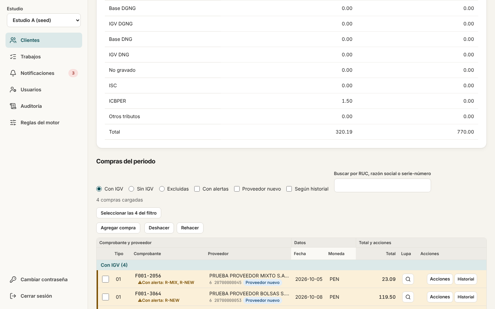
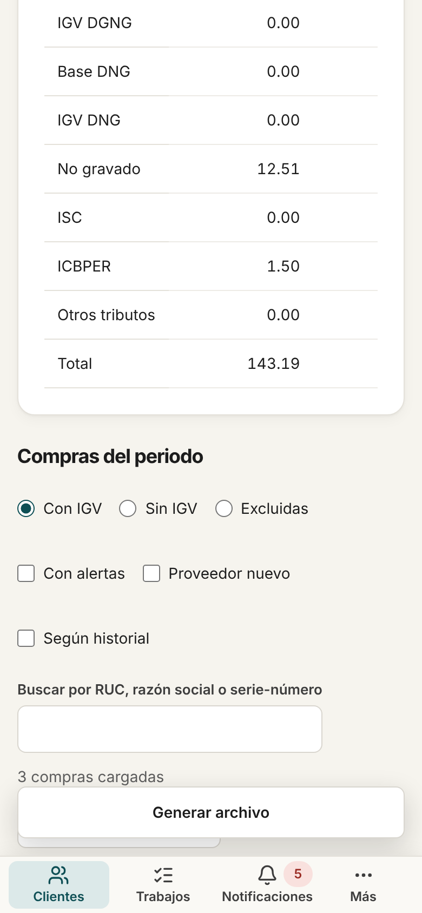

# 08 · Compras (RCE)

> Anterior: [07 · Ventas (RVIE)](07-ventas.md) · Siguiente: [09 · La lupa y el XML](09-lupa-y-xml.md) · Índice: [00-indice.md](00-indice.md)

Al terminar este módulo vas a poder descargar las compras de un periodo, revisarlas en una grilla tipo Excel, corregir montos con el teclado viendo el cuadre en vivo, clasificar, aplicar las sugerencias de las reglas, excluir lo que no es deducible, agregar compras que faltan, deshacer y exportar a Excel. Cómo hacer que ContApp recuerde la clasificación de un proveedor está en el [módulo 13](13-reglas-aprendidas.md).

## Para qué sirve

La propuesta del Registro de Compras Electrónico (RCE) que arma SUNAT casi nunca está lista para aceptarse tal cual. Los errores típicos que corrige un contador cada mes:

- Un **ISC registrado como base gravada** (el caso «San Juan»: una base de 770.00 con IGV 0.00).
- Una **compra mixta** con todo en base gravada, aunque una parte no está gravada (21.48 de base con 1.61 de IGV, cuando el 18 % de 21.48 sería 3.87).
- **Redondeos** que hacen que la suma de columnas no dé el total.
- **Proveedores nuevos** que hay que clasificar (¿crédito fiscal en DG, DGNG o DNG?).
- **Gastos personales** que no deben entrar al registro (unas zapatillas).

La pantalla **Compras** reúne todo eso. Es una hoja de cálculo con reglas de contador: cada fila muestra sus alertas, te propone la corrección y tú decides. Nada se aplica solo, y la propuesta original de SUNAT nunca se modifica: cada cambio crea una versión nueva de la fila, así que siempre puedes ver qué había antes y deshacer.

Se usa una vez por periodo y por cliente, después de descargar la propuesta y antes de generar el archivo de reemplazo (módulo 10).

## Quién puede usarlo

Los permisos salen de `packages/shared/src/acceso/roles.ts`. Dueño y Administrador ven todos los clientes; los demás roles, solo los asignados.

| Rol | Qué puede hacer en Compras |
|---|---|
| Dueño, Administrador | Todo, en todos los clientes. |
| Contador | Todo en sus clientes: descargar, editar, clasificar, aceptar sugerencias, excluir, agregar, deshacer, marcar revisado, **reabrir** y seguir editando un periodo **revisado**. También «Recordar» la clasificación de un proveedor ([módulo 13](13-reglas-aprendidas.md)). |
| Asistente | Descargar, editar, clasificar, aceptar, excluir, restaurar, agregar, descartar, deshacer y marcar revisado, solo con el periodo **abierto**. No ve el aviso «Recordar». |
| Lectura | Ver la grilla, filtrar, abrir el «Historial», ver el resumen y «Exportar a Excel». No ve «Acciones» ni puede editar; arriba aparece «No tienes permiso para modificar las compras.». |

| Permiso | Para qué |
|---|---|
| `clientes.ver` | Abrir la pantalla, ver, filtrar, «Historial» y «Exportar a Excel». Sin él: «No tienes permiso para ver las compras de este cliente.». |
| `sire.descargar` | Botón «Descargar». |
| `sire.clasificar` | Editar celdas, «Acciones» (clasificar, aceptar sugerencias, excluir, restaurar, descartar), acciones sobre la selección, «Agregar compra», «Deshacer», «Rehacer» y «Marcar como revisado». |
| `sire.aprobar_generar` | «Reabrir», modificar un periodo revisado y generar el archivo. |
| `reglas.gestionar` | El aviso «¿Recordar para este proveedor en este cliente?» al clasificar ([módulo 13](13-reglas-aprendidas.md)). |

## Antes de empezar

- Entorno levantado ([01](01-preparar-entorno.md)), sesión iniciada ([02](02-entrar-a-contapp.md)), cliente `20700000002` creado ([05](05-clientes.md)) y su credencial SIRE guardada con una clave inventada ([06](06-credenciales-y-trabajos.md)).
- Mejor una pantalla de al menos 1366 px de ancho: la grilla tiene muchas columnas. En un celular también se puede usar: la grilla se desplaza hacia los lados y «Generar archivo» queda fijo abajo (ver «Qué ves en pantalla»).
- Cómo llegar: «Clientes» → el cliente → enlace «Compras» del encabezado de su ficha. Desde Ventas, botón «Compras» del encabezado.

## Paso a paso

### Descargar la propuesta

1. Escribe el periodo en «Periodo (AAAAMM)», por ejemplo `202610`.
2. Haz clic en «Descargar». Verás «En cola · posición N» y luego «Descargando la propuesta…». El enlace «Ver en el panel de trabajos» lleva a `/trabajos`.
3. Espera. La grilla se carga sola al terminar.

**Resultado esperado:** «5 nuevas, 0 distintas», «Última descarga: <fecha>» y la grilla con las compras. Si falla: «La descarga falló: <motivo>» y «Reintentar». Volver a descargar **complementa**, como en ventas: agrega solo las compras nuevas, no toca las que ya trabajaste y lista las que llegaron con otros valores en «Diferencias de la última descarga» (comprobante, «Origen guardado» y «Valor del SIRE»). Ver el [módulo 07](07-ventas.md#volver-a-descargar-descarga-complementaria).

### Recorrer la grilla, filtrar y buscar

1. Arriba de la grilla elige la vista: «Con IGV» (la de entrada), «Sin IGV» o «Excluidas». Una compra va a «Sin IGV» cuando la suma de sus tres IGV es 0.00.
2. Marca «Con alertas» para ver solo las filas con hallazgos, «Proveedor nuevo» para las de proveedores sin historial en el cliente, «Según historial» para las que ContApp clasificó sola con una regla aprendida, o «DNG por perfil del cliente» para las que tienen la sugerencia del modo estándar R-STD ([módulo 13](13-reglas-aprendidas.md)).
3. En «Buscar por RUC, razón social o serie-número» escribe, por ejemplo, `CALZADO`, `20700000061` o `F001-2056`. Busca solo al dejar de teclear; Enter busca de inmediato.
4. Muévete con el teclado: flechas, Tab y Shift+Tab, Re Pág / Av Pág, Inicio y Fin (con Ctrl, a la primera o la última celda). La barra espaciadora marca o desmarca la fila.

**Resultado esperado:** el contador debajo de los filtros dice «N compras cargadas», o «Ninguna compra coincide con los filtros.». Los filtros piden los datos al servidor: con miles de filas, la grilla se puede usar desde el primer bloque mientras dice «Cargando…».

### Editar una fila con el teclado (cuadre en vivo)

1. Ubícate en una celda de monto (por ejemplo «Base DG» de F001-3064) y pulsa Enter o F2, o haz doble clic.
2. Escribe el monto nuevo. Tab pasa a la siguiente celda de monto **sin guardar**.
3. Debajo de la grilla aparece «Editando F001-3064 · Total …»: el total se recalcula al instante. Unos 300 ms después de dejar de teclear, ContApp revisa el cuadre y marca en rojo la celda que no cuadra, con su explicación (por ejemplo «IGV DG: 18.00 no es 18 % ni 10 % de 200.00 (No cuadra)»).
4. Para guardar, pulsa Enter, o una flecha arriba/abajo para guardar y pasar a otra fila. Se envía **una sola** corrección con todas las celdas que cambiaste. Esc descarta todo.

**Resultado esperado:** «Cambios guardados.» y el resumen se actualiza. Un descuadre no impide guardar: se guarda y queda señalado (lo que bloquea es la prevalidación del módulo 10). El total no se edita: siempre es la suma de las 10 columnas.

### Clasificar una compra

1. En la fila, haz clic en «Acciones» (columna de la derecha).
2. Elige «Clasificar como DG», «Clasificar como DGNG» o «Clasificar como DNG».

**Resultado esperado:** «Compra clasificada.». El servidor mueve la base y el IGV al casillero elegido y la columna «Destino» pasa de «Por clasificar» a «Clasificada». Si el proveedor era nuevo, su alerta R-NEW desaparece.

Si tienes el permiso `reglas.gestionar`, abajo a la izquierda aparece además el aviso «¿Recordar para este proveedor en este cliente?» con el proveedor, el destino y el botón «Recordar» (o Alt+R). No toma el foco ni corta tu trabajo con el teclado, y se oculta solo a los 10 segundos. Si lo aceptas, las compras de ese proveedor que lleguen en las próximas descargas vendrán ya clasificadas. El detalle está en el [módulo 13](13-reglas-aprendidas.md).

### Entender los hallazgos de las reglas

Cada fila con hallazgos muestra «⚠ Con alerta: R-…» en la columna «Comprobante» y la explicación con cifras en la columna «Con alerta». Lo que significan, en lenguaje de contador:

| Regla | Nombre en pantalla | Cuándo aparece | Qué te sugiere |
|---|---|---|---|
| R-ISC | «ISC en la base» | Hay base gravada con IGV 0 en un destino: lo más probable es que sea ISC mal registrado. | Mover ese monto de la base a la columna ISC. El total no cambia. |
| R-MIX | «Compra mixta» | El IGV no es el 18 % ni el 10 % de la base: parte de la compra no está gravada. | Separar la base en gravado (con IGV) y no gravado. Sin XML te pide el monto gravado; con XML lo trae exacto. |
| R-RED | «Redondeo» | La suma de las columnas no da el total por céntimos. | Ajustar el total a la suma (o la columna que indique el XML). |
| R-NEW | «Proveedor nuevo» | El proveedor no aparece en otros periodos de este cliente. En el primer periodo de un cliente, todos son nuevos. | Elegir el destino (DG, DGNG o DNG). |
| R-STD | «DNG por perfil» | El cliente es de la Amazonía, vende exonerado y no tiene ventas mixtas, y la compra tiene base en DG o DGNG de un proveedor sin regla aprendida. Solo en esos clientes ([módulo 13](13-reglas-aprendidas.md)). | Pasar la compra a DNG. No pide dato ni confirmación. |
| R-GP | «Glosa de gasto personal» | La descripción del XML tiene una palabra típica de consumo personal (zapatilla, polo, casaca…). Es un indicio, no una prueba. | Excluir la compra del registro. |

Las reglas que miran el XML (R-MIX exacta, R-ISC con el ISC del XML, R-GP) dependen de que el XML haya llegado. En tu entorno de prueba, el XML simulado entra en las reglas solo si `XML_SIMULADO_EN_REGLAS=1` (así viene en `.env.example`). Ver [09 · La lupa y el XML](09-lupa-y-xml.md).

### Aplicar una sugerencia

1. En la fila, «Acciones» → «Aceptar sugerencias».
2. El diálogo lista cada hallazgo («R-MIX · Compra mixta») con su explicación y un botón «Aceptar».
3. Según la regla, pasa una de tres cosas:
   - Se aplica directo (sugerencia exacta respaldada por el XML).
   - Te pide confirmar: «Esta sugerencia pide tu confirmación antes de aplicarse.» seguido de la explicación. Haz clic en «Confirmar».
   - Te pide un dato: «Monto gravado (base con IGV)» (R-MIX sin XML) o «Destino de la compra» (R-NEW). Complétalo y haz clic en «Aceptar sugerencia».

**Resultado esperado:** «Sugerencia aceptada.», la fila con los montos nuevos y el resumen actualizado. Si otra persona cambió la fila o la sugerencia ya no corresponde, verás «La sugerencia cambió. Se recargó la fila: revísala.».

### Aplicar en bloque

1. Marca las casillas «Seleccionar …» de varias filas, o haz clic en «Seleccionar las N del filtro» (cuando la carga terminó, hasta 5.000).
2. Aparece la barra «Acciones sobre la selección» con «N seleccionadas» y los botones «Clasificar como DG», «Clasificar como DGNG», «Clasificar como DNG», «Excluir», «Restaurar», «Aceptar R-RED», «Aceptar R-STD» y «Quitar selección».
3. Elige la acción.

**Resultado esperado:** el diálogo «Resultado de la acción masiva» con «N aplicadas» y, si hubo, «N rechazadas» y la tabla «Compras rechazadas» (comprobante y motivo, por ejemplo «Otra persona la cambió; se recargó la fila.»). Cierra con «Cerrar». En bloque **solo** se acepta R-RED, y solo la que no pide confirmación; las demás sugerencias se aceptan fila por fila. Para «aplicar a todas las del proveedor», busca su RUC y usa «Seleccionar las N del filtro». Si todas las filas que clasificaste en bloque son del mismo proveedor, aparece también el aviso «¿Recordar para este proveedor en este cliente?» ([módulo 13](13-reglas-aprendidas.md)).

### Excluir y restaurar una compra

1. «Acciones» → «Excluir».
2. En el diálogo, escribe el «Motivo (opcional)» (hasta 200 caracteres, una línea), por ejemplo «Gasto personal: zapatillas», y haz clic en «Excluir».
3. Para devolverla: vista «Excluidas» → «Acciones» → «Restaurar».

**Resultado esperado:** «Compra excluida.»; la compra sale de la vista principal y de los totales y aparece en «Excluidas» con la marca «Excluida». Al restaurar, «Compra restaurada.». Una compra excluida no se puede editar: primero se restaura.

### Agregar una compra que falta

1. Haz clic en «Agregar compra» (encima de la grilla).
2. Completa «Tipo» (viene `01`), «Serie», «Número», «Tipo de documento del proveedor» (viene `6`), «Documento del proveedor», «Razón social», «Fecha de emisión», «Moneda» (en USD el «Tipo de cambio» es obligatorio) y las columnas de monto. El «Total» se calcula en vivo.
3. Haz clic en «Agregar». («Subir XML» llena el formulario desde un XML: módulo 09.)

**Resultado esperado:** «Compra agregada.»; la fila aparece resaltada con la marca «Agregada». Si el comprobante ya existe (aunque esté excluido), verás «Ya existe en la propuesta» y el botón «Ubicar la compra existente», que te lleva a esa fila. No hay un botón «Duplicar»: cada compra se agrega con su propio formulario.

### Descartar una compra agregada

1. En una fila «Agregada», «Acciones» → «Descartar».
2. Confirma: «¿Descartar la compra F002-1234 agregada a mano?».

**Resultado esperado:** «Compra descartada.»; sale de la lista y del resumen y no cuenta como excluida. Solo las agregadas se descartan; las del SIRE se excluyen. Excluir una agregada equivale a descartarla (te avisa: «Esta compra se agregó a mano: excluirla equivale a descartarla. ¿Continuar?»).

### Deshacer y rehacer (Ctrl+Z / Ctrl+Y)

1. Con el foco en la grilla (no dentro de un campo en edición), pulsa Ctrl+Z para deshacer tu última operación y Ctrl+Y (o Ctrl+Shift+Z) para rehacerla. También están los botones «Deshacer» y «Rehacer».
2. Una acción en bloque es **un solo** paso.

**Resultado esperado:** «Se deshizo la operación (N compras).» o «Se rehízo la operación (N compras).»; las filas afectadas se recargan y muestran «Actualizada» un momento.

Detalles que conviene saber:

- El atajo solo funciona si hiciste algo en esta pantalla desde que la abriste. El botón «Deshacer» funciona siempre, pero entonces pide confirmar: «Se deshará la última operación del periodo, aunque no la hayas hecho en esta pantalla. ¿Continuar?».
- Si otra persona cambió alguna de esas filas, verás «Otra persona cambió estas filas» con los comprobantes y el botón «Ver filas»; no se reintenta solo.
- No se deshacen: agregar, descartar, excluir una agregada y los cambios de estado del periodo.
- Sin nada pendiente: «No hay nada que deshacer.».

### Ver el historial de una fila

1. En la fila, haz clic en «Historial».
2. El panel «Historial de la compra» muestra el «Valor original del SIRE» frente al «Valor vigente» por casillero (con «(cambió)»), las «Versiones» («Versión N · usuario · fecha» y la acción: «Original del SIRE», «Editada», «Clasificada», «Sugerencia aceptada», «Excluida», «Restaurada», «Deshecha», «Según historial»…) y los «Hallazgos». La versión que crea una regla aprendida no tiene usuario: dice «Según historial» en lugar del nombre.
3. Ciérralo con «Cerrar».

### Revisar el resumen y las diferencias con la propuesta

El panel «Resumen del periodo» es del **periodo entero** («no cambia con los filtros de la grilla»). Tiene dos tablas:

1. Por casillero: «Original del SIRE», «Vigente» y «Diferencia», con signo y texto: «+770.00 (aumenta)», «-177.00 (disminuye)», «0.00 (sin cambio)».
2. «Con IGV y sin IGV»: los mismos casilleros repartidos entre «N compras con IGV» y «N compras sin IGV».

Todo va en soles: las compras en USD se convierten con su tipo de cambio. Si una no tiene tipo de cambio, no suma y verás «1 compra en USD no se incluye en el resumen: falta su tipo de cambio.». Las excluidas y las descartadas no suman en «Vigente».

### Marcar el periodo como revisado o reabrirlo

Igual que en ventas: en «Estado del periodo», «Marcar como revisado» → «Confirmar» («Periodo marcado como revisado.»); para volver, «Reabrir» → «Confirmar» («Periodo reabierto.»). Con el periodo revisado, quien no tiene `sire.aprobar_generar` ve la grilla en solo lectura; con el periodo generado, nadie edita hasta reabrir.

### Exportar a Excel

1. Haz clic en «Exportar a Excel» (junto al periodo). Mientras tanto dice «Exportando…».

**Resultado esperado:** se descarga `compras-202610.xlsx` con dos hojas: «Compras» (las vigentes) y «Excluidas». Exporta el periodo entero, no el filtro. Si falla: «No se pudo exportar el Excel.».

## Qué ves en pantalla

*La pantalla «Compras» en escritorio: el periodo y «Exportar a Excel», el estado del periodo, «Generar archivo», la descarga, el «Resumen del periodo» y la grilla con sus filtros.*

*Compras en un celular: el menú pasa a la barra inferior, la grilla se desplaza hacia los lados y «Generar archivo» queda fijo abajo, sobre la barra.*

En pantallas de menos de 1024 px de ancho las columnas de los extremos dejan de estar fijas, para que no tapen el resto; el orden de las columnas no cambia. En un celular (menos de 768 px), el botón «Generar archivo» se queda fijo al pie de la pantalla, a todo lo ancho.

**Columnas de la grilla** (en pantallas anchas, comprobante y proveedor quedan fijos a la izquierda; total y acciones, a la derecha)

| Columna | Qué muestra |
|---|---|
| Seleccionar | Casilla para las acciones en bloque. |
| Tipo | Código del comprobante (`01` factura…). |
| Comprobante | Serie-número, «⚠ Con alerta: R-…», «Agregada», «Excluida», «Actualizada». |
| Proveedor | Razón social (o «(sin razón social)»), tipo y número de documento y las marcas «Proveedor nuevo» o «Según historial» (la clasificó una regla aprendida, [módulo 13](13-reglas-aprendidas.md)). |
| Fecha, Moneda | Fecha de emisión; moneda y, en USD, «TC 3.300». |
| Destino | «DG», «DGNG», «DNG», «Mixta» (base en más de un casillero) o «Sin base», y «Clasificada» / «Por clasificar». Es informativo: lo calcula la pantalla según qué bases tienen monto. |
| Con alerta | Cada regla con su explicación. |
| DG (Base, IGV), DGNG (Base, IGV), DNG (Base, IGV), No gravado, ISC, ICBPER, Otros | Las 10 columnas de monto editables, en la moneda del comprobante. |
| Total | Suma de las 10 columnas. No se edita. |
| Lupa | Botón «Ver comprobante» que abre la lupa (módulo 09). El encabezado dice «Lupa». |
| Acciones | Menú «Acciones» y botón «Historial». |

Los encabezados de la grilla separan las filas en «Con IGV (N)», «Sin IGV (N)» y «Excluidas (N)».

**Avisos de edición**

| Texto | Significado |
|---|---|
| «Editando F001-3064 · Total …» | Hay una fila abierta; el total es el que estás tecleando. |
| «Hay cambios sin guardar» | Tocaste celdas que aún no se enviaron. |
| «(No cuadra)» junto a una explicación | El IGV o el total de esa celda no cuadran. |
| «Cuadre no verificado» | No se pudo consultar el cuadre; el total local sigue siendo correcto. |
| «El monto admite como máximo 2 decimales: corrígelo para guardarlo.» | La celda no se envía hasta corregirla. |

## Reglas y límites

| Mensaje que ves | Por qué | Qué hacer |
|---|---|---|
| «Faltan las credenciales SOL o SIRE del cliente: configúralas para descargar.» | No hay credencial guardada. | Módulo 06. |
| «Otra persona cambió esta compra. Se recargó la fila: revisa y repite.» | Alguien guardó otra versión de la fila mientras la tenías abierta. | Revisa lo que dejó y repite tu cambio. |
| «La compra está excluida: restáurala antes de modificarla.» | Intentaste editar una excluida. | «Restaurar» primero. |
| «Solo se pueden descartar las compras agregadas a mano.» | Intentaste descartar una del SIRE. | Exclúyela. |
| «Ya existe en la propuesta» | El comprobante ya está en el periodo. | «Ubicar la compra existente». |
| «El tipo de cambio es obligatorio en USD.» | Agregaste una compra en USD sin tipo de cambio. | Escríbelo. |
| «El periodo está revisado: solo quien puede aprobar y generar lo modifica.» | Periodo revisado y tu rol no aprueba. | Pide a un Contador o al Dueño, o que lo reabra. |
| «El periodo ya está generado: reábrelo para modificarlo.» | Ya se generó el archivo. | «Reabrir» (con `sire.aprobar_generar`); luego habrá que generar de nuevo. |
| «El cliente está archivado: las compras son de solo lectura.» | Cliente archivado. | Reactívalo (módulo 05). |
| «Hay más de 5000 compras en el filtro: filtra más para seleccionarlas.» | La selección en bloque tiene tope de 5.000. | Filtra más. |
| «Solo se puede pegar un valor en la celda; no se pegan varias celdas a la vez.» | Pegaste un rango copiado de Excel. | Pega celda por celda. |

Otros límites: el total, la fecha, el proveedor y la moneda no se editan en la grilla. Las acciones se aplican con la versión de la fila que tienes en pantalla; si cambió, el sistema te avisa en vez de pisar el cambio ajeno.

## Pruébalo con los datos de prueba

Usa el cliente `20700000002`, su credencial SIRE guardada y el periodo `202610`. La propuesta es `fixtures/sire/20700000002-compras-202610.json` (5 compras). Haz los pasos en orden.

1. **Descarga.** «Descargar» → «5 nuevas, 0 distintas». En «Con IGV» hay 4 compras («4 compras cargadas»): F001-2056, F001-3064, F001-4062 y F001-5070. En «Sin IGV» está la quinta, F001-1040.
2. **Resumen inicial.** En «Resumen del periodo»: «Base DG» 1,041.98, «IGV DG» 46.71, «ICBPER» 1.50 y «Total» 1,090.19, con «Original del SIRE» igual a «Vigente» y «0.00 (sin cambio)». En la otra tabla: «4 compras con IGV» y «1 compra sin IGV».
3. **Alertas.** Es el primer periodo del cliente, así que todas las filas tienen R-NEW («Proveedor nuevo: elige la clasificación»). F001-1040 muestra además R-ISC y F001-2056, R-MIX («1.61 no es 18 % ni 10 % de 21.48»). Con `XML_SIMULADO_EN_REGLAS=1`, espera unos segundos a que lleguen los XML y **recarga la página** (F5). Al recargar, la pantalla olvida el periodo: vuelve a escribir `202610`, o abre directamente la dirección terminada en `/compras?periodo=202610`: F001-2056 dirá «…; el XML indica gravado 8.97», F001-1040 «Base gravada con IGV 0: el XML indica ISC» y F001-5070 tendrá R-GP («Posible gasto personal: la glosa dice "zapatilla"»).
4. **Editar con teclado (ICBPER).** En F001-3064 ve a «Base DG», Enter, escribe `200.00`, Tab. Verás «Editando F001-3064 · Total 219.50» y «IGV DG: 18.00 no es 18 % ni 10 % de 200.00 (No cuadra)». Escribe `36.00`: «Total 237.50» y desaparece «No cuadra». Enter: «Cambios guardados.»; el total del resumen pasa a «1,090.19 | 1,208.19 | +118.00 (aumenta)». Fíjate en que el ICBPER 1.50 sigue en su columna: no es base ni IGV. Ahora, con el foco en la grilla, Ctrl+Z: «Se deshizo la operación (1 compras).» y todo vuelve a 1,090.19.
5. **San Juan (R-ISC).** Vista «Sin IGV», F001-1040: Base DG 770.00, IGV DG 0.00, total 770.00. «Acciones» → «Aceptar sugerencias» → «Aceptar» en R-ISC. Sin XML te pide confirmar («…Base gravada 770.00 con IGV 0: posible ISC»): «Confirmar». Con XML se aplica directo. Resultado: «Sugerencia aceptada.», Base DG 0.00, ISC 770.00 y total 770.00. En el resumen: Base DG «1,041.98 | 271.98 | -770.00 (disminuye)», ISC «0.00 | 770.00 | +770.00 (aumenta)» y el Total sigue «0.00 (sin cambio)».
6. **Mixta (R-MIX).** Vista «Con IGV», F001-2056: Base DG 21.48, IGV DG 1.61, total 23.09. «Acciones» → «Aceptar sugerencias» → «Aceptar» en R-MIX. Sin XML aparece «Monto gravado (base con IGV)»: escribe `8.97` y haz clic en «Aceptar sugerencia» (el rango válido va de 8.92 a 8.97; fuera de él se rechaza). Con XML se aplica directo con 8.97. Resultado: Base DG 8.97, IGV DG 1.61, No gravado 12.51 y total 23.09. En el resumen, Base DG vigente 259.47 y No gravado «+12.51 (aumenta)».
7. **USD.** Mira F001-4062: «Moneda» USD con «TC 3.300» y montos en dólares (0.15, 0.03, 0.18). En el resumen esa compra suma convertida a soles (0.50 de base, 0.10 de IGV, 0.60 de total), por eso el total del periodo es 1,090.19. No sale el aviso de USD sin tipo de cambio.
8. **Zapatilla (R-GP o exclusión manual).** Si ves R-GP en F001-5070, «Aceptar sugerencias» → «Aceptar» → «Confirmar»: la compra pasa a «Excluidas». Si no lo ves (sin XML en las reglas), hazlo a mano: «Acciones» → «Excluir», motivo «Gasto personal: zapatillas», «Excluir». En ambos casos: «Con IGV» queda con 3 filas y el Total del resumen pasa a «1,090.19 | 913.19 | -177.00 (disminuye)». En «Excluidas» la verás con la marca «Excluida». Haz clic en su «Historial»: verás la versión «Excluida» (y el motivo, si lo escribiste). Luego «Acciones» → «Restaurar»: «Compra restaurada.» y el total vuelve a 1,090.19.
9. **Clasificar en bloque y deshacer.** Marca «Seleccionar F001-3064», «Seleccionar F001-4062» y «Seleccionar F001-5070». En la barra, «Clasificar como DNG». El informe dice «3 aplicadas» y abajo «3 aplicadas · 0 rechazadas». Las tres pasan a «DNG · Clasificada» y pierden la alerta R-NEW. Ctrl+Z: «Se deshizo la operación (3 compras).» y vuelven a «Por clasificar». Ctrl+Y: «Se rehízo la operación (3 compras).».
10. **Agregar, duplicado y descartar.** «Agregar compra»: serie `F002`, número `1234`, fecha 2026-10-20, documento `20700000096`, razón social `PRUEBA AGREGADA`, Base DG `100.00`, IGV DG `18.00`. El Total muestra 118.00. «Agregar»: «Compra agregada.» y la fila F002-1234 con «Agregada». Repite con la misma serie y número: «Ya existe en la propuesta» → «Ubicar la compra existente». Después, en F002-1234, «Acciones» → «Descartar» → «Confirmar»: «Compra descartada.».
11. **Exportar.** «Exportar a Excel» descarga `compras-202610.xlsx` con las hojas «Compras» y «Excluidas».
12. **Estado.** «Marcar como revisado» → «Confirmar». Si entras con un Asistente asignado al cliente, verás «El periodo está revisado: solo quien puede aprobar y generar lo modifica.», con «Agregar compra» y «Acciones» deshabilitados. Con el Dueño, «Reabrir» → «Confirmar».
13. **Descarga complementaria.** «Descargar» otra vez: «0 nuevas, 0 distintas». Tus correcciones siguen ahí.

**Para ver un error de descarga:** sin credencial guardada verás «Faltan las credenciales SOL o SIRE del cliente: configúralas para descargar.». Con un cliente cuyo RUC termine en 8 (`20700000088`) y su credencial guardada: «La descarga falló: Datos inválidos» con «Reintentar» (que vuelve a fallar igual). Con RUC terminado en 9 (`20700000029`): «La descarga falló: Credencial inválida». Con RUC terminado en 7 (`20700000037`): tras los reintentos, «La descarga falló: SUNAT no responde». En ningún caso se guarda una compra.

## Problemas frecuentes

| Síntoma | Causa | Solución |
|---|---|---|
| No veo F001-1040 (San Juan). | Tiene IGV 0.00: está en la vista «Sin IGV». | Cambia la vista. |
| Enter no abre la celda. | Estás en una celda que no es de monto, la fila está excluida, el periodo está bloqueado o no tienes `sire.clasificar`. | Revisa el aviso de solo lectura de arriba. |
| Ctrl+Z no hace nada. | No hiciste ninguna operación en esta pantalla, o el foco está dentro de un campo. | Usa el botón «Deshacer» (pide confirmar) o saca el foco del campo. |
| R-MIX me pide el monto gravado y yo esperaba 8.97 automático. | El XML aún no llegó o el XML simulado no entra en las reglas. | Escribe 8.97, o espera, recarga y vuelve a intentar. |
| «La sugerencia cambió. Se recargó la fila: revísala.» | Llegó el XML o alguien cambió la fila después de que la abriste. | Vuelve a abrir «Aceptar sugerencias». |
| No aparece R-GP en la zapatilla. | R-GP necesita la glosa del XML. | Ver módulo 09, o excluye a mano. |
| El resumen no cambia al filtrar. | Es del periodo entero, a propósito. | Usa los filtros solo para la grilla. |
| La grilla se ve cortada. | Pantalla angosta. | Desplázate hacia la derecha dentro de la grilla. Para trabajar cómodo, usa al menos 1366 px. |

## Comprueba lo aprendido

1. Una compra tiene base gravada 770.00 e IGV 0.00. ¿Qué regla salta y qué cambia si aceptas su sugerencia?
2. Corregiste una celda, pero el IGV quedó descuadrado. ¿Puedes guardar? ¿Qué pasará al generar el archivo?
3. Clasificaste 40 compras en bloque y te equivocaste de casillero. ¿Cuál es la forma más rápida de volver atrás?
4. Un proveedor aparece como nuevo en todas sus compras del mes y quieres pasarlas todas a DG. ¿Cómo lo haces?
5. ¿Qué diferencia hay entre excluir y descartar?

Soluciones

1. R-ISC («ISC en la base»). La sugerencia mueve los 770.00 de «Base DG» a «ISC»; el total sigue en 770.00.
2. Sí, el descuadre no impide guardar: queda señalado. Pero la prevalidación del módulo 10 lo marcará como error y no te dejará generar hasta corregirlo.
3. Ctrl+Z con el foco en la grilla (o «Deshacer»): una acción en bloque se deshace en un solo paso.
4. Busca su RUC en «Buscar por RUC, razón social o serie-número», haz clic en «Seleccionar las N del filtro» y en la barra elige «Clasificar como DG».
5. Excluir saca una compra (del SIRE o no) del archivo y de los totales, con motivo opcional, y se puede restaurar. Descartar solo vale para compras agregadas a mano: la quita del todo y no cuenta como excluida.

## Para saber más

- Curso técnico: [12 · Compras](../curso/12-compras.md) · [08 · Dinero y dominio](../curso/08-dinero-y-dominio.md) (motor de reglas)
- Specs: [`docs/specs/014-compras-backend/spec.md`](../specs/014-compras-backend/spec.md) · [`docs/specs/015-compras-frontend/spec.md`](../specs/015-compras-frontend/spec.md) · [`docs/specs/011-motor-reglas/spec.md`](../specs/011-motor-reglas/spec.md) · [`docs/specs/038-diseno-visual/spec.md`](../specs/038-diseno-visual/spec.md) (diseño en escritorio y celular)
- Requisitos: RF-060 a RF-071, RF-080 a RF-083, RF-085 · HU-14 a HU-19, HU-23, HU-24.
- Siguiente paso: [09 · La lupa y el XML](09-lupa-y-xml.md) y luego [10 · Generar el archivo SIRE](10-generar-archivo.md).
