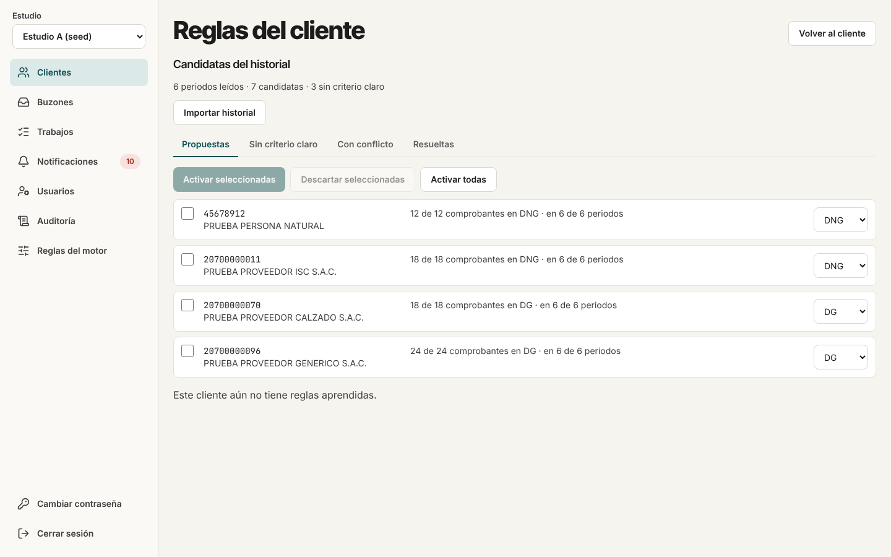

# 13 · Reglas aprendidas

> Anterior: [12 · Un mes de trabajo de punta a punta](12-un-mes-de-punta-a-punta.md) · Siguiente: [14 · Buzones SOL](14-buzones-sol.md) · Índice: [00-indice.md](00-indice.md)

Al terminar este módulo vas a poder pedirle a ContApp que recuerde cómo clasificas a un proveedor de un cliente, reconocer las compras que llegan clasificadas «Según historial», revertirlas si no corresponden, administrar las reglas del cliente, arrancar un cliente nuevo importando su historial del SIRE, usar el modo estándar para clientes de la selva y encender o apagar las reglas del motor del estudio.

## Para qué sirve

Cada mes llegan las compras de los mismos proveedores: la luz, el alquiler, el proveedor de insumos de siempre. Y cada mes alguien del estudio vuelve a decidir lo mismo: «esto va a DG», «esto va a DNG porque el cliente vende exonerado». Con muchos clientes, esa decisión repetida se come horas.

Las **reglas aprendidas** resuelven eso:

- **Clasificas una vez.** Al clasificar una compra, ContApp te pregunta «¿Recordar para este proveedor en este cliente?». Si dices que sí, guarda una regla: este proveedor, en este cliente, va a este destino (DG, DGNG o DNG).
- **ContApp la aplica sola en las próximas descargas.** Cuando descargas un periodo posterior, las compras nuevas de ese proveedor llegan ya clasificadas, con la etiqueta «Según historial».
- **Nada se pierde.** La propuesta del SIRE no se toca: la regla crea una versión nueva de la fila. Si no corresponde, la clasificas de nuevo y listo.

Piénsalo como la nota que deja el contador en el expediente del cliente: «al proveedor X, siempre a DNG». Solo que ContApp la lee por ti cada mes.

¿Y un cliente que recién llega al estudio? No tiene notas todavía, pero sí tiene meses ya presentados a SUNAT. Para no empezar de cero:

- **Importas su historial.** ContApp lee los últimos periodos presentados en el SIRE (6 por defecto, hasta 12) y te propone una regla por proveedor con su frecuencia, por ejemplo «18 de 18 comprobantes en DNG · en 6 de 6 periodos».
- **Tú decides.** Nada se aplica hasta que revisas y activas las reglas candidatas. Puedes cambiar el destino antes de activar, o descartarlas.
- **Modo estándar (R-STD).** Si el cliente es de la Amazonía, vende exonerado y no tiene ventas mixtas, ContApp sugiere DNG en las compras de proveedores sin regla, desde el primer periodo. Es una sugerencia: la aceptas una a una o en bloque.

Además, el estudio puede **encender o apagar las reglas del motor** (R-ISC, R-MIX, R-RED, R-NEW, R-GP, R-STD y la propia de reglas aprendidas, R-HIS) desde «Reglas del motor».

## Quién puede usarlo

| Rol | Ver reglas del cliente, candidatas y «Reglas del motor» | «Recordar», importar el historial, activar candidatas, editar, desactivar y eliminar reglas del cliente | Encender o apagar las reglas del motor |
|---|---|---|---|
| Dueño | Sí, de todos los clientes | Sí | Sí |
| Administrador | Sí, de todos los clientes | Sí | Sí |
| Contador | Sí, de sus clientes asignados | Sí, en sus clientes | No: ve los interruptores deshabilitados |
| Asistente | Sí, de sus clientes asignados | No | No |
| Lectura | Sí, de sus clientes asignados | No | No |

- Ver pide el permiso `reglas.ver` (todos los roles). Por eso todos ven «Reglas del motor» en el menú y el enlace «Reglas aprendidas» en la ficha del cliente.
- «Recordar» y cambiar reglas del cliente piden `reglas.gestionar` (Dueño, Administrador y Contador). Sin ese permiso no aparece el aviso «Recordar», ni el botón «Recordar para este proveedor» de la lupa, ni la columna «Acciones» de la tabla de reglas.
- «Importar historial», «Activar seleccionadas», «Activar todas», «Descartar seleccionadas» y «Reemplazar» también piden `reglas.gestionar`. Un Asistente o Lectura ve las candidatas y su «Destino propuesto», pero no los botones.
- Aceptar la sugerencia R-STD en la grilla de compras pide `sire.clasificar`, como cualquier otra sugerencia ([módulo 08](08-compras.md)).
- Los interruptores del motor piden `reglas.gestionar` **y** alcance global: solo Dueño y Administrador. Los demás ven «Solo un Dueño o Administrador con alcance global puede cambiar las reglas del estudio.».
- Una regla es de **un cliente**: nunca se aplica a otro cliente ni a otro estudio, aunque el proveedor sea el mismo.

## Antes de empezar

- Haz el [módulo 08 · Compras](08-compras.md): necesitas el cliente de prueba `20700000002` con su credencial SIRE guardada (clave inventada) y la propuesta de compras de `202610` descargada.
- Entra con un usuario que tenga `reglas.gestionar`, por ejemplo `ua@seed.contapp.test` (Dueño del «Estudio A (seed)»), contraseña de desarrollo `desarrollo-contapp-2026` (solo para pruebas locales).
- Ten claro el periodo en que aprendes la regla: la regla solo se aplica a descargas de **periodos posteriores**. Si la aprendes en `202610`, se aplica desde `202611`.
- Para importar el historial, el cliente necesita su **credencial SIRE** guardada ([módulo 06](06-credenciales-y-trabajos.md)), con valores de prueba.
- Para el modo estándar, el cliente necesita su perfil fiscal: «Zona», «Ventas exoneradas» y «Ventas mixtas» ([módulo 05](05-clientes.md)).

## Paso a paso

### Recordar la clasificación al clasificar una fila

1. En la grilla de compras, abre «Acciones» en la fila y elige «Clasificar como DG», «Clasificar como DGNG» o «Clasificar como DNG».
2. Verás «Compra clasificada.» y, abajo a la izquierda de la pantalla, el aviso «¿Recordar para este proveedor en este cliente?» con el proveedor y el destino (por ejemplo «PRUEBA PROVEEDOR · DNG»).
3. Haz clic en «Recordar», o pulsa Alt+R sin soltar el teclado.

**Resultado esperado:** «Regla guardada. Se aplicará en las próximas descargas de este proveedor.».

El aviso no toma el foco: puedes seguir trabajando en la grilla con el teclado. Si no lo aceptas, se oculta solo a los 10 segundos y no se guarda nada. No aparece si ya hay una regla activa de ese proveedor con ese mismo destino.

### Recordar al clasificar en bloque

1. Selecciona varias compras **del mismo proveedor** (por ejemplo, busca su RUC y usa «Seleccionar las N del filtro»).
2. En la barra «Acciones sobre la selección», elige «Clasificar como DG», «Clasificar como DGNG» o «Clasificar como DNG».
3. Junto con el informe «Resultado de la acción masiva» aparece, debajo de la barra, el aviso «¿Recordar para este proveedor en este cliente?». Pulsa Alt+R, o cierra el informe con «Cerrar» y haz clic en «Recordar». Recuerda que el aviso se oculta a los 10 segundos.

**Resultado esperado:** una sola regla para ese proveedor. Si la selección mezcla proveedores, el aviso no aparece: se recuerda un proveedor a la vez.

### Recordar desde la lupa

1. Abre la lupa de una compra ya clasificada ([módulo 09](09-lupa-y-xml.md)).
2. En las acciones, pulsa «Recordar para este proveedor».
3. En el aviso, haz clic en «Recordar».

**Resultado esperado:** «Regla guardada. Se aplicará en las próximas descargas de este proveedor.». El botón sale deshabilitado si la compra está por clasificar, es mixta o está excluida, o si ya hay una regla activa con ese destino («Ya hay una regla activa de este proveedor con este destino.»).

### Ver las compras clasificadas «Según historial»

1. Descarga un periodo **posterior** al de la regla ([módulo 08](08-compras.md)).
2. En la grilla, las compras de ese proveedor muestran la marca «Según historial» en la columna «Proveedor», con el destino de la regla y «Clasificada» en «Destino».
3. Para verlas juntas, marca el filtro «Según historial».
4. En la lupa, la cabecera también muestra «Según historial». En el «Historial» de la fila aparece la versión «Según historial», sin nombre de usuario: la creó ContApp, no una persona.

**Resultado esperado:** ya no tienes que clasificar esas compras. El resumen del periodo y el archivo que generes usan el destino de la regla. Esas filas ya no llevan la alerta R-NEW de proveedor nuevo.

### Revertir una compra «Según historial»

Si este mes una compra de ese proveedor no va al destino de siempre:

1. En la fila, «Acciones» → «Clasificar como …» con el destino correcto (o hazlo en bloque).
2. La etiqueta «Según historial» desaparece y ContApp no vuelve a aplicar la regla en esa fila.

**Resultado esperado:** la fila queda con tu destino. La regla **no cambia**: si quieres que cambie para los meses siguientes, acepta el aviso «Recordar» que aparece con el destino nuevo. Con Ctrl+Z vuelves a la versión «Según historial», igual que con cualquier otra operación ([módulo 08](08-compras.md)).

### Administrar las reglas del cliente

1. Abre la ficha del cliente y haz clic en «Reglas aprendidas» (en el encabezado, junto a «Compras» y «Ventas»).
2. Se abre «Reglas del cliente» (`/clientes/<id>/reglas`) con la tabla de reglas. «Volver al cliente» te devuelve a la ficha.
3. En la columna «Acciones» de cada regla:
   - **Cambiar el destino:** «Editar», elige el «Destino» y «Guardar» (o «Cancelar», o Esc).
   - **Pausar la regla:** «Desactivar». Para volver a usarla, «Activar».
   - **Borrarla:** «Eliminar» y «Confirmar» en «¿Eliminar la regla de …? Las próximas descargas ya no moverán sus compras al destino aprendido; lo ya clasificado no cambia.».

**Resultado esperado:** la tabla muestra el cambio al instante. Los cambios valen para las **próximas descargas**: lo que ya se clasificó no cambia. Una regla eliminada deja de mostrarse y de aplicarse, pero las compras que ya clasificó conservan su «Según historial». Si no hay reglas, verás «Este cliente aún no tiene reglas aprendidas.».

### Importar el historial de un cliente nuevo

1. Abre la ficha del cliente y haz clic en «Reglas aprendidas». Arriba de la tabla de reglas está la sección «Candidatas del historial». Si nunca importaste, dice «Aún no has importado el historial de este cliente.».
2. Pulsa «Importar historial». Se abre «Importar historial del cliente» con el aviso «No se aplica nada hasta que actives las reglas que se propongan.».
3. En «Periodos», elige cuántos meses leer (de 1 a 12; viene en 6). Se cuentan hacia atrás desde el mes anterior: en noviembre de 2026, 6 periodos son de `202605` a `202610`.
4. Pulsa «Importar» (o «Cancelar»).

**Resultado esperado:** mientras corre verás «Importando historial…» y en «Trabajos» un trabajo con el nombre técnico `reglas.historial.importar`. Al terminar, la sección muestra el resumen, por ejemplo «6 periodos leídos · 7 candidatas · 3 sin criterio claro», y debajo las candidatas. Si algún periodo no tenía registro, verás «Sin datos en: AAAAMM, …»: el resto se importa igual. Si falla, «La importación falló. Inténtalo de nuevo.».

ContApp no guarda las compras de esos meses: solo cuenta, por proveedor, cuántos comprobantes fueron a cada destino. Por eso esos periodos no aparecen en «Compras».

### Revisar y activar reglas candidatas

Las candidatas se reparten en cuatro pestañas:

| Pestaña | Qué hay | Qué puedes hacer |
|---|---|---|
| «Propuestas» | Proveedores con un destino claro, sin regla vigente. Cada uno con su frecuencia: «18 de 18 comprobantes en DNG · en 6 de 6 periodos». | Elegir otro destino en su lista, marcar la casilla («Seleccionar candidata de <documento>») y «Activar seleccionadas» o «Descartar seleccionadas»; o «Activar todas». |
| «Sin criterio claro» | Proveedores sin un destino dominante, con sus conteos: «18 en DG, 6 en DNG de 24 comprobantes». | Elegir el destino a mano en «Elige un destino» y pulsar «Activar», de una en una. |
| «Con conflicto» | Proveedores que ya tienen una regla viva. Verás «Regla vigente: <destino>». | Si el destino difiere, elegir el destino y «Reemplazar». Si es el mismo, dice «Ya aprendida: la regla vigente tiene este mismo destino.» y no hay nada que hacer. |
| «Resueltas» | Las candidatas ya activadas o descartadas de la última importación, con «Activada», «Descartada» o «Reemplazada» y el «Destino elegido». | Solo consultar. |

1. En «Propuestas», revisa la frecuencia de cada proveedor. Si un destino no te convence, cámbialo en su lista (DG, DGNG o DNG) antes de activar.
2. Marca las que quieras y pulsa «Activar seleccionadas». Verás «1 regla activada.» o «N reglas activadas.».
3. Para activar el resto de una vez, pulsa «Activar todas». La ventana confirma el total, por ejemplo «Se activarán 4 reglas. Quedan fuera 3 sin criterio claro y las que tengan conflicto con una regla vigente.». Pulsa «Confirmar».
4. Para no usar una candidata, márcala y pulsa «Descartar seleccionadas»: «1 candidata descartada.».

**Resultado esperado:** cada candidata activada se vuelve una regla normal en la tabla «Reglas del cliente», «Activa», con la marca «Importado del historial». Debajo de las candidatas sale «Las reglas rigen desde la próxima descarga. Para el periodo que ya está cargado, usa la corrección masiva filtrando por proveedor.» con el enlace «Ver compras del periodo». Si «Activar todas» omitió alguna, lo dice con su motivo, por ejemplo «1 omitida · conflicto con una regla vigente».

Desde ahí la regla se edita, desactiva o elimina como cualquier otra, y la próxima descarga de un periodo posterior al último importado la aplica con «Según historial».

### Usar el modo estándar (R-STD)

1. En la ficha del cliente, en «Datos fiscales», elige «Zona» «Amazonía», marca «Ventas exoneradas», deja sin marcar «Ventas mixtas» y pulsa «Guardar datos fiscales».
2. Descarga las compras del periodo ([módulo 08](08-compras.md)), o vuelve a evaluarlo.
3. Las compras con base gravada en DG o DGNG de proveedores sin regla activa muestran la alerta «R-STD: DNG por perfil del cliente».
4. Para aceptar una, «Acciones» → «Aceptar sugerencias» → «Aceptar» en R-STD. Para aceptar varias, marca el filtro «DNG por perfil del cliente», selecciónalas y pulsa «Aceptar R-STD» en la barra «Acciones sobre la selección».

**Resultado esperado:** la base y el IGV pasan a las columnas DNG, igual que si las clasificaras a mano como DNG, y la alerta desaparece. Al aceptar, aparece el aviso «¿Recordar para este proveedor en este cliente?» con DNG: si lo aceptas, el proveedor queda con regla y R-STD deja de sugerirlo.

R-STD no cambia nada solo: es una sugerencia. No aparece en compras que ya están en DNG, sin base gravada, ya clasificadas por alguien del estudio, ni de proveedores con regla activa (aunque sea DG). Cambiar el perfil del cliente no toca lo ya cargado: rige desde la próxima descarga o evaluación.

### Encender o apagar las reglas del motor

1. En el menú, haz clic en «Reglas del motor» (en celular, dentro de «Más»). Se abre `/configuracion/reglas`.
2. Verás «Enciende o apaga las reglas que revisan las compras de todo el estudio.» y una lista con un interruptor por regla: R-ISC, R-MIX, R-RED, R-NEW, R-GP, R-STD y R-HIS, cada una con su descripción y la marca «Activa» o «Inactiva». R-STD dice «Sugiere DNG en clientes de la Amazonía con ventas exoneradas y sin ventas mixtas.».
3. Haz clic en el interruptor de la regla que quieres apagar o encender.

**Resultado esperado:** la marca cambia a «Inactiva» o «Activa» cuando el servidor confirma. Una regla apagada no se evalúa en las evaluaciones siguientes, en ningún cliente del estudio; los hallazgos que ya estaban guardados no se borran. Apagar R-HIS hace que ninguna regla aprendida se aplique en las próximas descargas. Apagar R-STD hace que el modo estándar deje de sugerir DNG en todos los clientes.

Al final de la lista está «Aportar proveedores con RUC 20 al catálogo compartido» (ver «Reglas y límites»).

## Qué ves en pantalla

*La pantalla «Reglas del cliente»: cada regla con su proveedor, destino, estado, cuántas veces se aplicó y se aceptó, la fecha del último cambio y los botones «Editar», «Desactivar» y «Eliminar».*

*La sección «Candidatas del historial» tras importar: el resumen de la importación, las pestañas «Propuestas», «Sin criterio claro», «Con conflicto» y «Resueltas», y cada proveedor con su frecuencia, su destino y la casilla para activarlo.*

### Sección «Candidatas del historial»

| Elemento | Qué muestra |
|---|---|
| Resumen | «N periodos leídos · N candidatas · N sin criterio claro» y, si hubo, «Sin datos en: …». Las candidatas incluyen las «sin criterio claro». |
| Cada candidata | Número de documento, razón social del registro y la frecuencia: comprobantes en el destino sobre el total, y periodos en que aparece el proveedor sobre los periodos leídos. Si hubo comprobantes con base en varios destinos, añade «· N mixtos». |
| Lista de destino | DG, DGNG o DNG. Viene en el destino propuesto; si la cambias, se activa con el que elegiste. |
| Marca «Importado del historial» | En la tabla de reglas, bajo el proveedor: la regla nació de una candidata. |

### Tabla «Reglas del cliente»

| Columna | Qué muestra |
|---|---|
| «Proveedor» | Número de documento y, debajo, la razón social. |
| «Destino» | DG, DGNG o DNG: adónde manda la regla las compras de ese proveedor. |
| «Estado» | «Activa» (se aplica) o «Inactiva» (pausada). |
| «Aplicada» | Cuántas compras clasificó la regla en las descargas («Según historial»). |
| «Aceptada» | Cuántas de esas seguían en el destino de la regla cuando su periodo pasó a «Revisado». Las excluidas y las que quedaron sin base gravada no cuentan. |
| «Actualizada» | Fecha y hora (de Lima) del último cambio de la regla. |
| «Acciones» | «Editar», «Desactivar» o «Activar», y «Eliminar». Solo con `reglas.gestionar`. |

En un celular la tabla se apila: cada regla es una tarjeta con el nombre de cada columna delante de su dato.

«Aplicada» y «Aceptada» te dicen si la regla acierta: si «Aplicada» es 10 y «Aceptada» es 2, el contador está corrigiendo casi siempre lo que la regla propone, y conviene editarla o desactivarla.

### Marcas en compras

| Dónde | Qué ves |
|---|---|
| Grilla, columna «Proveedor» | La marca «Según historial» |
| Filtros de la grilla | La casilla «Según historial» |
| Lupa, cabecera | La marca «Según historial» junto a la razón social |
| «Historial» de la compra | La versión «Según historial», sin usuario |
| Grilla, columna «Con alerta» | «R-STD: DNG por perfil del cliente» (modo estándar) |
| Filtros de la grilla | La casilla «DNG por perfil del cliente» |
| Barra «Acciones sobre la selección» | El botón «Aceptar R-STD» |
| Auditoría ([módulo 11](11-auditoria-y-notificaciones.md)) | «Aplicó el destino según el historial», «Recordó una regla para un proveedor», «Editó…», «Activó…», «Desactivó…», «Eliminó una regla de un proveedor», «Cambió una regla del motor del estudio», «Importó el historial de un cliente», «Activó una regla del historial para un proveedor», «Descartó una candidata del historial» |

## Reglas y límites

Cuándo **sí** clasifica una regla una compra: es una compra **nueva** de una descarga, de un periodo **posterior** al periodo en que se aprendió la regla, de un proveedor con regla **activa**, con R-HIS encendida en el estudio y con base gravada distinta de cero.

Cuándo **no** la toca:

- Compras que ya existían antes de la descarga, de este u otros periodos. «Recordar» no reclasifica lo que ya está: para eso usa la clasificación en bloque del [módulo 08](08-compras.md).
- Volver a descargar el mismo periodo: las compras que ya tenías no se vuelven a clasificar.
- Compras sin base gravada, o que ya estaban en el destino de la regla.
- Compras del periodo en que aprendiste la regla, o de periodos anteriores.
- Ventas: las reglas aprendidas son solo de compras.
- «Agregar compra» y «Agregar desde XML»: el destino lo eliges tú.

Otras reglas:

- **Solo se aprende el destino.** Una regla no excluye compras, no cambia montos ni decide si un gasto es personal.
- **Una regla por proveedor y cliente.** Si ya hay una y pides «Recordar» con otro destino, se actualiza (gana el último). Si la regla estaba inactiva, «Recordar» la vuelve a activar con el destino nuevo.
- **Las demás reglas siguen funcionando.** Si una compra «Según historial» tiene además un ISC mal ubicado o una compra mixta, R-ISC y R-MIX la revisan igual, ya en el destino de la regla.
- **La prevalidación no se apaga.** En «Reglas del motor» no hay interruptor para los errores que bloquean la generación del archivo ([módulo 10](10-generar-archivo.md)).
- **Importar el historial no aplica nada.** Solo crea candidatas. Las reglas activadas rigen desde la próxima descarga de un periodo **posterior al último importado**; las compras que ya tienes cargadas no cambian (usa la clasificación en bloque con el filtro por proveedor).
- **Cómo se decide la propuesta.** Un comprobante cuenta para el destino donde tiene base gravada (las notas de crédito, por su valor absoluto). Si tiene base en dos destinos cuenta como «mixto»: suma al total, pero a ningún destino. Sin base gravada o sin proveedor identificable no cuenta. Se propone un destino si reúne **al menos el 80 %** de los comprobantes del proveedor **y al menos 2**; si no, o si hay empate, la candidata queda «sin criterio claro». También se propone DG: así el proveedor queda conocido y sale de R-STD.
- **Una importación a la vez por cliente.** Importar de nuevo reemplaza las candidatas pendientes de la anterior; las activadas y descartadas se conservan como historial.
- **Nunca se pisa una regla.** Si el proveedor ya tiene una regla viva, la candidata va a «Con conflicto» y solo cambia con «Reemplazar». «Activar todas» nunca incluye las «sin criterio claro» ni las que tienen conflicto.
- **Solo compras.** El historial importado es el registro de compras; las ventas no se importan.
- **Aporte al catálogo compartido.** Con el interruptor encendido, cada «Recordar» y cada compra «Según historial» aceptada de un proveedor con RUC que empieza en 20 deja un registro sin montos ni usuario, para un futuro catálogo de proveedores entre estudios. Proveedores con RUC 10 o sin RUC nunca se registran. Apagado, no se registra nada.

| Mensaje que ves | Por qué | Qué hacer |
|---|---|---|
| «La regla cambió mientras tanto. Revisa las reglas del cliente e inténtalo de nuevo.» | Otra persona cambió la regla mientras la tenías en pantalla. La tabla se vuelve a leer. | Revisa la regla y repite. |
| «Ya hay una regla activa de este proveedor con este destino.» | Pulsaste «Recordar para este proveedor» y la regla ya existe igual. | Nada: ya está recordada. |
| «Ya hay una importación en curso para este cliente.» | Pediste importar mientras otra importación seguía corriendo. | Espera a que termine. |
| «Configura primero la credencial del SIRE de este cliente.» | El cliente no tiene credencial SIRE. | Guárdala en su ficha ([módulo 06](06-credenciales-y-trabajos.md)). |
| «SUNAT rechazó la credencial del SIRE de este cliente. Actualízala e inténtalo de nuevo.» | La credencial SIRE está «Inválida». | Guarda la credencial correcta. |
| «La importación falló. Inténtalo de nuevo.» | El trabajo terminó con error (por ejemplo, la credencial fue rechazada durante la lectura). | Revisa la credencial SIRE y «Trabajos», y vuelve a importar. |
| «La regla está desactivada: no se aplica a este proveedor. Se reactiva desde la página de reglas.» | La candidata choca con una regla del proveedor que está «Inactiva». | Actívala en la tabla «Reglas del cliente». |
| «Las compras elegidas son de proveedores distintos. Recuerda un proveedor a la vez.» | Pediste recordar compras de varios proveedores. | Selecciona un solo proveedor. |
| «Las compras elegidas son de periodos distintos. Recuerda las compras de un solo periodo.» | Las compras son de varios periodos. | Recuerda desde un solo periodo. |
| «El cliente está archivado: sus reglas son de solo lectura.» | El cliente está archivado. | Reactívalo ([módulo 05](05-clientes.md)). |
| «Solo un Dueño o Administrador con alcance global puede cambiar las reglas del estudio.» | Entraste a «Reglas del motor» sin ser Dueño ni Administrador. | Pide el cambio a quien tenga ese rol. |
| «No tienes permiso para realizar esta acción.» | Tu rol no tiene `reglas.gestionar`. | Pide a un Contador, Administrador o Dueño. |

## Pruébalo con los datos de prueba

Usa el cliente `20700000002`, su credencial SIRE guardada y la propuesta `fixtures/sire/20700000002-compras-202610.json` del periodo `202610`, ya descargada. Entra como `ua@seed.contapp.test`.

**Aprender y administrar una regla**

1. **Recordar.** En la grilla de `202610`, en F001-3064 (proveedor `20700000053`), «Acciones» → «Clasificar como DG». Debe salir «¿Recordar para este proveedor en este cliente?» con el botón «Recordar». Haz clic: «Regla guardada. Se aplicará en las próximas descargas de este proveedor.».
2. **Pantalla de reglas.** Ve a la ficha del cliente y haz clic en «Reglas aprendidas». Verás «Reglas del cliente», el botón «Volver al cliente» y una fila con `20700000053`, destino DG, «Activa», «Aplicada» 0 y «Aceptada» 0 (todavía no hubo descargas posteriores).
3. **Editar.** «Editar» → «Destino» DGNG → «Guardar». La fila pasa a DGNG.
4. **Desactivar y activar.** «Desactivar»: el estado pasa a «Inactiva» y el botón cambia a «Activar». Vuelve a activarla.
5. **Sin permiso.** Abre la misma pantalla con un Asistente asignado al cliente: ves la tabla, pero sin la columna «Acciones». En sus compras, al clasificar no aparece el aviso «Recordar».

**Ver una regla aplicada en el mes siguiente**

El simulador no tiene propuesta propia de `202611` para este cliente: devuelve el conjunto genérico (`fixtures/sire/generico-compras.json`), con dos compras del proveedor `20700000096` (F001-6010 y F001-6012, ambas con la base en DG). Por eso primero enseñas a ContApp ese proveedor en `202610`.

6. **Aprender el proveedor genérico.** En `202610`, «Agregar compra»: serie `F002`, número `1234`, fecha 2026-10-20, documento `20700000096`, razón social `PRUEBA AGREGADA`, Base DG `100.00`, IGV DG `18.00` → «Agregar». En esa fila, «Acciones» → «Clasificar como DNG» y, en el aviso, «Recordar».
7. **Descargar el mes siguiente.** Cambia el periodo a `202611` y pulsa «Descargar»: «2 nuevas, 0 distintas». Las dos compras de `20700000096` llegan con «Según historial» en «Proveedor», destino DNG y «Clasificada», con la base y el IGV en las columnas DNG. Marca el filtro «Según historial»: quedan solo esas dos.
8. **Comprobar el original.** Abre el «Historial» de F001-6010: la versión 1 es «Original del SIRE» (con la base en DG) y la versión 2, «Según historial».
9. **Revertir una.** En F001-6012, «Acciones» → «Clasificar como DG». La marca «Según historial» desaparece y aparece el aviso «Recordar» con DG: **no** lo aceptes, para que la regla siga en DNG.
10. **Contadores.** En «Reglas del cliente», la regla de `20700000096` muestra «Aplicada» 2 y «Aceptada» 0. Marca `202611` como revisado («Marcar como revisado» → «Confirmar») y vuelve a la pantalla de reglas: «Aceptada» debería pasar a 1, porque F001-6012 ya no estaba en DNG.
11. **Eliminar.** «Eliminar» en la regla de `20700000096` → «Confirmar». La fila desaparece. F001-6010 conserva su «Según historial».

**Reglas del motor**

12. Como Dueño, en el menú, «Reglas del motor»: siete reglas «Activa». Apaga R-HIS y vuelve a encenderla.
13. Entra con `uab@seed.contapp.test` (Contador): los interruptores están deshabilitados y sale «Solo un Dueño o Administrador con alcance global puede cambiar las reglas del estudio.».
14. Como Dueño, en «Auditoría», verás «Recordó una regla para un proveedor», «Editó una regla de un proveedor», «Eliminó una regla de un proveedor», «Aplicó el destino según el historial» y «Cambió una regla del motor del estudio».

**Importar el historial y activar candidatas**

El cliente `20700000002` ya tiene descargado `202611` (pasos 6 a 11), y una regla nueva no toca compras que ya existen. Para ver el ciclo completo usa otro cliente: `20700000045`, que creaste con la importación del [módulo 05](05-clientes.md) (si no existe, créalo con «Nuevo cliente»).

El simulador no trae un registro presentado propio para este RUC: para cada periodo devuelve el mismo conjunto genérico (`fixtures/sire/generico-registro-compras.json`) con las fechas de ese mes. Con 6 periodos, el resultado es siempre este:

| Proveedor | Comprobantes en 6 periodos | Pestaña | Lo que verás |
|---|---|---|---|
| `45678912` PRUEBA PERSONA NATURAL (DNI) | 12, todos en DNG | «Propuestas» | «12 de 12 comprobantes en DNG · en 6 de 6 periodos» |
| `20700000011` PRUEBA PROVEEDOR ISC S.A.C. | 18, todos en DNG | «Propuestas» | «18 de 18 comprobantes en DNG · en 6 de 6 periodos» |
| `20700000070` PRUEBA PROVEEDOR CALZADO S.A.C. | 18 en DG, incluida una nota de crédito por mes | «Propuestas» | «18 de 18 comprobantes en DG · en 6 de 6 periodos» |
| `20700000096` PRUEBA PROVEEDOR GENERICO S.A.C. | 24, todos en DG | «Propuestas» | «24 de 24 comprobantes en DG · en 6 de 6 periodos» |
| `20700000045` PRUEBA PROVEEDOR MIXTO S.A.C. | 18 en DG y 6 en DNG (75 %, bajo el umbral) | «Sin criterio claro» | «18 en DG, 6 en DNG de 24 comprobantes» |
| `20700000061` PRUEBA PROVEEDOR USD S.A.C. | 6 en DG y 6 en DNG (empate) | «Sin criterio claro» | «6 en DG, 6 en DNG de 12 comprobantes» |
| `20700000053` PRUEBA PROVEEDOR BOLSAS S.A.C. | 6 en DG y 12 mixtos | «Sin criterio claro» | «6 en DG de 18 comprobantes» |

15. **Credencial.** En la ficha de `20700000045`, guarda la SOL (`PRUEBA01` / `CLAVEPRUEBA1`) y la SIRE (client_id `11111111-2222-3333-4444-555555555555`, client_secret `SECRETOPRUEBA1`), como en el [módulo 06](06-credenciales-y-trabajos.md).
16. **Importar.** «Reglas aprendidas» → «Importar historial». En el diálogo, «Periodos» viene en 6. Pulsa «Importar». En unos segundos: «6 periodos leídos · 7 candidatas · 3 sin criterio claro».
17. **Revisar.** En «Propuestas» hay cuatro candidatas, con la frecuencia de la tabla. En «Sin criterio claro», las otras tres. La tabla «Reglas del cliente» sigue vacía: nada se aplicó.
18. **Cambiar el destino y activar una.** En «Propuestas», en `20700000096`, cambia la lista a DNG, marca «Seleccionar candidata de 20700000096» y pulsa «Activar seleccionadas»: «1 regla activada.». En la tabla aparece `20700000096`, DNG, «Activa», «Aplicada» 0, «Aceptada» 0 y la marca «Importado del historial».
19. **Activar todas.** Pulsa «Activar todas»: «Se activarán 3 reglas. Quedan fuera 3 sin criterio claro y las que tengan conflicto con una regla vigente.». «Confirmar»: «3 reglas activadas.» y el aviso «Las reglas rigen desde la próxima descarga…». La tabla tiene cuatro reglas «Importado del historial». En «Resueltas» están las cuatro.
20. **Sin criterio claro.** En esa pestaña, en `20700000061`, elige DG en «Elige un destino» y pulsa «Activar». La regla se suma a la tabla.
21. **Descarga siguiente.** Abre «Compras» de este cliente con el periodo `202611` y pulsa «Descargar». Llegan las dos compras genéricas de `20700000096` (F001-6010 y F001-6012) con «Según historial» y destino DNG, porque elegiste DNG en el paso 18. Si hubieras dejado DG, no cambiarían: ya venían en DG.
22. **Conflicto.** Vuelve a «Importar historial» con 6 periodos. Las candidatas que activaste ahora tienen regla viva: van a «Con conflicto» con «Regla vigente: …» y «Ya aprendida: la regla vigente tiene este mismo destino.». La de `20700000096` debería mostrar «Regla vigente: DNG» y el botón «Reemplazar» (la propuesta es DG): si lo pulsas, sale «Regla reemplazada.» y la regla pasa a DG.

**Modo estándar con el cliente de Huánuco**

El RUC `20700000100` es el cliente de la selva de los datos de prueba. Su propuesta de `202610` (`fixtures/sire/20700000100-compras-202610.json`) trae cinco compras: cuatro con base en DG o DGNG y una (F003-8004) ya en DNG.

23. **Alta y perfil.** Crea el cliente `20700000100` ([módulo 05](05-clientes.md)). En «Datos fiscales», «Zona» «Amazonía», marca «Ventas exoneradas», deja «Ventas mixtas» sin marcar y «Guardar datos fiscales». Guarda su SOL y su SIRE con los valores de prueba.
24. **Descargar.** En «Compras», periodo `202610`, «Descargar». F001-8001, F001-8002, F002-8003 y F004-8005 muestran «R-STD: DNG por perfil del cliente». F003-8004 no, porque ya está en DNG. En el resumen, Base DG 1,005.00 y Base DNG 200.00.
25. **Aceptar en bloque.** Marca el filtro «DNG por perfil del cliente»: quedan cuatro. Selecciónalas y pulsa «Aceptar R-STD»: «4 aplicadas». Las cuatro pasan a DNG y el resumen muestra Base DG «1,005.00 | 0.00 | -1,005.00 (disminuye)», Base DGNG «150.00 | 0.00 | -150.00 (disminuye)» y Base DNG «200.00 | 1,355.00 | +1,155.00 (aumenta)».
26. **Apagar R-STD.** En «Reglas del motor», apaga R-STD: en las próximas descargas y evaluaciones ya no aparecerá. Vuelve a encenderla.

## Problemas frecuentes

| Síntoma | Causa | Solución |
|---|---|---|
| No aparece el aviso «Recordar» al clasificar. | Tu rol no tiene `reglas.gestionar`, ya hay una regla activa de ese proveedor con ese destino, o pasaron los 10 segundos. | Revisa tu rol o la pantalla «Reglas del cliente». Para volver a verlo, clasifica de nuevo o usa «Recordar para este proveedor» en la lupa. |
| Recordé un proveedor y sus compras del mismo mes siguen igual. | «Recordar» no toca compras que ya existen. | Clasifícalas en bloque ([módulo 08](08-compras.md)). La regla vale desde la próxima descarga de un periodo posterior. |
| Descargué el mes siguiente y nada salió «Según historial». | El proveedor no tiene compras en ese periodo, la regla está «Inactiva», R-HIS está apagada en «Reglas del motor», las compras no tienen base gravada o ya estaban en ese destino. | Revisa «Reglas del cliente» y «Reglas del motor». |
| Volví a descargar el periodo y no se aplicó la regla nueva. | La regla solo clasifica compras nuevas; las que ya tenías no se tocan. | Clasifícalas a mano o en bloque. |
| Corregí una compra «Según historial» y la regla no cambió. | Es a propósito: tu corrección no cambia la regla sola. | Acepta el aviso «Recordar» con el destino nuevo, o edita la regla. |
| Los interruptores de «Reglas del motor» están grises. | No eres Dueño ni Administrador. | Pide el cambio a quien tenga ese rol. |
| En la pantalla de reglas sale «No se encontró lo que buscas.» | No estás asignado a ese cliente. | Pide que te asignen ([módulo 03](03-equipo-roles-asignaciones.md)). |
| No veo «Importar historial» ni «Activar todas». | Tu rol no tiene `reglas.gestionar`. «Activar todas» además solo sale cuando la importación terminó. | Pide a un Contador, Administrador o Dueño. |
| Activé las candidatas y mis compras del mes no cambiaron. | Las reglas rigen desde la próxima descarga de un periodo posterior al último importado. | Usa el enlace «Ver compras del periodo» y clasifica en bloque filtrando por proveedor. |
| Un proveedor que conozco salió «sin criterio claro». | En su historial ningún destino llega al 80 %, hay empate o casi todo es mixto. | Elige el destino a mano y pulsa «Activar», o espera y usa «Recordar». |
| Una candidata no está en «Propuestas». | Ya tiene una regla viva: está en «Con conflicto». | Revisa la regla vigente y usa «Reemplazar» si corresponde. |
| No aparece la sugerencia R-STD en un cliente de la selva. | El perfil no cumple (zona, ventas exoneradas o tiene ventas mixtas), el proveedor ya tiene regla, la compra ya está en DNG o clasificada, o R-STD está apagada. También: cambiaste el perfil después de descargar. | Revisa «Datos fiscales» y «Reglas del motor», y descarga o evalúa de nuevo. |

## Comprueba lo aprendido

1. En octubre clasificas como DNG la compra de un proveedor y aceptas «Recordar». ¿Qué pasa con sus otras compras de octubre? ¿Y con las de noviembre?
2. En noviembre una compra «Según historial» de ese proveedor en realidad va a DG. ¿Qué haces? ¿Cambia la regla?
3. Un Asistente dice que nunca le sale el aviso «Recordar». ¿Es un error?
4. Una regla tiene «Aplicada» 12 y «Aceptada» 1. ¿Qué te dice y qué haces?
5. Eliminas una regla. ¿Qué pasa con las compras que ya clasificó?
6. Importas 6 periodos de un cliente nuevo. ¿Cuántas compras se clasifican en ese momento? ¿Desde cuándo valen las reglas que actives?
7. Un proveedor tiene 9 comprobantes en DG y 3 en DNG en el historial. ¿Qué propone ContApp y qué puedes hacer?
8. Un cliente es de Iquitos, vende exonerado y no tiene ventas mixtas. Un proveedor suyo con regla aprendida DG aparece en la descarga. ¿Le sale la sugerencia R-STD?

Soluciones

1. Las otras compras de octubre no cambian: «Recordar» no reclasifica lo que ya existe (usa la clasificación en bloque). Las de noviembre llegan clasificadas en DNG con la etiqueta «Según historial» al descargar ese periodo.
2. En la fila, «Acciones» → «Clasificar como DG». La etiqueta desaparece y la regla no se vuelve a aplicar en esa fila. La regla no cambia sola: solo cambia si aceptas el aviso «Recordar» con DG o la editas en «Reglas del cliente».
3. No. «Recordar» pide `reglas.gestionar`, que tienen el Dueño, el Administrador y el Contador, no el Asistente.
4. Que la regla casi nunca acierta: de 12 compras que clasificó, solo 1 seguía en su destino al revisar el periodo. Edita su destino o desactívala.
5. Conservan su clasificación y su etiqueta «Según historial». La regla deja de mostrarse y de aplicarse en las próximas descargas.
6. Ninguna: importar solo crea candidatas. Las reglas que actives valen desde la próxima descarga de un periodo posterior al último importado.
7. Nada: DG tiene el 75 %, bajo el umbral del 80 %, así que queda en «Sin criterio claro». Puedes elegir el destino a mano y pulsar «Activar», si sabes cuál corresponde.
8. No. R-STD no sugiere nada a proveedores con regla activa, aunque la regla sea DG. Esa compra la clasifica la regla, si hace falta.

## Para saber más

- Curso técnico: [16 · Reglas aprendidas](../curso/16-reglas-aprendidas.md)
- Specs: [`docs/specs/021-reglas-aprendidas/spec.md`](../specs/021-reglas-aprendidas/spec.md) y [`docs/specs/025-aprendizaje-arranque/spec.md`](../specs/025-aprendizaje-arranque/spec.md) (importar historial, candidatas y R-STD). Plan y tareas en las mismas carpetas.
- Requisitos: RF-086, RF-089, RF-110 a RF-115 · HU-28 a HU-31.
- Siguiente: [14 · Buzones SOL](14-buzones-sol.md).
