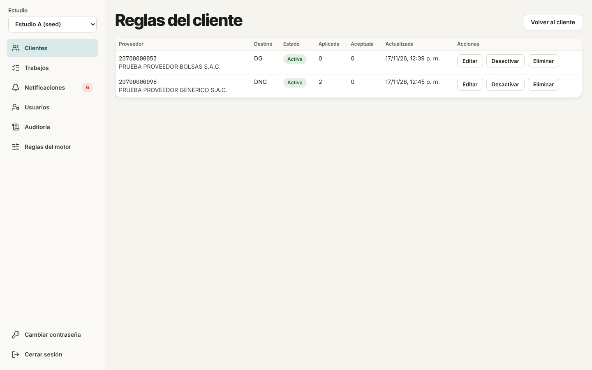

# 13 · Reglas aprendidas

> Anterior: [12 · Un mes de trabajo de punta a punta](12-un-mes-de-punta-a-punta.md) · Índice: [00-indice.md](00-indice.md)

Al terminar este módulo vas a poder pedirle a ContApp que recuerde cómo clasificas a un proveedor de un cliente, reconocer las compras que llegan clasificadas «Según historial», revertirlas si no corresponden, administrar las reglas del cliente y encender o apagar las reglas del motor del estudio.

## Para qué sirve

Cada mes llegan las compras de los mismos proveedores: la luz, el alquiler, el proveedor de insumos de siempre. Y cada mes alguien del estudio vuelve a decidir lo mismo: «esto va a DG», «esto va a DNG porque el cliente vende exonerado». Con muchos clientes, esa decisión repetida se come horas.

Las **reglas aprendidas** resuelven eso:

- **Clasificas una vez.** Al clasificar una compra, ContApp te pregunta «¿Recordar para este proveedor en este cliente?». Si dices que sí, guarda una regla: este proveedor, en este cliente, va a este destino (DG, DGNG o DNG).
- **ContApp la aplica sola en las próximas descargas.** Cuando descargas un periodo posterior, las compras nuevas de ese proveedor llegan ya clasificadas, con la etiqueta «Según historial».
- **Nada se pierde.** La propuesta del SIRE no se toca: la regla crea una versión nueva de la fila. Si no corresponde, la clasificas de nuevo y listo.

Piénsalo como la nota que deja el contador en el expediente del cliente: «al proveedor X, siempre a DNG». Solo que ContApp la lee por ti cada mes.

Además, el estudio puede **encender o apagar las reglas del motor** (R-ISC, R-MIX, R-RED, R-NEW, R-GP y la propia de reglas aprendidas, R-HIS) desde «Reglas del motor».

## Quién puede usarlo

| Rol | Ver reglas del cliente y «Reglas del motor» | «Recordar», editar, activar, desactivar y eliminar reglas del cliente | Encender o apagar las reglas del motor |
|---|---|---|---|
| Dueño | Sí, de todos los clientes | Sí | Sí |
| Administrador | Sí, de todos los clientes | Sí | Sí |
| Contador | Sí, de sus clientes asignados | Sí, en sus clientes | No: ve los interruptores deshabilitados |
| Asistente | Sí, de sus clientes asignados | No | No |
| Lectura | Sí, de sus clientes asignados | No | No |

- Ver pide el permiso `reglas.ver` (todos los roles). Por eso todos ven «Reglas del motor» en el menú y el enlace «Reglas aprendidas» en la ficha del cliente.
- «Recordar» y cambiar reglas del cliente piden `reglas.gestionar` (Dueño, Administrador y Contador). Sin ese permiso no aparece el aviso «Recordar», ni el botón «Recordar para este proveedor» de la lupa, ni la columna «Acciones» de la tabla de reglas.
- Los interruptores del motor piden `reglas.gestionar` **y** alcance global: solo Dueño y Administrador. Los demás ven «Solo un Dueño o Administrador con alcance global puede cambiar las reglas del estudio.».
- Una regla es de **un cliente**: nunca se aplica a otro cliente ni a otro estudio, aunque el proveedor sea el mismo.

## Antes de empezar

- Haz el [módulo 08 · Compras](08-compras.md): necesitas el cliente de prueba `20700000002` con su credencial SIRE guardada (clave inventada) y la propuesta de compras de `202610` descargada.
- Entra con un usuario que tenga `reglas.gestionar`, por ejemplo `ua@seed.contapp.test` (Dueño del «Estudio A (seed)»), contraseña de desarrollo `desarrollo-contapp-2026` (solo para pruebas locales).
- Ten claro el periodo en que aprendes la regla: la regla solo se aplica a descargas de **periodos posteriores**. Si la aprendes en `202610`, se aplica desde `202611`.

## Paso a paso

### Recordar la clasificación al clasificar una fila

1. En la grilla de compras, abre «Acciones» en la fila y elige «Clasificar como DG», «Clasificar como DGNG» o «Clasificar como DNG».
2. Verás «Compra clasificada.» y, abajo a la izquierda de la pantalla, el aviso «¿Recordar para este proveedor en este cliente?» con el proveedor y el destino (por ejemplo «PRUEBA PROVEEDOR · DNG»).
3. Haz clic en «Recordar», o pulsa Alt+R sin soltar el teclado.

**Resultado esperado:** «Regla guardada. Se aplicará en las próximas descargas de este proveedor.».

El aviso no toma el foco: puedes seguir trabajando en la grilla con el teclado. Si no lo aceptas, se oculta solo a los 10 segundos y no se guarda nada. No aparece si ya hay una regla activa de ese proveedor con ese mismo destino.

### Recordar al clasificar en bloque

1. Selecciona varias compras **del mismo proveedor** (por ejemplo, busca su RUC y usa «Seleccionar las N del filtro»).
2. En la barra «Acciones sobre la selección», elige «Clasificar como DG», «Clasificar como DGNG» o «Clasificar como DNG».
3. Junto con el informe «Resultado de la acción masiva» aparece, debajo de la barra, el aviso «¿Recordar para este proveedor en este cliente?». Pulsa Alt+R, o cierra el informe con «Cerrar» y haz clic en «Recordar». Recuerda que el aviso se oculta a los 10 segundos.

**Resultado esperado:** una sola regla para ese proveedor. Si la selección mezcla proveedores, el aviso no aparece: se recuerda un proveedor a la vez.

### Recordar desde la lupa

1. Abre la lupa de una compra ya clasificada ([módulo 09](09-lupa-y-xml.md)).
2. En las acciones, pulsa «Recordar para este proveedor».
3. En el aviso, haz clic en «Recordar».

**Resultado esperado:** «Regla guardada. Se aplicará en las próximas descargas de este proveedor.». El botón sale deshabilitado si la compra está por clasificar, es mixta o está excluida, o si ya hay una regla activa con ese destino («Ya hay una regla activa de este proveedor con este destino.»).

### Ver las compras clasificadas «Según historial»

1. Descarga un periodo **posterior** al de la regla ([módulo 08](08-compras.md)).
2. En la grilla, las compras de ese proveedor muestran la marca «Según historial» en la columna «Proveedor», con el destino de la regla y «Clasificada» en «Destino».
3. Para verlas juntas, marca el filtro «Según historial».
4. En la lupa, la cabecera también muestra «Según historial». En el «Historial» de la fila aparece la versión «Según historial», sin nombre de usuario: la creó ContApp, no una persona.

**Resultado esperado:** ya no tienes que clasificar esas compras. El resumen del periodo y el archivo que generes usan el destino de la regla. Esas filas ya no llevan la alerta R-NEW de proveedor nuevo.

### Revertir una compra «Según historial»

Si este mes una compra de ese proveedor no va al destino de siempre:

1. En la fila, «Acciones» → «Clasificar como …» con el destino correcto (o hazlo en bloque).
2. La etiqueta «Según historial» desaparece y ContApp no vuelve a aplicar la regla en esa fila.

**Resultado esperado:** la fila queda con tu destino. La regla **no cambia**: si quieres que cambie para los meses siguientes, acepta el aviso «Recordar» que aparece con el destino nuevo. Con Ctrl+Z vuelves a la versión «Según historial», igual que con cualquier otra operación ([módulo 08](08-compras.md)).

### Administrar las reglas del cliente

1. Abre la ficha del cliente y haz clic en «Reglas aprendidas» (en el encabezado, junto a «Compras» y «Ventas»).
2. Se abre «Reglas del cliente» (`/clientes/<id>/reglas`) con la tabla de reglas. «Volver al cliente» te devuelve a la ficha.
3. En la columna «Acciones» de cada regla:
   - **Cambiar el destino:** «Editar», elige el «Destino» y «Guardar» (o «Cancelar», o Esc).
   - **Pausar la regla:** «Desactivar». Para volver a usarla, «Activar».
   - **Borrarla:** «Eliminar» y «Confirmar» en «¿Eliminar la regla de …? Las próximas descargas ya no moverán sus compras al destino aprendido; lo ya clasificado no cambia.».

**Resultado esperado:** la tabla muestra el cambio al instante. Los cambios valen para las **próximas descargas**: lo que ya se clasificó no cambia. Una regla eliminada deja de mostrarse y de aplicarse, pero las compras que ya clasificó conservan su «Según historial». Si no hay reglas, verás «Este cliente aún no tiene reglas aprendidas.».

### Encender o apagar las reglas del motor

1. En el menú, haz clic en «Reglas del motor» (en celular, dentro de «Más»). Se abre `/configuracion/reglas`.
2. Verás «Enciende o apaga las reglas que revisan las compras de todo el estudio.» y una lista con un interruptor por regla: R-ISC, R-MIX, R-RED, R-NEW, R-GP y R-HIS, cada una con su descripción y la marca «Activa» o «Inactiva».
3. Haz clic en el interruptor de la regla que quieres apagar o encender.

**Resultado esperado:** la marca cambia a «Inactiva» o «Activa» cuando el servidor confirma. Una regla apagada no se evalúa en las evaluaciones siguientes, en ningún cliente del estudio; los hallazgos que ya estaban guardados no se borran. Apagar R-HIS hace que ninguna regla aprendida se aplique en las próximas descargas.

Al final de la lista está «Aportar proveedores con RUC 20 al catálogo compartido» (ver «Reglas y límites»).

## Qué ves en pantalla

*La pantalla «Reglas del cliente»: cada regla con su proveedor, destino, estado, cuántas veces se aplicó y se aceptó, la fecha del último cambio y los botones «Editar», «Desactivar» y «Eliminar».*

### Tabla «Reglas del cliente»

| Columna | Qué muestra |
|---|---|
| «Proveedor» | Número de documento y, debajo, la razón social. |
| «Destino» | DG, DGNG o DNG: adónde manda la regla las compras de ese proveedor. |
| «Estado» | «Activa» (se aplica) o «Inactiva» (pausada). |
| «Aplicada» | Cuántas compras clasificó la regla en las descargas («Según historial»). |
| «Aceptada» | Cuántas de esas seguían en el destino de la regla cuando su periodo pasó a «Revisado». Las excluidas y las que quedaron sin base gravada no cuentan. |
| «Actualizada» | Fecha y hora (de Lima) del último cambio de la regla. |
| «Acciones» | «Editar», «Desactivar» o «Activar», y «Eliminar». Solo con `reglas.gestionar`. |

En un celular la tabla se apila: cada regla es una tarjeta con el nombre de cada columna delante de su dato.

«Aplicada» y «Aceptada» te dicen si la regla acierta: si «Aplicada» es 10 y «Aceptada» es 2, el contador está corrigiendo casi siempre lo que la regla propone, y conviene editarla o desactivarla.

### Marcas en compras

| Dónde | Qué ves |
|---|---|
| Grilla, columna «Proveedor» | La marca «Según historial» |
| Filtros de la grilla | La casilla «Según historial» |
| Lupa, cabecera | La marca «Según historial» junto a la razón social |
| «Historial» de la compra | La versión «Según historial», sin usuario |
| Auditoría ([módulo 11](11-auditoria-y-notificaciones.md)) | «Aplicó el destino según el historial», «Recordó una regla para un proveedor», «Editó…», «Activó…», «Desactivó…», «Eliminó una regla de un proveedor», «Cambió una regla del motor del estudio» |

## Reglas y límites

Cuándo **sí** clasifica una regla una compra: es una compra **nueva** de una descarga, de un periodo **posterior** al periodo en que se aprendió la regla, de un proveedor con regla **activa**, con R-HIS encendida en el estudio y con base gravada distinta de cero.

Cuándo **no** la toca:

- Compras que ya existían antes de la descarga, de este u otros periodos. «Recordar» no reclasifica lo que ya está: para eso usa la clasificación en bloque del [módulo 08](08-compras.md).
- Volver a descargar el mismo periodo: las compras que ya tenías no se vuelven a clasificar.
- Compras sin base gravada, o que ya estaban en el destino de la regla.
- Compras del periodo en que aprendiste la regla, o de periodos anteriores.
- Ventas: las reglas aprendidas son solo de compras.
- «Agregar compra» y «Agregar desde XML»: el destino lo eliges tú.

Otras reglas:

- **Solo se aprende el destino.** Una regla no excluye compras, no cambia montos ni decide si un gasto es personal.
- **Una regla por proveedor y cliente.** Si ya hay una y pides «Recordar» con otro destino, se actualiza (gana el último). Si la regla estaba inactiva, «Recordar» la vuelve a activar con el destino nuevo.
- **Las demás reglas siguen funcionando.** Si una compra «Según historial» tiene además un ISC mal ubicado o una compra mixta, R-ISC y R-MIX la revisan igual, ya en el destino de la regla.
- **La prevalidación no se apaga.** En «Reglas del motor» no hay interruptor para los errores que bloquean la generación del archivo ([módulo 10](10-generar-archivo.md)).
- **Aporte al catálogo compartido.** Con el interruptor encendido, cada «Recordar» y cada compra «Según historial» aceptada de un proveedor con RUC que empieza en 20 deja un registro sin montos ni usuario, para un futuro catálogo de proveedores entre estudios. Proveedores con RUC 10 o sin RUC nunca se registran. Apagado, no se registra nada.

| Mensaje que ves | Por qué | Qué hacer |
|---|---|---|
| «La regla cambió mientras tanto. Revisa las reglas del cliente e inténtalo de nuevo.» | Otra persona cambió la regla mientras la tenías en pantalla. La tabla se vuelve a leer. | Revisa la regla y repite. |
| «Ya hay una regla activa de este proveedor con este destino.» | Pulsaste «Recordar para este proveedor» y la regla ya existe igual. | Nada: ya está recordada. |
| «Las compras elegidas son de proveedores distintos. Recuerda un proveedor a la vez.» | Pediste recordar compras de varios proveedores. | Selecciona un solo proveedor. |
| «Las compras elegidas son de periodos distintos. Recuerda las compras de un solo periodo.» | Las compras son de varios periodos. | Recuerda desde un solo periodo. |
| «El cliente está archivado: sus reglas son de solo lectura.» | El cliente está archivado. | Reactívalo ([módulo 05](05-clientes.md)). |
| «Solo un Dueño o Administrador con alcance global puede cambiar las reglas del estudio.» | Entraste a «Reglas del motor» sin ser Dueño ni Administrador. | Pide el cambio a quien tenga ese rol. |
| «No tienes permiso para realizar esta acción.» | Tu rol no tiene `reglas.gestionar`. | Pide a un Contador, Administrador o Dueño. |

## Pruébalo con los datos de prueba

Usa el cliente `20700000002`, su credencial SIRE guardada y la propuesta `fixtures/sire/20700000002-compras-202610.json` del periodo `202610`, ya descargada. Entra como `ua@seed.contapp.test`.

**Aprender y administrar una regla**

1. **Recordar.** En la grilla de `202610`, en F001-3064 (proveedor `20700000053`), «Acciones» → «Clasificar como DG». Debe salir «¿Recordar para este proveedor en este cliente?» con el botón «Recordar». Haz clic: «Regla guardada. Se aplicará en las próximas descargas de este proveedor.».
2. **Pantalla de reglas.** Ve a la ficha del cliente y haz clic en «Reglas aprendidas». Verás «Reglas del cliente», el botón «Volver al cliente» y una fila con `20700000053`, destino DG, «Activa», «Aplicada» 0 y «Aceptada» 0 (todavía no hubo descargas posteriores).
3. **Editar.** «Editar» → «Destino» DGNG → «Guardar». La fila pasa a DGNG.
4. **Desactivar y activar.** «Desactivar»: el estado pasa a «Inactiva» y el botón cambia a «Activar». Vuelve a activarla.
5. **Sin permiso.** Abre la misma pantalla con un Asistente asignado al cliente: ves la tabla, pero sin la columna «Acciones». En sus compras, al clasificar no aparece el aviso «Recordar».

**Ver una regla aplicada en el mes siguiente**

El simulador no tiene propuesta propia de `202611` para este cliente: devuelve el conjunto genérico (`fixtures/sire/generico-compras.json`), con dos compras del proveedor `20700000096` (F001-6010 y F001-6012, ambas con la base en DG). Por eso primero enseñas a ContApp ese proveedor en `202610`.

6. **Aprender el proveedor genérico.** En `202610`, «Agregar compra»: serie `F002`, número `1234`, fecha 2026-10-20, documento `20700000096`, razón social `PRUEBA AGREGADA`, Base DG `100.00`, IGV DG `18.00` → «Agregar». En esa fila, «Acciones» → «Clasificar como DNG» y, en el aviso, «Recordar».
7. **Descargar el mes siguiente.** Cambia el periodo a `202611` y pulsa «Descargar»: «2 nuevas, 0 distintas». Las dos compras de `20700000096` llegan con «Según historial» en «Proveedor», destino DNG y «Clasificada», con la base y el IGV en las columnas DNG. Marca el filtro «Según historial»: quedan solo esas dos.
8. **Comprobar el original.** Abre el «Historial» de F001-6010: la versión 1 es «Original del SIRE» (con la base en DG) y la versión 2, «Según historial».
9. **Revertir una.** En F001-6012, «Acciones» → «Clasificar como DG». La marca «Según historial» desaparece y aparece el aviso «Recordar» con DG: **no** lo aceptes, para que la regla siga en DNG.
10. **Contadores.** En «Reglas del cliente», la regla de `20700000096` muestra «Aplicada» 2 y «Aceptada» 0. Marca `202611` como revisado («Marcar como revisado» → «Confirmar») y vuelve a la pantalla de reglas: «Aceptada» debería pasar a 1, porque F001-6012 ya no estaba en DNG.
11. **Eliminar.** «Eliminar» en la regla de `20700000096` → «Confirmar». La fila desaparece. F001-6010 conserva su «Según historial».

**Reglas del motor**

12. Como Dueño, en el menú, «Reglas del motor»: seis reglas «Activa». Apaga R-HIS y vuelve a encenderla.
13. Entra con `uab@seed.contapp.test` (Contador): los interruptores están deshabilitados y sale «Solo un Dueño o Administrador con alcance global puede cambiar las reglas del estudio.».
14. Como Dueño, en «Auditoría», verás «Recordó una regla para un proveedor», «Editó una regla de un proveedor», «Eliminó una regla de un proveedor», «Aplicó el destino según el historial» y «Cambió una regla del motor del estudio».

## Problemas frecuentes

| Síntoma | Causa | Solución |
|---|---|---|
| No aparece el aviso «Recordar» al clasificar. | Tu rol no tiene `reglas.gestionar`, ya hay una regla activa de ese proveedor con ese destino, o pasaron los 10 segundos. | Revisa tu rol o la pantalla «Reglas del cliente». Para volver a verlo, clasifica de nuevo o usa «Recordar para este proveedor» en la lupa. |
| Recordé un proveedor y sus compras del mismo mes siguen igual. | «Recordar» no toca compras que ya existen. | Clasifícalas en bloque ([módulo 08](08-compras.md)). La regla vale desde la próxima descarga de un periodo posterior. |
| Descargué el mes siguiente y nada salió «Según historial». | El proveedor no tiene compras en ese periodo, la regla está «Inactiva», R-HIS está apagada en «Reglas del motor», las compras no tienen base gravada o ya estaban en ese destino. | Revisa «Reglas del cliente» y «Reglas del motor». |
| Volví a descargar el periodo y no se aplicó la regla nueva. | La regla solo clasifica compras nuevas; las que ya tenías no se tocan. | Clasifícalas a mano o en bloque. |
| Corregí una compra «Según historial» y la regla no cambió. | Es a propósito: tu corrección no cambia la regla sola. | Acepta el aviso «Recordar» con el destino nuevo, o edita la regla. |
| Los interruptores de «Reglas del motor» están grises. | No eres Dueño ni Administrador. | Pide el cambio a quien tenga ese rol. |
| En la pantalla de reglas sale «No se encontró lo que buscas.» | No estás asignado a ese cliente. | Pide que te asignen ([módulo 03](03-equipo-roles-asignaciones.md)). |

## Comprueba lo aprendido

1. En octubre clasificas como DNG la compra de un proveedor y aceptas «Recordar». ¿Qué pasa con sus otras compras de octubre? ¿Y con las de noviembre?
2. En noviembre una compra «Según historial» de ese proveedor en realidad va a DG. ¿Qué haces? ¿Cambia la regla?
3. Un Asistente dice que nunca le sale el aviso «Recordar». ¿Es un error?
4. Una regla tiene «Aplicada» 12 y «Aceptada» 1. ¿Qué te dice y qué haces?
5. Eliminas una regla. ¿Qué pasa con las compras que ya clasificó?

Soluciones

1. Las otras compras de octubre no cambian: «Recordar» no reclasifica lo que ya existe (usa la clasificación en bloque). Las de noviembre llegan clasificadas en DNG con la etiqueta «Según historial» al descargar ese periodo.
2. En la fila, «Acciones» → «Clasificar como DG». La etiqueta desaparece y la regla no se vuelve a aplicar en esa fila. La regla no cambia sola: solo cambia si aceptas el aviso «Recordar» con DG o la editas en «Reglas del cliente».
3. No. «Recordar» pide `reglas.gestionar`, que tienen el Dueño, el Administrador y el Contador, no el Asistente.
4. Que la regla casi nunca acierta: de 12 compras que clasificó, solo 1 seguía en su destino al revisar el periodo. Edita su destino o desactívala.
5. Conservan su clasificación y su etiqueta «Según historial». La regla deja de mostrarse y de aplicarse en las próximas descargas.

## Para saber más

- Curso técnico: [16 · Reglas aprendidas](../curso/16-reglas-aprendidas.md)
- Spec: [`docs/specs/021-reglas-aprendidas/spec.md`](../specs/021-reglas-aprendidas/spec.md) (plan y tareas en la misma carpeta)
- Requisitos: RF-086, RF-089, RF-110, RF-111, RF-114, RF-115 · HU-28, HU-31.
