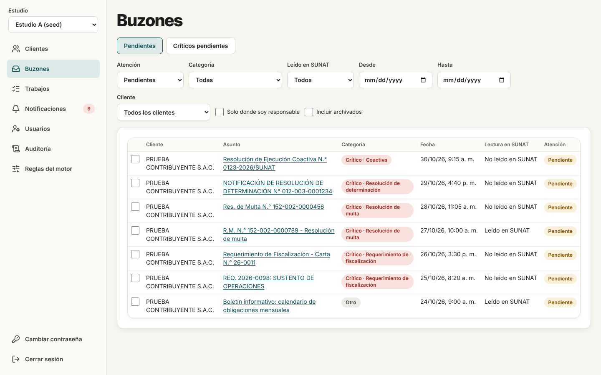
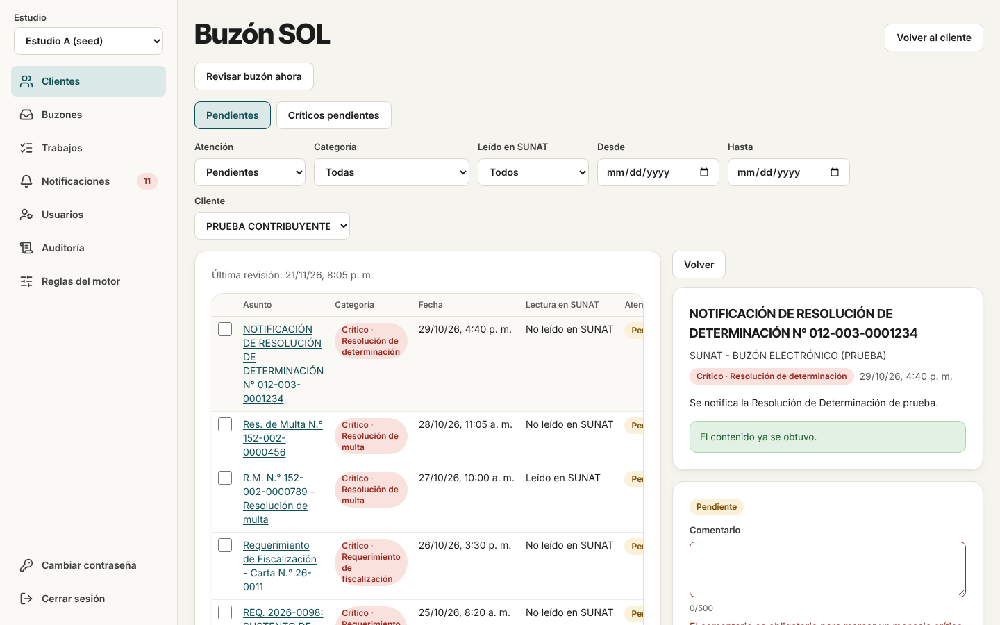

# 14 · Buzones SOL

> Anterior: [13 · Reglas aprendidas](13-reglas-aprendidas.md) · Índice: [00-indice.md](00-indice.md)

Al terminar este módulo vas a poder hacer que ContApp revise el buzón SOL de tus clientes, pedir una revisión al momento, reconocer los mensajes críticos, leer un mensaje y sus adjuntos, y marcar como atendido lo que tu equipo ya gestionó, cliente por cliente o desde una sola bandeja.

## Para qué sirve

SUNAT notifica por el buzón electrónico de SOL: resoluciones, requerimientos, constancias y avisos. Con muchos clientes, entrar al buzón de cada uno con su clave SOL todos los días es imposible, y una coactiva que nadie vio puede terminar en un embargo.

ContApp hace esa ronda por ti:

- **Revisa sola los buzones.** Cada cierto tiempo (según tu plan) entra al buzón SOL de cada cliente activo con clave SOL guardada y anota los mensajes nuevos. Solo lee la lista: **no abre ningún mensaje, así que no lo marca como leído en SUNAT**.
- **Te avisa de lo grave.** Si llega una coactiva, una resolución de determinación, una resolución de multa o un requerimiento de fiscalización, te llega un aviso en la campana en ese momento.
- **Junta todo en una bandeja.** En «Buzones» ves los mensajes de todos tus clientes, con los críticos en rojo, y filtras lo que falta atender.
- **Lleva el control interno.** Marcas un mensaje como «atendido» con un comentario («se presentó el descargo el 12/11»). Eso queda para tu equipo y no cambia nada en SUNAT.

Piénsalo como la persona del estudio que cada mañana revisa la casilla de cada cliente, separa lo urgente y deja una nota en cada sobre que ya se trabajó.

## Quién puede usarlo

| Rol | Ver la bandeja y los mensajes, «Revisar buzón ahora» | «Abrir en SUNAT» (obtener el contenido) | «Marcar como atendido» y «Deshacer» |
|---|---|---|---|
| Dueño | Sí, de todos los clientes | Sí | Sí |
| Administrador | Sí, de todos los clientes | Sí | Sí |
| Contador | Sí, de sus clientes asignados | Sí | Sí |
| Asistente | Sí, de sus clientes asignados | Sí | Sí |
| Lectura | Sí, de sus clientes asignados | No | No |

- Ver pide el permiso `buzon.ver` (todos los roles). Con él ves la entrada «Buzones» del menú, el enlace «Buzón SOL» y el botón «Revisar buzón ahora» en la ficha del cliente, y la columna «Buzón» del listado de clientes.
- «Abrir en SUNAT» pide `buzon.marcar_leido`, porque abrir un mensaje en el portal puede marcarlo como leído. Sin ese permiso ves «Para obtenerlo, una persona con permiso para abrir mensajes en SUNAT debe abrirlo desde esta pantalla.».
- Atender pide `buzon.atender`. Sin él no ves el bloque para comentar ni las casillas de selección.
- Un Contador, Asistente o Lectura solo ve los mensajes de los clientes que tiene asignados ([módulo 03](03-equipo-roles-asignaciones.md)).

## Antes de empezar

- Haz el [módulo 06](06-credenciales-y-trabajos.md): el cliente necesita su **clave SOL guardada** («Configurada» o «Verificada»). Usa siempre la clave inventada `CLAVEPRUEBA1`, nunca una real.
- El worker tiene que estar corriendo ([módulo 01](01-preparar-entorno.md)): la revisión es un trabajo en segundo plano.
- Entra con un usuario que tenga los tres permisos, por ejemplo `ua@seed.contapp.test` (Dueño del «Estudio A (seed)»), contraseña de desarrollo `desarrollo-contapp-2026` (solo para pruebas locales).
- Recuerda que hoy el buzón es una **simulación**: ContApp no entra al portal real de SUNAT ([índice](00-indice.md)).

## Paso a paso

### Dejar que ContApp revise solo

No tienes que hacer nada: basta con que el cliente esté activo (no archivado) y tenga la clave SOL «Configurada» o «Verificada».

- La primera revisión del día es de madrugada (entre las 2:00 y las 5:00 de Lima, cada cliente a una hora distinta para no saturar).
- Después se repite con la frecuencia de tu plan: una vez al día, dos veces al día, cada 4 horas o cada hora ([módulo 04](04-planes-y-limites.md)).
- Un cliente que nunca se revisó entra en la ronda siguiente (como máximo, unos 15 minutos después de guardar su clave).

**Resultado esperado:** en «Trabajos» aparece «Revisión de buzón SOL» por cada cliente revisado, y los mensajes nuevos llegan a la bandeja. Un cliente archivado, sin clave SOL o con la clave «Inválida» no se revisa.

### Pedir una revisión al momento

1. Abre la ficha del cliente (o su «Buzón SOL»).
2. Pulsa «Revisar buzón ahora».

**Resultado esperado:** «Revisión encolada.» con el enlace «Ver en el panel de trabajos». En «Trabajos», «Revisión de buzón SOL» pasa a «Completado» en unos segundos, y la campana te avisa al terminar. Tu pedido pasa delante de las revisiones programadas.

- Si ya había una revisión en marcha verás «Ya hay una revisión en curso.»: no se duplica.
- Se puede pedir como máximo una vez cada 10 minutos por cliente (contando también la última revisión terminada). Antes de eso verás «Se revisó hace poco. Podrás pedirlo de nuevo en N min.».
- El botón queda deshabilitado, con el motivo debajo, si el cliente está archivado («El cliente está archivado y es de solo lectura.»), no tiene clave SOL («Primero guarda la clave SOL del cliente.») o la tiene inválida («La clave SOL fue rechazada por SUNAT. Actualízala para revisar el buzón.»).

### Ver la bandeja de todos tus clientes

1. En el menú, haz clic en «Buzones» (en celular está en la barra inferior). Se abre `/buzon`.
2. La bandeja abre en «Pendientes»: los mensajes que nadie del equipo atendió todavía, del más reciente al más antiguo.
3. Pulsa «Críticos pendientes» para ver solo los críticos sin atender.
4. Para afinar, usa los filtros (se aplican al cambiarlos; en celular, botón «Filtros» y luego «Aplicar»):
   - «Atención»: «Pendientes», «Atendidos», «Históricos» o «Todos».
   - «Categoría»: «Todas», «Críticos (todas las categorías críticas)» o una categoría.
   - «Leído en SUNAT»: «Todos», «Leídos» o «No leídos».
   - «Desde» y «Hasta»: fechas del mensaje.
   - «Cliente»: elegir uno te lleva a la bandeja de ese cliente.
   - «Solo donde soy responsable» e «Incluir archivados».
5. Si hay más de 50 mensajes, pulsa «Cargar más» al final.

**Resultado esperado:** solo ves mensajes de clientes que puedes ver. Los críticos muestran la etiqueta roja «Crítico · <categoría>», por ejemplo «Crítico · Coactiva».

### Ver el buzón de un cliente

1. En la ficha del cliente, haz clic en «Buzón SOL» (en el encabezado, junto a «Compras», «Ventas» y «Reglas aprendidas»). También llegas desde la columna «Buzón» del listado de clientes.
2. Se abre «Buzón SOL» (`/clientes/<id>/buzon`): la misma bandeja, fijada en ese cliente, con «Revisar buzón ahora» arriba, «Volver al cliente» y la línea «Última revisión: <fecha>» (o «Este buzón aún no se revisó.»).

### Leer un mensaje y obtener su contenido

1. En la bandeja, haz clic en el asunto del mensaje. Se abre su detalle al costado (en celular, a pantalla completa, con «Volver»). Desde «Buzones», el mensaje se abre en la bandeja de su cliente.
2. Arriba ves el asunto, el remitente, la etiqueta de crítico si corresponde y la fecha. Mientras nadie lo haya abierto, dice «El contenido aún no se obtuvo.».
3. Pulsa «Abrir en SUNAT». Lee el aviso «¿Abrir este mensaje en SUNAT?»: «Para obtener el contenido se abrirá el mensaje en el portal de SUNAT y SUNAT puede marcar este mensaje como leído. Esta acción no se deshace.».
4. Pulsa «Confirmar» (o «Cancelar»).

**Resultado esperado:** primero «Apertura encolada.» con «Ver en el panel de trabajos» (en «Trabajos» aparece «Apertura de mensaje SOL»). Sin salir de la pantalla, en unos segundos el detalle muestra el contenido como texto, el aviso «El contenido ya se obtuvo.» y, si trae, la sección «Adjuntos» con cada archivo y su tamaño. Haz clic en el nombre de un adjunto para descargarlo. Desde entonces cualquiera con `buzon.ver` lee el contenido sin que ContApp vuelva a entrar a SUNAT. Si el contenido no aparece, vuelve a abrir el mensaje.

### Marcar un mensaje como atendido

1. Abre el mensaje. Debajo del contenido está el bloque de atención con el estado «Pendiente».
2. Escribe un «Comentario» (hasta 500 caracteres; el contador muestra «N/500»). Es **obligatorio en un crítico**: sin él, el botón no se activa y ves «El comentario es obligatorio para marcar un mensaje crítico.».
3. Pulsa «Marcar como atendido».

**Resultado esperado:** el bloque dice «Atendido por <nombre> · <fecha>» con tu comentario, el botón cambia a «Deshacer» y el «Historial de atención» suma «<nombre> Marcó como atendido». El mensaje sale de «Pendientes». En SUNAT no cambia nada: «Lectura en SUNAT» sigue igual.

No hace falta haber abierto el contenido para atender un mensaje.

### Deshacer la atención

1. Abre un mensaje atendido.
2. Si quieres, escribe un «Comentario» (opcional) y pulsa «Deshacer».

**Resultado esperado:** el mensaje vuelve a «Pendiente» (o a «Histórico», si lo era) y el historial suma «<nombre> Deshizo la atención». Puede deshacer cualquiera con `buzon.atender`, no solo quien marcó.

### Marcar varios a la vez

1. En la bandeja, marca la casilla de cada mensaje («Seleccionar <asunto>»).
2. Arriba aparece «N seleccionados» y el botón «Marcar como atendidos». Púlsalo.
3. En la ventana «Marcar como atendidos» («Se marcarán N mensajes como atendidos.»), escribe un «Comentario» (obligatorio si alguno es crítico) y pulsa «Confirmar».

**Resultado esperado:** «N atendidos, M ya estaban atendidos». El máximo es 100 por vez («Máximo 100 mensajes por vez.»). Deshacer es siempre de uno en uno.

### Ver qué clientes tienen mensajes nuevos

1. En «Clientes», mira la columna «Buzón»: «N nuevos» y, en rojo, «N críticos». Haz clic para ir al buzón del cliente.
2. Marca el filtro «Con mensajes nuevos» para ver solo esos clientes.

**Resultado esperado:** el número baja cuando atiendes mensajes (al recargar). Un cliente sin mensajes nuevos no muestra nada en esa columna.

## Qué ves en pantalla

*La bandeja «Buzones»: arriba, los accesos «Pendientes» y «Críticos pendientes» y los filtros; debajo, cada mensaje con su cliente, asunto, categoría, fecha, lectura en SUNAT y estado de atención.*

*Un mensaje ya abierto en SUNAT: asunto, remitente, etiqueta de crítico y fecha; el contenido como texto; el bloque de atención con el comentario y «Marcar como atendido»; y la sección «Adjuntos» con cada archivo y su tamaño.*

### Columnas de la bandeja

| Columna | Qué muestra |
|---|---|
| (casilla) | Solo con `buzon.atender`, para marcar en lote. Deshabilitada en clientes archivados. |
| «Cliente» | Razón social (con «(archivado)» si corresponde). No sale en el buzón de un cliente. |
| «Asunto» | Enlace al detalle del mensaje. |
| «Categoría» | «Crítico · Coactiva», «Crítico · Resolución de determinación», «Crítico · Resolución de multa», «Crítico · Requerimiento de fiscalización» (en rojo) u «Otro». |
| «Fecha» | Fecha y hora de Lima del mensaje. |
| «Lectura en SUNAT» | «Leído en SUNAT» o «No leído en SUNAT», según la última revisión. |
| «Atención» | «Pendiente», «Atendido» (con «por <nombre>») o «Histórico». |

En celular cada mensaje es una tarjeta con el nombre de cada columna delante de su dato.

### Estados de atención

| Estado | Qué significa |
|---|---|
| «Pendiente» | Nadie del equipo lo atendió. Cuenta como «nuevo» en el listado de clientes. |
| «Atendido» | Alguien lo marcó, con fecha y comentario. Es un control **interno** de tu estudio. |
| «Histórico» | Llegó en la **primera** revisión del cliente y tiene más de 30 días. No sale en «Pendientes» ni cuenta como nuevo, para que el arranque no te llene la bandeja de mensajes viejos. Se ve en «Históricos» y «Todos» y se puede atender. |

### Mensajes críticos y avisos

| Categoría | Ejemplos de asunto que reconoce |
|---|---|
| Coactiva | «Resolución de Ejecución Coactiva…» |
| Resolución de determinación | «Resolución de Determinación…», «R.D. …» |
| Resolución de multa | «Resolución de Multa…», «Res. de Multa…», «R.M. …» |
| Requerimiento de fiscalización | «Requerimiento de Fiscalización…», «REQ. …» |

ContApp reconoce el asunto aunque venga con o sin tildes, en mayúsculas o abreviado. Ante la duda, lo trata como crítico.

Cuando entra un crítico nuevo, la campana muestra «Mensaje crítico en el buzón SOL de <cliente>: <categoría>», por ejemplo «Mensaje crítico en el buzón SOL de PRUEBA CONTRIBUYENTE S.A.C.: Coactiva». Le llega al **responsable** del cliente o, si no tiene, a todos los Dueños y Administradores activos. Al hacer clic se abre ese mensaje en el buzón del cliente ([módulo 11](11-auditoria-y-notificaciones.md)).

### Adjuntos

| Lo que ves junto al nombre | Qué significa |
|---|---|
| El tamaño (por ejemplo «153 B» o «2 KB») | Se puede descargar con un clic. |
| «Tipo de archivo no permitido» | No es PDF, XML, PNG, JPG ni ZIP. No se guarda. |
| «Supera los 20 MB» | El adjunto pasa el tope. No se guarda. |
| «Superó el tope de 50 MB del mensaje» | Entre todos los adjuntos del mensaje se pasó el tope. |

Los nombres raros o peligrosos se limpian antes de mostrarse. El contenido del mensaje siempre se muestra como texto simple.

## Reglas y límites

- **Revisar no marca como leído.** Las revisiones automáticas y «Revisar buzón ahora» solo leen la lista de mensajes. Lo único que entra al mensaje en SUNAT es «Abrir en SUNAT», con confirmación y registrado en la auditoría.
- **Hasta 200 mensajes por revisión,** de los más recientes a los más antiguos. Si el buzón tiene más, entran en las revisiones siguientes.
- **«Atendido» no es «leído».** Son dos cosas distintas: «Lectura en SUNAT» la da SUNAT; «Atendido» lo decide tu equipo. Una revisión nueva nunca cambia la atención.
- **Primera revisión:** solo se avisan los críticos de los últimos 30 días. Los más antiguos quedan como críticos «Histórico», sin aviso. Una coactiva vieja que llegue así solo se ve en «Históricos» o «Todos»: revísalos al dar de alta un cliente.
- **Un aviso por mensaje.** Revisar de nuevo el mismo buzón no repite avisos.
- **Clave rechazada:** la clave SOL pasa a «Inválida», te llega el aviso de credencial y la revisión se detiene sin reintentar. Lo que ya se guardó se conserva y la siguiente revisión, con la clave corregida, continúa donde quedó. Tras corregirla puedes pedir «Revisar buzón ahora» enseguida.
- **Cliente archivado:** no se revisa, no se abre ni se atiende («El cliente está archivado y es de solo lectura.»), pero sus mensajes y su historial se siguen viendo.
- **Solo lectura del buzón.** ContApp no responde ni sube documentos a SUNAT.
- **Sin correo.** El aviso de crítico solo llega a la campana.
- **La bandeja no se actualiza sola.** Se vuelve a leer al cambiar un filtro, al atender o al volver a la pestaña.

| Mensaje que ves | Por qué | Qué hacer |
|---|---|---|
| «Se revisó hace poco. Podrás pedirlo de nuevo en N min.» | Pasaron menos de 10 minutos desde el último pedido o la última revisión. | Espera los minutos que indica. |
| «Primero guarda la clave SOL del cliente.» | El cliente no tiene clave SOL. | Guárdala en su ficha ([módulo 06](06-credenciales-y-trabajos.md)). |
| «La clave SOL fue rechazada por SUNAT. Actualízala para revisar el buzón.» | La clave SOL está «Inválida». | Guarda la clave correcta. |
| «El cliente está archivado y es de solo lectura.» | El cliente está archivado. | Reactívalo ([módulo 05](05-clientes.md)). |
| «El comentario es obligatorio para marcar un mensaje crítico.» | Quisiste atender un crítico sin comentario. | Escribe qué se hizo con el mensaje. |
| «Otra persona ya cambió este mensaje.» | Alguien atendió o deshizo el mensaje mientras lo tenías abierto. | Mira el estado actualizado y decide de nuevo. |
| «La fecha «Desde» no puede ser posterior a «Hasta».» | Las fechas del filtro están al revés. | Corrígelas. |
| «No se encontró lo que buscas.» | El cliente no existe o no está asignado a ti. | Pide que te asignen ([módulo 03](03-equipo-roles-asignaciones.md)). |

## Pruébalo con los datos de prueba

Usa el cliente `20700000002` («PRUEBA CONTRIBUYENTE S.A.C.») con su clave SOL guardada (`PRUEBA01` / `CLAVEPRUEBA1`) y entra como `ua@seed.contapp.test`.

El simulador del buzón lee `fixtures/sol/buzon/20700000002.json`: diez mensajes de octubre de 2026, todos del remitente «SUNAT - BUZÓN ELECTRÓNICO (PRUEBA)».

| Asunto | Categoría | Lectura en SUNAT | Adjuntos |
|---|---|---|---|
| «Resolución de Ejecución Coactiva N.° 0123-2026/SUNAT» (30/10) | Crítico · Coactiva | No leído | un PDF |
| «NOTIFICACIÓN DE RESOLUCIÓN DE DETERMINACIÓN N° 012-003-0001234» (29/10) | Crítico · Resolución de determinación | No leído | un PDF y un XML |
| «Res. de Multa N.° 152-002-0000456» (28/10) | Crítico · Resolución de multa | No leído | un PNG |
| «R.M. N.° 152-002-0000789 - Resolución de multa» (27/10) | Crítico · Resolución de multa | Leído | — |
| «Requerimiento de Fiscalización - Carta N.° 26-0011» (26/10) | Crítico · Requerimiento de fiscalización | No leído | un ZIP y dos de nombre hostil |
| «REQ. 2026-0098: SUSTENTO DE OPERACIONES» (25/10) | Crítico · Requerimiento de fiscalización (por duda) | No leído | — |
| «Boletín informativo: calendario de obligaciones mensuales» (24/10) | Otro | Leído | — |
| «Constancia de presentación de declaración del periodo 2026-09» (22/10) | Otro | Leído | un PDF |
| «Aviso: actualice sus datos de contacto» (20/10) | Otro | No leído | — |
| «Respaldo completo del buzón (archivo muy grande)» (18/10) | Otro | Leído | un ZIP de 25 MB |

Qué mensajes salen en «Pendientes» y cuáles como «Histórico» depende del día en que hagas la **primera** revisión (la regla de los 30 días). Revisando el 22 de noviembre de 2026, los siete primeros salen pendientes, los seis críticos avisan en la campana, y los tres últimos quedan «Histórico».

1. **Revisar ahora.** En la ficha del cliente, pulsa «Revisar buzón ahora». Debe salir «Revisión encolada.». Con «Ver en el panel de trabajos» verás «Revisión de buzón SOL» → «Completado». Si ContApp ya lo revisó solo hace menos de 10 minutos, verás «Se revisó hace poco…»: espera o sigue con los mensajes ya capturados.
2. **Avisos.** La campana suma los críticos: «Mensaje crítico en el buzón SOL de PRUEBA CONTRIBUYENTE S.A.C.: Coactiva», y uno por cada crítico. Haz clic en el de «Coactiva»: se abre ese mensaje en «Buzón SOL», con «Crítico · Coactiva» y «El contenido aún no se obtuvo.».
3. **Bandeja.** En el menú, «Buzones». En «Pendientes» están los siete primeros. Pulsa «Críticos pendientes»: quedan los seis críticos. En «Atención» elige «Históricos» para ver los otros tres.
4. **Abrir.** Abre la coactiva y pulsa «Abrir en SUNAT»: sale «¿Abrir este mensaje en SUNAT?». Pulsa «Confirmar»: «Apertura encolada.» y, en unos segundos, el contenido «Se le notifica la Resolución de Ejecución Coactiva N.° 0123-2026.», «El contenido ya se obtuvo.» y en «Adjuntos» `resolucion-coactiva-0123.pdf`. Haz clic para descargarlo. En «Trabajos» verás «Apertura de mensaje SOL» → «Completado».
5. **Contenido seguro.** Abre en SUNAT la resolución de determinación: su contenido original trae HTML con un script, pero verás solo el texto «Se notifica la Resolución de Determinación de prueba.», sin que se ejecute nada. En «Adjuntos» salen `determinacion-0001234.pdf` (153 B) y `anexo-0001234.xml` (84 B).
6. **Adjuntos rechazados.** Abre en SUNAT el requerimiento «Carta N.° 26-0011»: el ZIP se descarga, y los dos adjuntos de nombre hostil (programas `.exe` disfrazados) salen con «Tipo de archivo no permitido». En el «Respaldo completo del buzón» (en «Históricos»), el ZIP de 25 MB sale con «Supera los 20 MB».
7. **Atender un crítico.** En la coactiva, pulsa «Marcar como atendido» sin comentario: el botón no se activa y ves «El comentario es obligatorio para marcar un mensaje crítico.». Escribe «Se coordinó con el cliente el pago» y márcalo. Verás «Atendido por Usuario A · <fecha>», el comentario y el historial. Vuelve a «Pendientes»: la coactiva ya no está.
8. **Deshacer.** Abre la coactiva desde «Atención» → «Atendidos» y pulsa «Deshacer»: vuelve a «Pendiente».
9. **Lote.** En «Pendientes», marca el boletín y la «REQ. 2026-0098», pulsa «Marcar como atendidos», escribe un comentario (la REQ es crítica) y «Confirmar»: «2 atendidos, 0 ya estaban atendidos».
10. **Indicador.** En «Clientes», la columna «Buzón» del cliente muestra cuántos nuevos y cuántos críticos quedan. Marca «Con mensajes nuevos»: solo aparecen clientes con pendientes.
11. **Leído en SUNAT.** Pasados 10 minutos, pulsa otra vez «Revisar buzón ahora». La coactiva que abriste debería pasar a «Leído en SUNAT», porque el simulador la marcó al abrirla. Su atención no cambia.
12. **Sin permiso.** Entra con un usuario Lectura asignado al cliente: ve la bandeja y los mensajes, pero no «Abrir en SUNAT», ni las casillas, ni el bloque para comentar.
13. **Auditoría.** Como Dueño, en «Auditoría», verás «Pidió revisar el buzón SOL», «Pidió abrir un mensaje del buzón SOL», «Obtuvo el contenido de un mensaje del buzón SOL», «Vio el contenido de un mensaje del buzón SOL», «Descargó un adjunto del buzón SOL», «Marcó como atendido un mensaje del buzón SOL» y «Deshizo la atención de un mensaje del buzón SOL». Ninguno muestra el asunto, el contenido ni tu comentario.

**Clave rechazada.** Guarda la clave SOL `clave-errada` (el centinela del simulador) y pulsa «Revisar buzón ahora». La revisión termina con error, la clave pasa a «Inválida» y te llega «La clave SOL de PRUEBA CONTRIBUYENTE S.A.C. fue rechazada por SUNAT. Actualízala para seguir trabajando.». El botón queda deshabilitado con «La clave SOL fue rechazada por SUNAT. Actualízala para revisar el buzón.». Guarda otra vez `CLAVEPRUEBA1` para seguir.

**Otro RUC.** Un cliente sin archivo propio recibe un buzón inventado por el simulador, siempre igual para el mismo RUC, con mensajes de cada categoría.

## Problemas frecuentes

| Síntoma | Causa | Solución |
|---|---|---|
| No veo «Buzones» ni «Revisar buzón ahora». | Tu rol no tiene `buzon.ver`, o el cliente no está asignado a ti. | Revisa tu rol y tus asignaciones ([módulo 03](03-equipo-roles-asignaciones.md)). |
| «Revisar buzón ahora» está gris. | Cliente archivado, sin clave SOL o con la clave «Inválida». El motivo sale debajo del botón. | Reactiva el cliente o guarda la clave. |
| El trabajo «Revisión de buzón SOL» se queda «En cola». | El worker no está corriendo. | Levántalo ([módulo 01](01-preparar-entorno.md)). |
| La bandeja sale vacía después de revisar. | Estás en «Pendientes» y todo está atendido o es «Histórico», o un filtro lo oculta. | Elige «Todos» en «Atención» y limpia los filtros. |
| Llegó una coactiva vieja y no hubo aviso. | Era de más de 30 días en la primera revisión del cliente: quedó «Histórico». | Revisa «Históricos» al dar de alta un cliente. |
| No aparece «Abrir en SUNAT». | Tu rol es Lectura, el cliente está archivado o el contenido ya se obtuvo. | Pide a alguien con permiso que lo abra. |
| Abro un mensaje desde «Buzones» y termino en el buzón del cliente. | Así funciona: el detalle se abre en la bandeja de su cliente. «Volver» regresa a esa bandeja. | Usa el menú «Buzones» para volver a la bandeja general. |
| Un adjunto no baja al abrirlo en una pestaña nueva. | La descarga necesita los datos de tu sesión. | Haz clic normal sobre el nombre del adjunto. |
| Marqué un mensaje en otra pestaña y aquí sigue «Pendiente». | La bandeja no se actualiza sola. | Cambia de pestaña y vuelve, o recarga. |

## Comprueba lo aprendido

1. Un Asistente pulsa «Revisar buzón ahora» en un cliente. ¿Puede quedar algún mensaje marcado como leído en SUNAT por eso?
2. Marcas una coactiva como atendida. ¿Cambia «Lectura en SUNAT»? ¿Qué te pide ContApp antes?
3. Das de alta a un cliente con una resolución de multa de hace tres meses en su buzón. ¿Te llega aviso? ¿Dónde la encuentras?
4. Pides «Revisar buzón ahora» dos veces seguidas. ¿Qué pasa la segunda vez?
5. Un usuario Lectura dice que no puede leer el contenido de un mensaje. ¿Qué le falta y qué solución hay?

Soluciones

1. No. La revisión solo lee la lista de mensajes. Solo «Abrir en SUNAT», con confirmación, entra al mensaje en el portal.
2. No: «Atendido» es un control interno de tu estudio. Por ser crítico, ContApp exige un comentario antes de marcarlo.
3. No llega aviso: en la primera revisión, los críticos de más de 30 días quedan como «Histórico». La encuentras en «Atención» → «Históricos» o «Todos».
4. Si la primera sigue en marcha, verás «Ya hay una revisión en curso.»; si ya terminó, «Se revisó hace poco. Podrás pedirlo de nuevo en N min.» (espera de 10 minutos).
5. Le falta el permiso `buzon.marcar_leido`, porque abrir puede marcar el mensaje como leído en SUNAT. Una persona con ese permiso (Asistente o superior) debe pulsar «Abrir en SUNAT»; después el usuario Lectura podrá leer el contenido.

## Para saber más

- Specs: [`docs/specs/023-buzones-captura/spec.md`](../specs/023-buzones-captura/spec.md) (captura, críticos, apertura y avisos) · [`docs/specs/024-bandeja-buzones/spec.md`](../specs/024-bandeja-buzones/spec.md) (bandeja, atención, históricos e indicador). Plan y tareas en las mismas carpetas.
- Datos de prueba: [`fixtures/LEEME.md`](../../fixtures/LEEME.md) (buzón del contribuyente de prueba).
- Requisitos: RF-120 a RF-126, RF-160 · HU-32, HU-33, HU-34.
